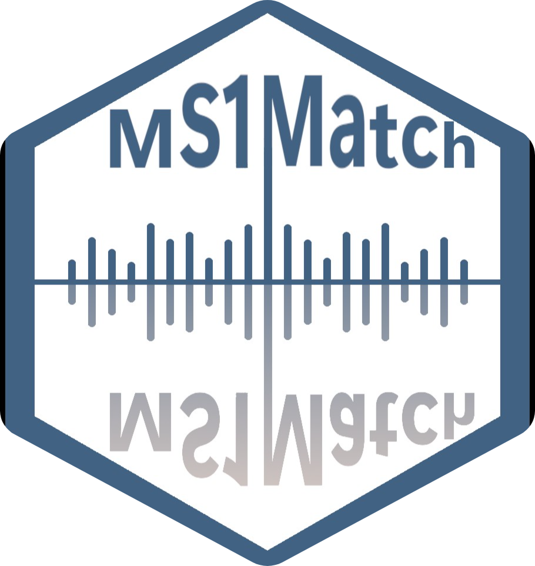

# MS1Match 

**MS1Match** is an R package for annotating mass spectrometry (MS1 and MS2) feature tables using compound libraries. It offers:

1. Preprocessing of raw spectral data using the xcms framework

2. Direct library-based annotation of detected features

3. Annotation of adducts, neutral losses, and isotopic patterns

4. Targeted annotation based on a user-defined compound list

# Installation

## Requirements

- **R**: `>= 4.5` (recommended; matches current Bioconductor release)
- **Rcpp**: required (the package contains compiled C++ code)
- **Build tools** (required to compile Rcpp source code):

  - **Windows**: Install **Rtools** matching your R version  
    - R 4.4.x → **Rtools44**
  
  - **macOS**: Install Apple Command Line Tools  
    ```bash
    xcode-select --install
    ```

  - **Linux (Ubuntu/Debian)**:
    ```bash
    sudo apt update
    sudo apt install build-essential r-base-dev
    ```

Install Rcpp (if not already installed):

```r
install.packages("Rcpp")
```
### Bioconductor dependencies

This package depends on the following Bioconductor packages:
- `xcms`
- `MSnbase`
- `Spectra`
- `MetaboCoreUtils`
```r
if (!requireNamespace("BiocManager", quietly = TRUE))
  install.packages("BiocManager")

BiocManager::install(
  c("xcms", "MSnbase", "Spectra", "MetaboCoreUtils"),
  ask = FALSE,
  update = TRUE
)

```

```r
## Installation

if (!requireNamespace("remotes", quietly = TRUE))
    install.packages("remotes")

remotes::install_github("RuibingS/MS1Match_Rpackage")

```

## Using Docker

A Dockerfile is provided to allow users to run the package in a reproducible environment without installing all system dependencies manually.

### 1. Clone the repository

```bash
git clone https://github.com/RuibingS/MS1Match_Rpackage.git
cd MS1Match_Rpackage
```

### 2. Build the Docker image

```bash
docker build -t ms1match .
```

### 3. Run an interactive R session

```bash
docker run -it --rm ms1match
```

Options explained:

- `-it` opens an interactive terminal so you can use the R console
- `--rm` automatically removes the container after exiting R (`q()`), keeping your system clean

Once inside the container you can load and use the package:

```r
library(MS1Match)
```

### Optional: Mount a local folder

If you want to access files from your host system:

```bash
docker run -it --rm -v $(pwd):/workspace MS1Match
```

This mounts your current directory inside the container at `/workspace`.


## 📘 Vignette

A full reproducible tutorial using the demo StM14 data set is available:

[MS1Match Tutorial](https://RuibingS.github.io/MS1Match_Rpackage/MS1Match_StM14_tutorial.html)


