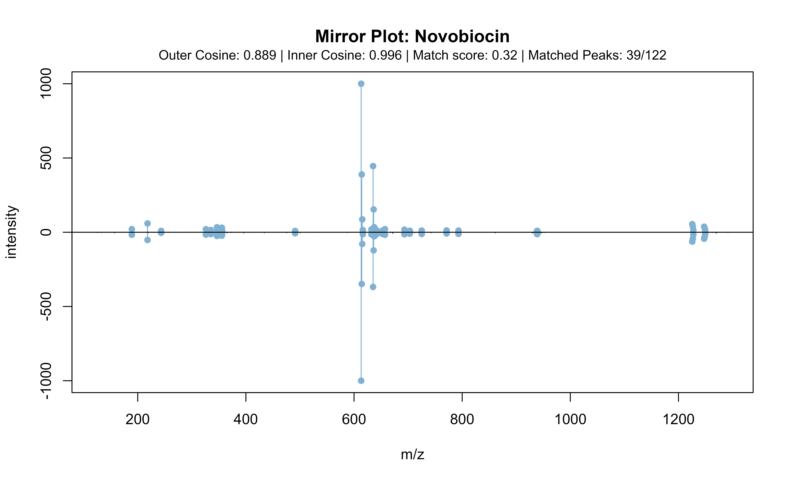
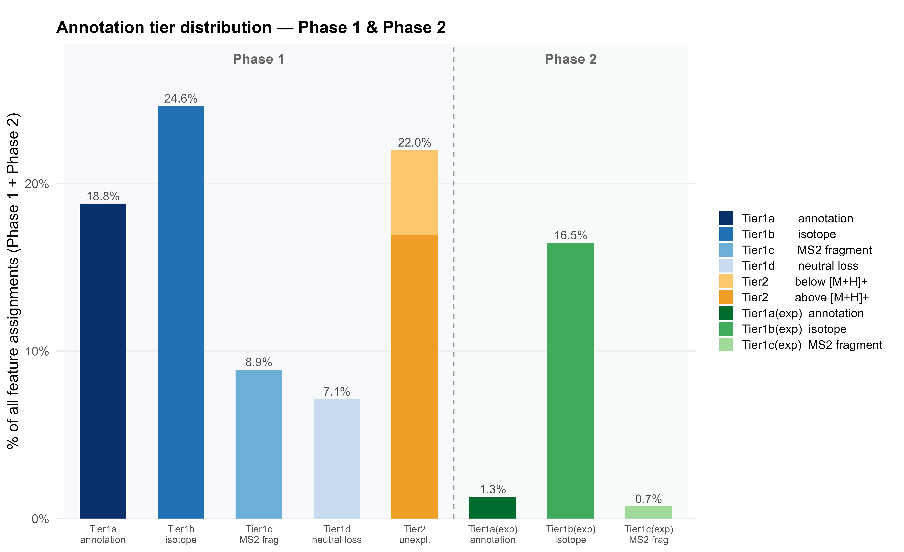

# 2a. MS1Match workflow: StM14 (MS1 + MS2)

## Overview

This tutorial walks through the full **MS1Match** workflow on the
**StM14** dataset: 14 standard compounds spiked into a *Pseudomonas
aeruginosa* metabolome extract, measured with MS1 and MS2. It covers:

1.  Peak picking with `xcms` (feature table + `MsExperiment` object);
    see vignette *01_preprocessing_xcms*
2.  Building per-feature consensus MS2 spectra
3.  Importing the reference library and preparing adduct/neutral-loss
    tables
4.  Running the MS1Match pipeline: direct library match → Phase 1 and
    Phase 2 annotation → ISF (in-source fragment) annotation → joined
    tier assignment
5.  Summarizing annotation tiers (table + plot)
6.  Exporting results (CSV, XLSX, figures)

The `anno_result` built here is the input for vignette *3. Evaluate a
feature-grouping tool against MS1Match*.

Package objects that take a long time to (re)compute (peak picking, MS2
consensus building) are loaded from cached `.rds` files bundled with the
package for time efficiency.

``` r

library(MS1Match)
library(xcms)
library(MsExperiment)
library(BiocParallel)
library(S4Vectors)
library(Spectra)
library(MsBackendMgf)
library(dplyr)
```

## 1. Peak picking with xcms

[`runxcmsFT()`](https://ruibings.github.io/MS1Match_Rpackage/reference/runxcmsFT.md)
is a wrapper around the standard `xcms` workflow. It takes raw file
paths plus the three standard `xcms` parameter objects (`CentWaveParam`,
`PeakDensityParam`, `ObiwarpParam`) and returns a list with the aligned
feature table (`ft`) and the underlying `MsExperiment` object (`x_exp`).

``` r

# Not run by default 
# Requires access to the raw .mzML/.mzXML files.

cwp <- CentWaveParam(
  peakwidth          = c(5, 30),
  ppm                = 5,
  snthresh           = 10,
  mzdiff             = 0.001,
  prefilter          = c(3,1000),
  noise              = 100,
  verboseBetaColumns = TRUE
)

pdp <- PeakDensityParam(
  sampleGroups = c(rep("10um", 3),rep("10um_MS2", 3),rep("4um", 3),rep("4um_MS2", 3),rep("8um", 3),rep("8um_MS2", 1)),  #
  bw           = 5,
  minFraction  = 0.5,   #
  binSize      = 0.01
)

obi <- ObiwarpParam(binSize = 0.5)

#  xcms example
StM14_out <- runxcmsFT(
  files_dir    = "C:/Users/StM14_MS1_MS2",
  sample_name  = c("10um_1", "10um_2", "10um_3", "10um_MS2_1", "10um_MS2_2", "10um_MS2_3",
                   "4um_1", "4um_2", "4um_3", "4um_MS2_1",
                    "8um_1", "8um_2", "8um_3", "8um_MS2_1"),
  sample_group = c(rep("10um", 3),rep("10um_MS2", 3),rep("4um", 3),rep("4um_MS2", 1),rep("8um", 3),rep("8um_MS2", 1)),
  cwp          = cwp,
  pdp          = pdp,
  obi          = obi,
  BPPARAM      = SnowParam(workers = 4)
)


# saveRDS(StM14_out,"StM14_out.rds")
```

For this tutorial we load a precomputed run so the document knits
without access to the raw files.
[`processFeatureTable()`](https://ruibings.github.io/MS1Match_Rpackage/reference/processFeatureTable.md)
then applies a retention-time window (here 60–1200 s) to drop features
outside the analytically useful range — void volume and column wash-out.

``` r

StM14_out <- readRDS(system.file("extdata", "RDS_files", "StM14", "StM14_out.rds", package = "MS1Match")) 

StM14_FT <- StM14_out$ft
StM14_x_exp <- StM14_out$result$x_exp

StM14_FT_sub <- processFeatureTable(StM14_out$ft,StM14_out$result$x_exp, rt_range = c(60,1200))

head(StM14_FT_sub)
```

    ##     feature_name     mzmed     mzmin     mzmax    rtmed    rtmin    rtmax
    ## 508       FT0795 219.02244 219.02233 219.02269 61.69365 61.58964 61.80972
    ## 509       FT0531 164.96999 164.96977 164.97012 61.84052 61.74000 62.13095
    ## 510       FT0210 125.98620 125.98603 125.98637 62.00363 61.93275 62.27331
    ## 511       FT0020  84.95968  84.95954  84.95995 62.02225 61.80972 62.22001
    ## 512       FT0118 110.00868 110.00855 110.00878 62.02225 61.96619 62.31397
    ## 513       FT0005  73.53200  73.53181  73.53202 62.09441 62.00360 62.25810
    ##     npeaks 10um 10um_MS2 4um 4um_MS2 8um 8um_MS2      peakidx ms_level
    ## 508      6    0        0   3       2   1       0 15715, 1....        1
    ## 509      9    3        0   3       2   1       0 273, 332....        1
    ## 510      9    3        0   3       2   1       0 290, 333....        1
    ## 511      9    3        0   3       2   1       0 285, 334....        1
    ## 512      9    3        0   3       2   1       0 294, 334....        1
    ## 513      3    2        0   0       1   0       0 274, 332....        1
    ##     Pool-10um Si11 MS_GA2_01_50172.mzXML Pool-10um Si11 MS_GA2_01_50173.mzXML
    ## 508                             986.5365                             1030.856
    ## 509                            5345.6066                             5820.798
    ## 510                           27881.0806                            26811.804
    ## 511                           21329.1475                            20595.198
    ## 512                           70452.0683                            72058.551
    ## 513                            2621.4795                             2399.964
    ##     Pool-10um Si11 MS_GA2_01_50174.mzXML Pool-10um Si11 MSMS_GA2_01_50175.mzXML
    ## 508                             1247.126                                     NA
    ## 509                             6492.303                                     NA
    ## 510                            26308.471                               260.7511
    ## 511                            20570.505                              1009.9071
    ## 512                            73398.795                              1301.0906
    ## 513                             2492.685                                     NA
    ##     Pool-10um Si11 MSMS_GA2_01_50176.mzXML
    ## 508                                     NA
    ## 509                                     NA
    ## 510                               1122.079
    ## 511                               1334.485
    ## 512                               1853.701
    ## 513                                     NA
    ##     Pool-10um Si11 MSMS_GA2_01_50177.mzXML
    ## 508                                     NA
    ## 509                                     NA
    ## 510                               431.1543
    ## 511                              1019.2473
    ## 512                               976.5900
    ## 513                                     NA
    ##     Pool-4umSi11_neu MS_GA3_01_50025.mzXML
    ## 508                               3136.698
    ## 509                               5646.875
    ## 510                              16422.514
    ## 511                              12572.132
    ## 512                              58055.068
    ## 513                               3027.339
    ##     Pool-4umSi11_neu MS_GA3_01_50026.mzXML
    ## 508                               3016.079
    ## 509                               5472.594
    ## 510                              17088.917
    ## 511                              14590.196
    ## 512                              56725.452
    ## 513                               2331.425
    ##     Pool-4umSi11_neu MS_GA3_01_50027.mzXML
    ## 508                               3267.735
    ## 509                               6060.833
    ## 510                              20956.833
    ## 511                              14016.938
    ## 512                              62844.130
    ## 513                               2645.092
    ##     Pool-4umSi11_neu MSMS_GA3_01_50028.mzXML
    ## 508                                       NA
    ## 509                                       NA
    ## 510                                 1633.395
    ## 511                                 2543.448
    ## 512                                 2252.719
    ## 513                                       NA
    ##     Pool-8umSi11_neu MS_GA4_01_50029.mzXML
    ## 508                               3024.836
    ## 509                               5911.665
    ## 510                              20132.505
    ## 511                              15971.074
    ## 512                              59971.632
    ## 513                               2364.360
    ##     Pool-8umSi11_neu MS_GA4_01_50030.mzXML
    ## 508                               2816.694
    ## 509                               5930.000
    ## 510                              21984.645
    ## 511                              14812.883
    ## 512                              66831.114
    ## 513                               2303.880
    ##     Pool-8umSi11_neu MS_GA4_01_50031.mzXML
    ## 508                               3057.226
    ## 509                               5407.985
    ## 510                              21665.877
    ## 511                              15762.097
    ## 512                              59871.563
    ## 513                               1971.751
    ##     Pool-8umSi11_neu MSMS_GA4_01_50032.mzXML intensity_median intensity_mean
    ## 508                                       NA         3016.079       2454.370
    ## 509                                 37.53582         5690.356       5256.054
    ## 510                               1588.45603        17849.814      14843.202
    ## 511                               3197.74033        14160.252      11563.058
    ## 512                               3239.05424        58509.192      43182.854
    ## 513                                       NA         2399.964       2456.358

## 2. MS2 processing

Building per-feature consensus MS2 spectra is a three-step process:
extract candidate MS2 scans for each feature
([`get_ms2_peaks()`](https://ruibings.github.io/MS1Match_Rpackage/reference/get_ms2_peaks.md),
a wrapper around
[`xcms::chromPeakSpectra()`](https://rdrr.io/pkg/xcms/man/chromPeakSpectra.html)),
collapse repeated scans of the same feature into one consensus spectrum
([`combineSpectra()`](https://rdrr.io/pkg/Spectra/man/combineSpectra.html)),
then convert the result into the named list format the annotator expects
([`read_ms2_consensus()`](https://ruibings.github.io/MS1Match_Rpackage/reference/read_ms2_consensus.md)).

``` r

# Not run — kept for reference.
# Requires access to the XcmsExperiment object from last step
# Step 1 — get MS2 peaks with feature_name
ms2_peaks <- get_ms2_peaks(StM14_x_exp, expand_rt = 20, expand_mz = 0.02)


# Step 2 — build consensus
ms2_consensus <- combineSpectra(
  ms2_peaks,
  FUN          = combinePeaksData,
  ppm          = 20,
  peaks        = "intersect",
  minProp      = 0.50,
  intensityFun = median,
  mzFun        = median,
  f            = factor(ms2_peaks$feature_name)
)

ms2_list <- read_ms2_consensus(ms2_consensus, feature_table = StM14_FT_sub)
```

``` r

# Not run by default — requires the raw MSMS files and the XcmsExperiment object from last step

# Step 1: rerun get_ms2_peaks 
ms2_peaks <- suppressWarnings(
  get_ms2_peaks(StM14_x_exp, expand_rt = 10, expand_mz = 0.02)
)
# Step 2: combine per-feature consensus
ms2_consensus <- combineSpectra(
  ms2_peaks,
  f            = ms2_peaks$feature_name,
  method       = combinePeaks,
  minProp      = 0.5,
  intensityFun = base::mean,
  mzFun        = base::mean,
  ppm          = 10
)

# Step 3: convert to named list
ms2_list <- read_ms2_consensus(ms2_consensus, feature_table = StM14_FT_sub)


#saveRDS(ms2_consensus,"StM14_ms2_consensus.rds")
```

In this tutorial we just load the cached result.

``` r

ms2_consensus <- readRDS(system.file("extdata", "RDS_files", "StM14", "StM14_ms2_consensus.rds", package = "MS1Match"))
ms2_list <- read_ms2_consensus(ms2_consensus, feature_table = StM14_FT_sub)
```

## 3. Reference library and lookup tables

Next we load two lookup tables — an adduct table and a neutral-loss
table — plus the Si14 MS1 reference spectral library used for direct
library matching in the next section.

``` r

# ── 3. adduct_table  ───────────────────────────────────────────────
adduct_table <- read.csv(
  system.file("extdata", "Adducts", "adducts_with_4M.csv", package = "MS1Match")
)

neutral_loss_table <- read.csv(
  system.file("extdata", "Neutral loss", "neutral loss database.csv", package = "MS1Match"),
  check.names = TRUE
)

# ── 4. library  ───────────────────────────────────────────────

Si14_library <- import_msp(
  file_path = system.file(
    "extdata",
    "StM14_library",
    "Si14_library.msp",
    package = "MS1Match"
  ),
  ionPolarity = "pos",
  spectrum_type = "MS1"
)
```

    ## [parser] Parsed:          14
    ## [parser] Filtered:        0
    ## [parser] Pre-dedup total: 14
    ## [parser] Duplicates:      0
    ## [parser] Building result: 14 compounds...
    ## [parser] Done.

## 4. MS1Match Pipeline: library match and annotation

This is the core MS1Match pipeline, run in four steps:

1.  **[`createDirectLibMatch()`](https://ruibings.github.io/MS1Match_Rpackage/reference/createDirectLibMatch.md) +
    [`libAnnotate()`](https://ruibings.github.io/MS1Match_Rpackage/reference/libAnnotate.md)**
    — match features against the library reference within a
    retention-time and ppm window, scored with cosine similarity and
    mirror plots.
2.  **[`createPeakAnnotationFromLibraryMatch()`](https://ruibings.github.io/MS1Match_Rpackage/reference/createPeakAnnotationFromLibraryMatch.md) +
    [`annotateLibMatch()`](https://ruibings.github.io/MS1Match_Rpackage/reference/annotateLibMatch.md)**
    — annotate features from the library matches, resolving adducts and
    neutral losses to assign Phase 1 tiers (Tier 1a–Tier 2), with an
    optional Phase 2 expansion (Tier 1a_exp–Tier 1d_exp) for
    lower-confidence, \[M+H\]⁺-relative matches. `cutoff_MH` applies for
    all tiers.
3.  **[`createPeakAnnotationISF()`](https://ruibings.github.io/MS1Match_Rpackage/reference/createPeakAnnotationISF.md) +
    `annotateISF()`** — attribute in-source fragments to their confirmed
    parent (Tier 1a anchor) using the MS2 consensus spectra, within
    `ppm_isf`/`rt_isf_threshold` tolerances.
4.  **[`join_annotation_results()`](https://ruibings.github.io/MS1Match_Rpackage/reference/join_annotation_results.md)**
    — merge everything into one tier-resolved, cross-compound-aware
    annotation table.

``` r

DirectLibMatch_MS1_StM14_obj <- createDirectLibMatch(
  FT = StM14_FT_sub,
  compounds_list = Si14_library,
  rt_thr_compound = 30,
  rt_thr_coelution = 5, 
  ppm = 10,
  ms_level = "MS1",
  polarity = "pos"
)

direct_match_StM14_MS1_obj <- libAnnotate(
  DirectLibMatch_MS1_StM14_obj,
  compute_cosine = TRUE,
  ppm = 20,
  BPPARAM = SerialParam()
)

# Accessing MS1 Matching Results

direct_match_StM14_res_MS1 <- results(direct_match_StM14_MS1_obj)

# ──  Create annotation object ───────────────────────────────────────────────
PeakAnnotation_obj_MS1 <- createPeakAnnotationFromLibraryMatch(
  library_matches    = direct_match_StM14_res_MS1,
  adducts_df         = adduct_table,
  neutral_loss_table = neutral_loss_table,
  FT            = StM14_FT_sub,
  polarity           = "positive",
  ppm                = 30
)

# ──  Run lib-match annotation (Phase 1 + optional Phase 2 expansion) ────────
StM14_annotate_res_ms1 <- annotateLibMatch(
  PeakAnnotation_obj_MS1,
  cutoff_MH = TRUE
)

# ── Create ISF annotation object ──────────────────────────────────────────

PeakAnnotation_ISF_obj <- createPeakAnnotationISF(
  phase1_result    = StM14_annotate_res_ms1,
  ms2_list         = ms2_list,
  FT          = StM14_FT_sub,
  parent_col       = "PI_match",
  ppm_isf          = 10,
  rt_isf_threshold = 5.0
)

# ── Run ISF / MS2 fragment annotation ─────────────────────────────────────
isf_result <- annotateISF(PeakAnnotation_ISF_obj)

# ──  Join outputs ───────
anno_result <- join_annotation_results(
  FT              = StM14_FT_sub,
  direct_lib_list = direct_match_StM14_res_MS1,
  lib_anno_list   = StM14_annotate_res_ms1,
  isf_result      = isf_result,
  include_phase2  = TRUE
)
```

### Visualizing MS1 Spectral Matches

`MS1Match` provides visualization tools to help inspect the quality of
spectral matches between query features and reference library compounds
using mirror. This function `plotMirrorSpectraSingle` creates a mirror
plot using the matched feature peaks (on top) and reference library
spectrum (on bottom). The cosine similarity score (inner and outer
cosine from `Spectra` package) and the match score are displayed in the
plot. If no `output_dir` is provided, only the plot is shown. If
`output_dir` is set, the plot will be saved as a PNG file instead.

``` r

plotMirrorSpectraSingle(object = direct_match_StM14_MS1_obj, match = direct_match_StM14_res_MS1[[5]], output_dir = NULL)
```



### Plot All Matches and Export

To generate and export mirror plots for all matched compounds at once:

``` r

plotMirrorSpectra(object = direct_match_StM14_MS1_obj, matches = direct_match_StM14_res_MS1, output_dir = "mirror_plots_StM14_MS1")
```

### Saving the result

Vignette 3 starts from this `anno_result`. The package ships a copy as
`extdata/RDS_files/StM14/anno_result_StM14.rds`; for your own data, save
it:

``` r

saveRDS(anno_result, "anno_result_StM14.rds")
```

## 5. Exporting the annotation tables

All tables from
[`join_annotation_results()`](https://ruibings.github.io/MS1Match_Rpackage/reference/join_annotation_results.md)
are exported to a single folder.

``` r

export_dir <- paste0("anno_export_StM14_MS1MS2_", format(Sys.Date(), "%Y%m%d"))
dir.create(export_dir, showWarnings = FALSE)

# Full: all features (with annotation or not), all FT columns + annotation columns
exportFeatureTable(anno_result$export_full_table,
                   file.path(export_dir, "anno_full_table_StM14_MS1MS2.csv"), na = "")

# Reduced: all features (with annotation or not), only ID (name/mz/rt) + annotation columns
write.csv(anno_result$export_reduced_table,
          file.path(export_dir, "anno_reduced_table_StM14_MS1MS2.csv"),
          na = "", row.names = FALSE)

# Reduced anno: reduced table, annotated features only (Compound_name not NA)
write.csv(anno_result$export_reduced_anno_table,
          file.path(export_dir, "anno_reduced_anno_table_StM14_MS1MS2.csv"),
          na = "", row.names = FALSE)

# Summary: one row per feature x compound x Lib_group
write.csv(anno_result$export_feature_compound_summary,
          file.path(export_dir, "anno_feature_compound_summary_StM14_MS1MS2.csv"),
          na = "", row.names = FALSE)

# Match: annotation evidence before FT join
write.csv(anno_result$export_match_table,
          file.path(export_dir, "anno_match_table_StM14_MS1MS2.csv"),
          na = "", row.names = FALSE)
```

## 6. Tier distribution: plot and per-compound tables

This section builds the summary figure: a stacked bar chart of
annotation tiers, split into Phase 1 (blue, direct annotation) and Phase
2 (green, expanded annotation), with per-tier percentages of all feature
assignments. Tier 2 (unexplained features) is further split into
below/above `[M+H]+`(in-source fragments vs. higher adducts/multimers).

``` r

library(ggplot2)
library(RColorBrewer)

# ── Input ─────────────────────────────────────────────────────────────────────

dat_all <- anno_result$export_feature_compound_summary %>% data.frame()
dat_all$cutoff_to_MH[dat_all$reference_tier != "Tier2_Unexplained"] <- NA_character_

# ── plot_tier ─────────────────────────────────────────────────────────────────
is_tier2 <- !is.na(dat_all$reference_tier) &
            dat_all$reference_tier == "Tier2_Unexplained"
dat_all$plot_tier <- dat_all$reference_tier
dat_all$plot_tier[is_tier2] <- paste0("Tier2_", dat_all$cutoff_to_MH[is_tier2])

# ── Phase split ───────────────────────────────────────────────────────────────
dat_p1 <- dat_all[!is.na(dat_all$annotation_phase) &
                    dat_all$annotation_phase == "Phase1", ]
dat_p2 <- dat_all[!is.na(dat_all$annotation_phase) &
                    grepl("Phase2", dat_all$annotation_phase), ]

# ── Colour palettes ───────────────────────────────────────────────────────────
.p1_blues <- RColorBrewer::brewer.pal(9, "Blues")
.greens   <- RColorBrewer::brewer.pal(9, "Greens")

tier_colors <- c(
  "Tier1a_AnnoMatch"       = .p1_blues[9],
  "Tier1b_Isotope"           = .p1_blues[7],
  "Tier1c_MS2Fragment"       = .p1_blues[5],
  "Tier1d_NeutralLoss"       = .p1_blues[3],
  "Tier2_below_MH"           = "#FCC66D",
  "Tier2_above_MH"           = "#EF9F27",
  "Tier1a_exp_AnnoMatch"   = .greens[8],
  "Tier1b_exp_Isotope"       = .greens[6],
  "Tier1c_MS2Fragment_exp"   = .greens[4],
  "Tier1d_exp_NeutralLoss"   = .greens[2]
)

tier_labels <- c(
  "Tier1a_AnnoMatch"       = "Tier1a       annotation",
  "Tier1b_Isotope"           = "Tier1b       isotope",
  "Tier1c_MS2Fragment"       = "Tier1c       MS2 fragment",
  "Tier1d_NeutralLoss"       = "Tier1d       neutral loss",
  "Tier2_below_MH"           = "Tier2        below [M+H]+",
  "Tier2_above_MH"           = "Tier2        above [M+H]+",
  "Tier1a_exp_AnnoMatch"   = "Tier1a(exp)  annotation",
  "Tier1b_exp_Isotope"       = "Tier1b(exp)  isotope",
  "Tier1c_MS2Fragment_exp"   = "Tier1c(exp)  MS2 fragment",
  "Tier1d_exp_NeutralLoss"   = "Tier1d(exp)  neutral loss"
)

p1_stack <- c("Tier1a_AnnoMatch", "Tier1b_Isotope",
              "Tier1c_MS2Fragment", "Tier1d_NeutralLoss",
              "Tier2_below_MH",     "Tier2_above_MH")

p2_stack <- c("Tier1a_exp_AnnoMatch", "Tier1b_exp_Isotope",
              "Tier1c_MS2Fragment_exp", "Tier1d_exp_NeutralLoss")

p1_xlevels <- c("Tier1a_AnnoMatch", "Tier1b_Isotope",
                "Tier1c_MS2Fragment", "Tier1d_NeutralLoss", "Tier2")
p2_xlevels <- c("Tier1a_exp_AnnoMatch", "Tier1b_exp_Isotope",
                "Tier1c_MS2Fragment_exp", "Tier1d_exp_NeutralLoss")

all_xlevels <- c(p1_xlevels, p2_xlevels)

all_xlabels <- c(
  "Tier1a_AnnoMatch"      = "Tier1a\nannotation",
  "Tier1b_Isotope"          = "Tier1b\nisotope",
  "Tier1c_MS2Fragment"      = "Tier1c\nMS2 frag",
  "Tier1d_NeutralLoss"      = "Tier1d\nneutral loss",
  "Tier2"                   = "Tier2\nunexpl.",
  "Tier1a_exp_AnnoMatch"  = "Tier1a(exp)\nannotation",
  "Tier1b_exp_Isotope"      = "Tier1b(exp)\nisotope",
  "Tier1c_MS2Fragment_exp"  = "Tier1c(exp)\nMS2 frag",
  "Tier1d_exp_NeutralLoss"  = "Tier1d(exp)\nneutral loss"
)

# ── Helper: build summary df ──────────────────────────────────────────────────
build_summary <- function(dat, stack_levels, x_levels) {
  dat$plot_tier <- factor(dat$plot_tier, levels = stack_levels)
  x_pos_chr <- as.character(dat$plot_tier)
  x_pos_chr[grepl("^Tier2", x_pos_chr)] <- "Tier2"
  dat$x_pos <- factor(x_pos_chr, levels = x_levels)
  overall <- as.data.frame(
    table(x_pos = dat$x_pos, plot_tier = dat$plot_tier),
    stringsAsFactors = FALSE
  )
  overall$x_pos     <- factor(overall$x_pos,     levels = all_xlevels)
  overall$plot_tier <- factor(overall$plot_tier, levels = names(tier_colors))
  overall
}

n_grand    <- nrow(dat_all)
overall_p1 <- build_summary(dat_p1, p1_stack, p1_xlevels)
overall_p2 <- build_summary(dat_p2, p2_stack, p2_xlevels)
overall    <- rbind(overall_p1, overall_p2)
overall$pct <- overall$Freq / n_grand * 100

active_tiers   <- intersect(names(tier_colors),
                            as.character(unique(overall$plot_tier[overall$Freq > 0])))
active_xlevels <- intersect(all_xlevels,
                            as.character(unique(overall$x_pos[overall$Freq > 0])))

overall <- overall[overall$Freq > 0, ]
overall$plot_tier <- factor(overall$plot_tier, levels = active_tiers)
overall$x_pos     <- factor(overall$x_pos,     levels = active_xlevels)

totals       <- aggregate(pct ~ x_pos, data = overall, FUN = sum)
totals$x_pos <- factor(totals$x_pos, levels = active_xlevels)

active_p1_x        <- intersect(p1_xlevels, active_xlevels)
active_p2_x        <- intersect(p2_xlevels, active_xlevels)
n_p1_active        <- length(active_p1_x)
n_p2_active        <- length(active_p2_x)
phase_split_active <- n_p1_active + 0.5
p2_xmid_active     <- if (n_p2_active > 0) phase_split_active + n_p2_active / 2 else NA_real_

# ── plot ──────────────────────────────────────────────────────────────────────
p <- ggplot(overall, aes(x = x_pos, y = pct, fill = plot_tier)) +
  annotate("rect",
           xmin = 0.5, xmax = phase_split_active,
           ymin = -Inf, ymax = Inf,
           fill = "#F0F4FA", alpha = 0.5) +
  {if (n_p2_active > 0)
    annotate("rect",
             xmin = phase_split_active,
             xmax = phase_split_active + n_p2_active,
             ymin = -Inf, ymax = Inf,
             fill = "#F0FAF4", alpha = 0.5)} +
  {if (n_p2_active > 0)
    annotate("segment",
             x = phase_split_active, xend = phase_split_active,
             y = 0, yend = Inf,
             linetype = "dashed", colour = "grey60", linewidth = 0.4)} +
  annotate("text", x = (n_p1_active + 1) / 2, y = Inf,
           label = "Phase 1",
           vjust = 2, size = 3.5, colour = "grey40", fontface = "bold") +
  {if (n_p2_active > 0 && !is.na(p2_xmid_active))
    annotate("text", x = p2_xmid_active, y = Inf,
             label = "Phase 2",
             vjust = 2, size = 3.5, colour = "grey40", fontface = "bold")} +
  geom_col(width = 0.6) +
  geom_text(data = totals[totals$pct > 0, ],
            aes(x = x_pos, y = pct, label = sprintf("%.1f%%", pct), fill = NULL),
            vjust = -0.4, size = 3.0, colour = "grey30") +
  scale_fill_manual(values = tier_colors[active_tiers],
                    labels = tier_labels[active_tiers],
                    name   = NULL) +
  scale_x_discrete(labels = all_xlabels[active_xlevels]) +
  scale_y_continuous(expand = expansion(mult = c(0, 0.15)),
                     labels = function(x) paste0(x, "%")) +
  coord_cartesian(clip = "off") +
  labs(
    title = "Annotation tier distribution — Phase 1 & Phase 2",
    x     = NULL,
    y     = "% of all feature assignments (Phase 1 + Phase 2)"
  ) +
  theme_minimal(base_size = 11) +
  theme(
    legend.position    = "right",
    legend.key.size    = unit(0.4, "cm"),
    legend.text        = element_text(size = 8.5),
    panel.grid.major.x = element_blank(),
    panel.grid.minor   = element_blank(),
    axis.text.x        = element_text(size = 7),
    plot.title         = element_text(size = 12, face = "bold"),
    plot.margin        = margin(t = 15, r = 10, b = 5, l = 5)
  )

print(p)
```



``` r

# ── Phase 1 per-compound summary ──────────────────────────────────────
tier_cols_p1 <- c("Tier1a_AnnoMatch", "Tier1b_Isotope",
                  "Tier1c_MS2Fragment", "Tier1d_NeutralLoss",
                  "Tier2_below_MH",     "Tier2_above_MH")

per_cpd <- do.call(rbind, lapply(
  split(dat_p1, dat_p1$Compound_name),
  function(df) {
    n_total <- nrow(df)
    counts  <- table(factor(df$plot_tier, levels = tier_cols_p1))
    data.frame(
      Compound_name   = df$Compound_name[1],
      n_total         = n_total,
      n_Tier1a        = as.integer(counts["Tier1a_AnnoMatch"]),
      n_Tier1b        = as.integer(counts["Tier1b_Isotope"]),
      n_Tier1c_MS2    = as.integer(counts["Tier1c_MS2Fragment"]),
      n_Tier1d        = as.integer(counts["Tier1d_NeutralLoss"]),
      n_Tier2_below   = as.integer(counts["Tier2_below_MH"]),
      n_Tier2_above   = as.integer(counts["Tier2_above_MH"]),
      pct_Tier1a      = round(counts["Tier1a_AnnoMatch"] / n_total * 100, 1),
      pct_Tier1b      = round(counts["Tier1b_Isotope"]     / n_total * 100, 1),
      pct_Tier1c_MS2  = round(counts["Tier1c_MS2Fragment"] / n_total * 100, 1),
      pct_Tier1d      = round(counts["Tier1d_NeutralLoss"] / n_total * 100, 1),
      pct_Tier2_below = round(counts["Tier2_below_MH"]     / n_total * 100, 1),
      pct_Tier2_above = round(counts["Tier2_above_MH"]     / n_total * 100, 1),
      stringsAsFactors = FALSE, row.names = NULL
    )
  }
))

# ── Phase 2 per-compound summary ──────────────────────────────────────
tier_cols_p2 <- c("Tier1a_exp_AnnoMatch", "Tier1b_exp_Isotope",
                  "Tier1c_MS2Fragment_exp", "Tier1d_exp_NeutralLoss")

per_cpd_p2 <- do.call(rbind, lapply(
  split(dat_p2, dat_p2$Compound_name),
  function(df) {
    n_total <- nrow(df)
    counts  <- table(factor(df$plot_tier, levels = tier_cols_p2))
    data.frame(
      Compound_name      = df$Compound_name[1],
      n_total            = n_total,
      n_Tier1a_exp       = as.integer(counts["Tier1a_exp_AnnoMatch"]),
      n_Tier1b_exp       = as.integer(counts["Tier1b_exp_Isotope"]),
      n_Tier1c_MS2_exp   = as.integer(counts["Tier1c_MS2Fragment_exp"]),
      n_Tier1d_exp       = as.integer(counts["Tier1d_exp_NeutralLoss"]),
      pct_Tier1a_exp     = round(counts["Tier1a_exp_AnnoMatch"] / n_total * 100, 1),
      pct_Tier1b_exp     = round(counts["Tier1b_exp_Isotope"]     / n_total * 100, 1),
      pct_Tier1c_MS2_exp = round(counts["Tier1c_MS2Fragment_exp"] / n_total * 100, 1),
      pct_Tier1d_exp     = round(counts["Tier1d_exp_NeutralLoss"] / n_total * 100, 1),
      stringsAsFactors = FALSE, row.names = NULL
    )
  }
))

per_cpd    <- per_cpd[order(per_cpd$n_total,       decreasing = TRUE), ]
per_cpd_p2 <- per_cpd_p2[order(per_cpd_p2$n_total, decreasing = TRUE), ]
rownames(per_cpd)    <- NULL
rownames(per_cpd_p2) <- NULL

cat("\n── Phase 1 per-compound summary ──\n")
```

    ## 
    ## ── Phase 1 per-compound summary ──

``` r

print(per_cpd,    row.names = FALSE)
```

    ##             Compound_name n_total n_Tier1a n_Tier1b n_Tier1c_MS2 n_Tier1d
    ##                  Naproxen      96       18       26           11        9
    ##  Indole-3-acetyl-L-valine      65       15       25            7        0
    ##        Trans-Ferulic acid      60       14       15            5        9
    ##                 Phlorizin      52       12       22            8        3
    ##           p-Coumaric acid      48       13       11            2       12
    ##     2-Methoxybenzoic acid      46       17       12            9        0
    ##                     Rutin      42        6       14            3        4
    ##                Novobiocin      39        8       15            2        2
    ##              Nortriptylin      33        1        8            6        7
    ##   Indole-3-carboxaldehyde      28        8        8            3        2
    ##      3-Indoleacetonitrile      22        6        4            2        1
    ##               Biochanin A      17        7        5            0        0
    ##               Trimetoprim       6        2        2            2        0
    ##                   Kinetin       5        2        2            1        0
    ##  n_Tier2_below n_Tier2_above pct_Tier1a pct_Tier1b pct_Tier1c_MS2 pct_Tier1d
    ##              4            28       18.8       27.1           11.5        9.4
    ##              1            17       23.1       38.5           10.8        0.0
    ##              1            16       23.3       25.0            8.3       15.0
    ##              0             7       23.1       42.3           15.4        5.8
    ##              0            10       27.1       22.9            4.2       25.0
    ##              2             6       37.0       26.1           19.6        0.0
    ##             12             3       14.3       33.3            7.1        9.5
    ##              5             7       20.5       38.5            5.1        5.1
    ##              5             6        3.0       24.2           18.2       21.2
    ##              1             6       28.6       28.6           10.7        7.1
    ##              1             8       27.3       18.2            9.1        4.5
    ##              3             2       41.2       29.4            0.0        0.0
    ##              0             0       33.3       33.3           33.3        0.0
    ##              0             0       40.0       40.0           20.0        0.0
    ##  pct_Tier2_below pct_Tier2_above
    ##              4.2            29.2
    ##              1.5            26.2
    ##              1.7            26.7
    ##              0.0            13.5
    ##              0.0            20.8
    ##              4.3            13.0
    ##             28.6             7.1
    ##             12.8            17.9
    ##             15.2            18.2
    ##              3.6            21.4
    ##              4.5            36.4
    ##             17.6            11.8
    ##              0.0             0.0
    ##              0.0             0.0

``` r

cat("\n── Phase 2 per-compound summary ──\n")
```

    ## 
    ## ── Phase 2 per-compound summary ──

``` r

print(per_cpd_p2, row.names = FALSE)
```

    ##             Compound_name n_total n_Tier1a_exp n_Tier1b_exp n_Tier1c_MS2_exp
    ##     2-Methoxybenzoic acid      24            3           20                1
    ##  Indole-3-acetyl-L-valine      21            3           18                0
    ##   Indole-3-carboxaldehyde      17            1           15                1
    ##                  Naproxen      17            0           17                0
    ##        Trans-Ferulic acid      15            0           15                0
    ##              Nortriptylin      12            2           10                0
    ##           p-Coumaric acid      11            0           10                1
    ##                 Phlorizin       4            0            4                0
    ##      3-Indoleacetonitrile       2            0            2                0
    ##                     Rutin       2            0            2                0
    ##               Biochanin A       1            0            0                1
    ##               Trimetoprim       1            0            0                1
    ##  n_Tier1d_exp pct_Tier1a_exp pct_Tier1b_exp pct_Tier1c_MS2_exp pct_Tier1d_exp
    ##             0           12.5           83.3                4.2              0
    ##             0           14.3           85.7                0.0              0
    ##             0            5.9           88.2                5.9              0
    ##             0            0.0          100.0                0.0              0
    ##             0            0.0          100.0                0.0              0
    ##             0           16.7           83.3                0.0              0
    ##             0            0.0           90.9                9.1              0
    ##             0            0.0          100.0                0.0              0
    ##             0            0.0          100.0                0.0              0
    ##             0            0.0          100.0                0.0              0
    ##             0            0.0            0.0              100.0              0
    ##             0            0.0            0.0              100.0              0

## 7. Exporting the figure

The tier-distribution plot is exported in three formats — PDF and SVG as
vector formats for publication figures, PNG as a raster preview — at a
fixed 180 × 120 mm size.

``` r

# ── Export ─────────────────────────────────────────────────────

fig_width_mm  <- 180
fig_height_mm <- 120
fig_dpi       <- 600
fig_base      <- "StM14_tier_distribution"
 
ggplot2::ggsave(paste0(fig_base, ".pdf"),
                plot   = p,
                width  = fig_width_mm,
                height = fig_height_mm,
                units  = "mm",
                device = cairo_pdf)
 
ggplot2::ggsave(paste0(fig_base, ".png"),
                plot   = p,
                width  = fig_width_mm,
                height = fig_height_mm,
                units  = "mm",
                dpi    = fig_dpi)
 
ggplot2::ggsave(paste0(fig_base, ".svg"),
                plot   = p,
                width  = fig_width_mm,
                height = fig_height_mm,
                units  = "mm",
                device = svglite::svglite)
 
message("Exported: ", fig_base, ".pdf / .png / .svg")
```

## 8. Exporting per-compound summaries to Excel

`export_tier_summary_xlsx()` writes the Phase 1 and Phase 2 per-compound
tables from Section 6 to two styled sheets in a single workbook (header
colour matches the blue/green Phase 1/Phase 2 convention used in the
plot).

``` r

library(openxlsx)

# ── per-compound summaries to Excel ────────────────────────────────────

# ── helper: header ──────────────────────────────
add_styled_sheet <- function(wb, sheet_name, df, header_colour) {
    openxlsx::addWorksheet(wb, sheet_name)
    openxlsx::writeData(wb, sheet_name, df, startRow = 1, startCol = 1,
                        headerStyle = openxlsx::createStyle(
                          fontName     = "Arial",
                          fontSize     = 10,
                          fontColour   = "#FFFFFF",
                          fgFill       = header_colour,
                          halign       = "CENTER",
                          valign       = "CENTER",
                          textDecoration = "bold",
                          border       = "Bottom",
                          borderColour = "#D0D0D0"
                        ))

    body_style <- openxlsx::createStyle(
      fontName = "Arial", fontSize = 10,
      border   = "Bottom", borderColour = "#D0D0D0"
    )
    if (nrow(df) > 0)
      openxlsx::addStyle(wb, sheet_name, body_style,
                         rows  = 2:(nrow(df) + 1),
                         cols  = 1:ncol(df),
                         gridExpand = TRUE)

    num_cols <- which(sapply(df, is.numeric))
    if (length(num_cols) > 0 && nrow(df) > 0) {
      num_style <- openxlsx::createStyle(
        fontName = "Arial", fontSize = 10, halign = "CENTER",
        border   = "Bottom", borderColour = "#D0D0D0"
      )
      openxlsx::addStyle(wb, sheet_name, num_style,
                         rows  = 2:(nrow(df) + 1),
                         cols  = num_cols,
                         gridExpand = TRUE)
    }

    openxlsx::setColWidths(wb, sheet_name, cols = 1:ncol(df), widths = "auto")
    openxlsx::freezePane(wb,  sheet_name, firstRow = TRUE)
  }


export_tier_summary_xlsx <- function(per_cpd, per_cpd_p2,
                                     file = "annotation_tier_summary.xlsx") {
  if (!requireNamespace("openxlsx", quietly = TRUE))
    stop("Please install openxlsx:  install.packages('openxlsx')")

  wb <- openxlsx::createWorkbook()

  add_styled_sheet(wb, "Phase1_per_compound", per_cpd,    "#2F6496")  # dark blue
  add_styled_sheet(wb, "Phase2_per_compound", per_cpd_p2, "#2E7D4F")  # dark green

  openxlsx::saveWorkbook(wb, file, overwrite = TRUE)
  message("Saved: ", file)
  invisible(file)
}

# ───────────────────────────────────────────────────────────────────────
export_tier_summary_xlsx(per_cpd, per_cpd_p2,
                         file = "StM14_annotation_tier_summary.xlsx")
```

Final look at the two per-compound summary tables:

``` r

per_cpd
```

    ##               Compound_name n_total n_Tier1a n_Tier1b n_Tier1c_MS2 n_Tier1d
    ## 1                  Naproxen      96       18       26           11        9
    ## 2  Indole-3-acetyl-L-valine      65       15       25            7        0
    ## 3        Trans-Ferulic acid      60       14       15            5        9
    ## 4                 Phlorizin      52       12       22            8        3
    ## 5           p-Coumaric acid      48       13       11            2       12
    ## 6     2-Methoxybenzoic acid      46       17       12            9        0
    ## 7                     Rutin      42        6       14            3        4
    ## 8                Novobiocin      39        8       15            2        2
    ## 9              Nortriptylin      33        1        8            6        7
    ## 10  Indole-3-carboxaldehyde      28        8        8            3        2
    ## 11     3-Indoleacetonitrile      22        6        4            2        1
    ## 12              Biochanin A      17        7        5            0        0
    ## 13              Trimetoprim       6        2        2            2        0
    ## 14                  Kinetin       5        2        2            1        0
    ##    n_Tier2_below n_Tier2_above pct_Tier1a pct_Tier1b pct_Tier1c_MS2 pct_Tier1d
    ## 1              4            28       18.8       27.1           11.5        9.4
    ## 2              1            17       23.1       38.5           10.8        0.0
    ## 3              1            16       23.3       25.0            8.3       15.0
    ## 4              0             7       23.1       42.3           15.4        5.8
    ## 5              0            10       27.1       22.9            4.2       25.0
    ## 6              2             6       37.0       26.1           19.6        0.0
    ## 7             12             3       14.3       33.3            7.1        9.5
    ## 8              5             7       20.5       38.5            5.1        5.1
    ## 9              5             6        3.0       24.2           18.2       21.2
    ## 10             1             6       28.6       28.6           10.7        7.1
    ## 11             1             8       27.3       18.2            9.1        4.5
    ## 12             3             2       41.2       29.4            0.0        0.0
    ## 13             0             0       33.3       33.3           33.3        0.0
    ## 14             0             0       40.0       40.0           20.0        0.0
    ##    pct_Tier2_below pct_Tier2_above
    ## 1              4.2            29.2
    ## 2              1.5            26.2
    ## 3              1.7            26.7
    ## 4              0.0            13.5
    ## 5              0.0            20.8
    ## 6              4.3            13.0
    ## 7             28.6             7.1
    ## 8             12.8            17.9
    ## 9             15.2            18.2
    ## 10             3.6            21.4
    ## 11             4.5            36.4
    ## 12            17.6            11.8
    ## 13             0.0             0.0
    ## 14             0.0             0.0

``` r

per_cpd_p2
```

    ##               Compound_name n_total n_Tier1a_exp n_Tier1b_exp n_Tier1c_MS2_exp
    ## 1     2-Methoxybenzoic acid      24            3           20                1
    ## 2  Indole-3-acetyl-L-valine      21            3           18                0
    ## 3   Indole-3-carboxaldehyde      17            1           15                1
    ## 4                  Naproxen      17            0           17                0
    ## 5        Trans-Ferulic acid      15            0           15                0
    ## 6              Nortriptylin      12            2           10                0
    ## 7           p-Coumaric acid      11            0           10                1
    ## 8                 Phlorizin       4            0            4                0
    ## 9      3-Indoleacetonitrile       2            0            2                0
    ## 10                    Rutin       2            0            2                0
    ## 11              Biochanin A       1            0            0                1
    ## 12              Trimetoprim       1            0            0                1
    ##    n_Tier1d_exp pct_Tier1a_exp pct_Tier1b_exp pct_Tier1c_MS2_exp pct_Tier1d_exp
    ## 1             0           12.5           83.3                4.2              0
    ## 2             0           14.3           85.7                0.0              0
    ## 3             0            5.9           88.2                5.9              0
    ## 4             0            0.0          100.0                0.0              0
    ## 5             0            0.0          100.0                0.0              0
    ## 6             0           16.7           83.3                0.0              0
    ## 7             0            0.0           90.9                9.1              0
    ## 8             0            0.0          100.0                0.0              0
    ## 9             0            0.0          100.0                0.0              0
    ## 10            0            0.0          100.0                0.0              0
    ## 11            0            0.0            0.0              100.0              0
    ## 12            0            0.0            0.0              100.0              0

------------------------------------------------------------------------

## Session info

``` r

sessionInfo()
```

    ## R version 4.6.1 (2026-06-24 ucrt)
    ## Platform: x86_64-w64-mingw32/x64
    ## Running under: Windows 11 x64 (build 26100)
    ## 
    ## Matrix products: default
    ##   LAPACK version 3.12.1
    ## 
    ## locale:
    ## [1] LC_COLLATE=English_United States.utf8 
    ## [2] LC_CTYPE=English_United States.utf8   
    ## [3] LC_MONETARY=English_United States.utf8
    ## [4] LC_NUMERIC=C                          
    ## [5] LC_TIME=English_United States.utf8    
    ## 
    ## time zone: Europe/Berlin
    ## tzcode source: internal
    ## 
    ## attached base packages:
    ## [1] stats4    stats     graphics  grDevices utils     datasets  methods  
    ## [8] base     
    ## 
    ## other attached packages:
    ##  [1] RColorBrewer_1.1-3  ggplot2_4.0.3       dplyr_1.2.1        
    ##  [4] MsBackendMgf_1.20.1 Spectra_1.22.2      S4Vectors_0.50.3   
    ##  [7] BiocGenerics_0.58.1 generics_0.1.4      MsExperiment_1.14.0
    ## [10] ProtGenerics_1.44.0 xcms_4.10.1         BiocParallel_1.46.0
    ## [13] MS1Match_0.0.0.9000
    ## 
    ## loaded via a namespace (and not attached):
    ##   [1] DBI_1.3.0                   rlang_1.3.0                
    ##   [3] magrittr_2.0.5              clue_0.3-68                
    ##   [5] MassSpecWavelet_1.78.2      otel_0.2.0                 
    ##   [7] matrixStats_1.5.0           compiler_4.6.1             
    ##   [9] PTMods_1.0.0                systemfonts_1.3.2          
    ##  [11] vctrs_0.7.3                 reshape2_1.4.5             
    ##  [13] stringr_1.6.0               crayon_1.5.3               
    ##  [15] pkgconfig_2.0.3             MetaboCoreUtils_1.20.1     
    ##  [17] fastmap_1.2.0               XVector_0.52.0             
    ##  [19] labeling_0.4.3              rmarkdown_2.32             
    ##  [21] preprocessCore_1.74.0       ragg_1.5.2                 
    ##  [23] purrr_1.2.2                 xfun_0.62                  
    ##  [25] MultiAssayExperiment_1.38.0 cachem_1.1.0               
    ##  [27] jsonlite_2.0.0              progress_1.2.3             
    ##  [29] DelayedArray_0.38.2         prettyunits_1.2.0          
    ##  [31] parallel_4.6.1              cluster_2.1.8.3            
    ##  [33] R6_2.6.1                    bslib_0.12.0               
    ##  [35] stringi_1.8.9               limma_3.68.5               
    ##  [37] GenomicRanges_1.64.0        jquerylib_0.1.4            
    ##  [39] iterators_1.0.14            Rcpp_1.1.2                 
    ##  [41] Seqinfo_1.2.0               SummarizedExperiment_1.42.0
    ##  [43] knitr_1.52                  IRanges_2.46.0             
    ##  [45] Matrix_1.7-6                igraph_2.3.4               
    ##  [47] tidyselect_1.2.1            rstudioapi_0.19.0          
    ##  [49] abind_1.4-8                 yaml_2.3.12                
    ##  [51] doParallel_1.0.17           codetools_0.2-20           
    ##  [53] affy_1.90.0                 lattice_0.23-1             
    ##  [55] tibble_3.3.1                plyr_1.8.9                 
    ##  [57] withr_3.0.3                 Biobase_2.72.0             
    ##  [59] S7_0.2.2                    evaluate_1.0.5             
    ##  [61] desc_1.4.3                  pillar_1.11.1              
    ##  [63] affyio_1.82.0               BiocManager_1.30.27        
    ##  [65] MatrixGenerics_1.24.0       foreach_1.5.2              
    ##  [67] MSnbase_2.38.1              MALDIquant_1.22.3          
    ##  [69] ncdf4_1.24                  hms_1.1.4                  
    ##  [71] scales_1.4.0                glue_1.8.1                 
    ##  [73] MsFeatures_1.20.0           lazyeval_0.2.3             
    ##  [75] tools_4.6.1                 mzID_1.50.0                
    ##  [77] data.table_1.18.6.1         QFeatures_1.22.0           
    ##  [79] vsn_3.80.0                  mzR_2.46.0                 
    ##  [81] enviPat_2.8                 fs_2.1.0                   
    ##  [83] XML_3.99-0.25               grid_4.6.1                 
    ##  [85] impute_1.86.0               tidyr_1.3.2                
    ##  [87] MsCoreUtils_1.24.0          patchwork_1.3.2            
    ##  [89] PSMatch_1.16.0              cli_3.6.6                  
    ##  [91] textshaping_1.0.5           S4Arrays_1.12.1            
    ##  [93] AnnotationFilter_1.36.0     pcaMethods_2.4.0           
    ##  [95] gtable_0.3.6                sass_0.4.10                
    ##  [97] digest_0.6.39               progressr_1.1.0            
    ##  [99] SparseArray_1.12.3          ggrepel_0.9.8              
    ## [101] htmlwidgets_1.6.4           farver_2.1.2               
    ## [103] htmltools_0.5.9             pkgdown_2.2.1              
    ## [105] lifecycle_1.0.5             statmod_1.5.2              
    ## [107] MASS_7.3-66
