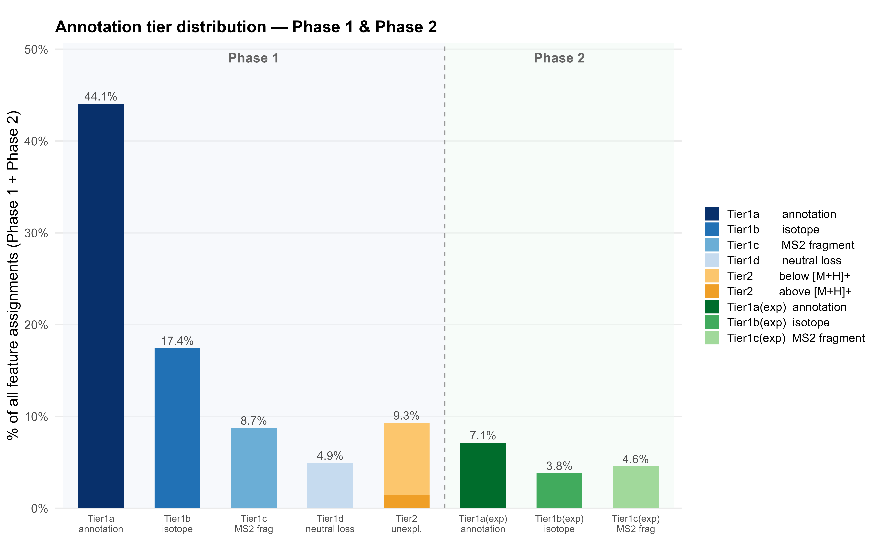

# 2b. MS1Match workflow: SuperPool (MS1 + MS2)

## Overview

This tutorial walks through the full **MS1Match** workflow on the
**SuperPool** dataset, a pooled sample of MSMLS standards, measured with
MS1 and MS2. It follows the same steps as vignette 2a on a larger
compound set. It covers:

1.  Peak picking with `xcms` (feature table + `MsExperiment` object);
    see vignette *1. Preprocessing raw files with xcms*
2.  Building per-feature consensus MS2 spectra
3.  Importing the reference library and preparing adduct/neutral-loss
    tables
4.  Running the MS1Match pipeline: direct library match → Phase 1 and
    Phase 2 annotation → ISF (in-source fragment) annotation → joined
    tier assignment
5.  Summarizing annotation tiers (table + plot)
6.  Exporting results (CSV, figures)

Package objects that take a long time to (re)compute (peak picking, MS2
consensus building) are loaded from cached `.rds` files for time
efficiency. The corresponding “from scratch” code is kept, so it can be
re-run on a new dataset by pointing `files_dir` at the raw files.

``` r

library(xcms)
library(MsExperiment)
library(BiocParallel)
library(S4Vectors)
library(Spectra)
library(MsBackendMgf)
library(dplyr)
library(MS1Match)
```

## 1. Peak picking with xcms

[`runxcmsFT()`](https://ruibings.github.io/MS1Match_Rpackage/reference/runxcmsFT.md)
is a wrapper around the standard `xcms` workflow. It takes raw file
paths plus the three standard `xcms` parameter objects (`CentWaveParam`,
`PeakDensityParam`, `ObiwarpParam`) and returns a list with the aligned
feature table (`ft`) and the underlying `MsExperiment` object (`x_exp`).

``` r

# Not run by default
# Requires access to the raw .mzML/.mzXML files.

cwp <- CentWaveParam(
  peakwidth          = c(5, 30),
  ppm                = 5,
  snthresh           = 10,
  mzdiff             = 0.001,
  prefilter          = c(3, 1000),
  noise              = 500,
  verboseBetaColumns = TRUE
)

pdp <- PeakDensityParam(
  sampleGroups = c(rep("3ul", 4), rep("3ul_ms2", 4)),
  bw           = 5,
  minFraction  = 0.5,
  binSize      = 0.01
)

obi <- ObiwarpParam(binSize = 0.5)

out <- runxcmsFT(
  files_dir    = system.file(
    "extdata", "mixture_pool", "MS1_MS2",
    package = "MS1Match"
  ),
  sample_name  = c("3ul_1", "3ul_2", "3ul_3", "3ul_4",
                    "3ul_ms2_1", "3ul_ms2_2", "3ul_ms2_3", "3ul_ms2_4"),
  sample_group = c(rep("3ul", 4), rep("3ul_ms2", 4)),
  cwp          = cwp,
  pdp          = pdp,
  obi          = obi,
  BPPARAM      = SnowParam(workers = 4)
)

# saveRDS(out, "SuperPool_MS1MS2_result.rds")
```

For this tutorial we load a precomputed run without access to the raw
files, then apply a retention-time window (60–1200 s) to drop features
outside the analytically useful range.

``` r

out <- readRDS(system.file("extdata", "RDS_files", "SuperPool", "SuperPool_MS1MS2_result.rds", package = "MS1Match"))
pool_FT <- out$ft
x_exp   <- out$result$x_exp

pool_FT_sub <- pool_FT %>% filter(rtmed >= 60 & rtmed <= 1200)

head(pool_FT_sub)
```

    ##   feature_name     mzmed     mzmin     mzmax    rtmed  rtmin    rtmax npeaks
    ## 1       FT0324 128.01916 128.01905 128.01941 60.13449 50.568 60.55100      8
    ## 2       FT0144 110.00864 110.00859 110.00879 60.17269 51.175 60.51436      6
    ## 3       FT0194 115.96401 115.96395 115.96404 60.17599 60.093 60.50846      3
    ## 4       FT0599 151.03519 151.03505 151.03892 60.17599 51.175 62.51200      7
    ## 5       FT0083  99.51217  99.51207  99.51225 60.25239 50.568 60.51436      7
    ## 6       FT0149 111.00992 111.00983 111.01004 60.25239 51.175 60.51436      5
    ##   3ul 3ul_ms2      peakidx ms_level
    ## 1   4       4 36, 4784....        1
    ## 2   4       2 62, 4808....        1
    ## 3   3       0 4768, 91....        1
    ## 4   4       3 38, 4786....        1
    ## 5   4       3 31, 4779....        1
    ## 6   4       1 24, 4781....        1
    ##   IROA_hm351_SuperPool_3ul_MS_GE1_01_55491.d.mzXML
    ## 1                                         8971.625
    ## 2                                        49787.684
    ## 3                                         3260.027
    ## 4                                         7413.975
    ## 5                                         6402.141
    ## 6                                         7094.429
    ##   IROA_hm351_SuperPool_3ul_MS_GE1_01_55493.d.mzXML
    ## 1                                         9597.613
    ## 2                                        52244.931
    ## 3                                         3699.297
    ## 4                                         8257.155
    ## 5                                         6277.326
    ## 6                                         8046.126
    ##   IROA_hm351_SuperPool_3ul_MS_GE1_01_55495.d.mzXML
    ## 1                                        10753.941
    ## 2                                        62503.791
    ## 3                                         3305.708
    ## 4                                         9526.005
    ## 5                                         6163.766
    ## 6                                         8978.829
    ##   IROA_hm351_SuperPool_3ul_MS_GE1_01_55497.d.mzXML
    ## 1                                        12014.144
    ## 2                                        68238.259
    ## 3                                         3853.268
    ## 4                                        10324.279
    ## 5                                         6023.707
    ## 6                                         9743.923
    ##   IROA_hm351_SuperPool_3ul_MSMS_GE1_01_55492.d.mzXML
    ## 1                                          15741.421
    ## 2                                          18752.154
    ## 3                                           5948.822
    ## 4                                           3601.019
    ## 5                                           5482.303
    ## 6                                           5206.957
    ##   IROA_hm351_SuperPool_3ul_MSMS_GE1_01_55494.d.mzXML
    ## 1                                           16583.45
    ## 2                                           59905.95
    ## 3                                                 NA
    ## 4                                           57185.07
    ## 5                                           12705.35
    ## 6                                                 NA
    ##   IROA_hm351_SuperPool_3ul_MSMS_GE1_01_55496.d.mzXML
    ## 1                                           20442.96
    ## 2                                           69471.85
    ## 3                                                 NA
    ## 4                                           12579.69
    ## 5                                           12034.95
    ## 6                                                 NA
    ##   IROA_hm351_SuperPool_3ul_MSMS_GE1_01_55498.d.mzXML intensity_median
    ## 1                                           21963.29        13877.783
    ## 2                                           80047.29        61204.870
    ## 3                                                 NA         3699.297
    ## 4                                           13001.93         9925.142
    ## 5                                           13486.37         6339.733
    ## 6                                           12769.64         8512.477
    ##   intensity_mean
    ## 1      14508.555
    ## 2      57618.988
    ## 3       4013.424
    ## 4      15236.140
    ## 5       8571.989
    ## 6       8639.984

## 2. MS2 processing

Building per-feature consensus MS2 spectra is a three-step process:
extract candidate MS2 scans for each feature
([`get_ms2_peaks()`](https://ruibings.github.io/MS1Match_Rpackage/reference/get_ms2_peaks.md),
a wrapper around
[`xcms::chromPeakSpectra()`](https://rdrr.io/pkg/xcms/man/chromPeakSpectra.html)),
collapse repeated scans of the same feature into one consensus spectrum
([`combineSpectra()`](https://rdrr.io/pkg/Spectra/man/combineSpectra.html)),
then convert the result into the named list format the annotator expects
([`read_ms2_consensus()`](https://ruibings.github.io/MS1Match_Rpackage/reference/read_ms2_consensus.md)).

``` r

# Not run by default — requires the raw MSMS files and the XcmsExperiment
# object from the previous step.

# Step 2a — extract MS2 peaks with feature_name assignment
ms2_peaks <- get_ms2_peaks(x_exp, expand_rt = 10, expand_mz = 0.02)

# Step 2b — build one consensus spectrum per feature
ms2_consensus <- combineSpectra(
  ms2_peaks,
  FUN          = combinePeaksData,
  ppm          = 20,
  peaks        = "intersect",
  minProp      = 0.50,
  intensityFun = median,
  mzFun        = median,
  f            = factor(ms2_peaks$feature_name)
)

# saveRDS(ms2_consensus, "ms2_consensus_SuperPool.rds")
```

In this tutorial we just load the cached result.

``` r

ms2_consensus <- readRDS(system.file("extdata", "RDS_files", "SuperPool", "ms2_consensus_SuperPool.rds", package = "MS1Match"))
ms2_list <- read_ms2_consensus(ms2_consensus, feature_table = pool_FT_sub)
```

## 3. Reference library and lookup tables

Alongside the MS2 list we load two tables — an adduct table (covering up
to 4M multimers) and a neutral-loss table — plus the in-house CBIO
library, restricted to compounds targeted in this pool.

``` r

# ── Adduct / neutral loss tables  ────────────────────────────────
adduct_table <- read.csv(
  system.file("extdata", "Adducts", "adducts_with_4M.csv", package = "MS1Match")
)

neutral_loss_table <- read.csv(
  system.file("extdata", "Neutral loss", "neutral loss database.csv", package = "MS1Match"),
  check.names = TRUE
)

# ── In-house library, restricted to compounds targeted in this pool ──
CBIO_library <- import_msp(
  file_path = system.file(
    "extdata", "CBIO", "CBIO_Standards.msp",
    package = "MS1Match"
  ),
  ionPolarity   = "pos",
  spectrum_type = "MS1",
  filter        = list(field = "Comments", pattern = "MSMLS"),
  dedup_by      = "name_only"
)
```

    ## [parser] Parsed:          1811
    ## [parser] Filtered:        1309
    ## [parser] Pre-dedup total: 502
    ## [parser] Duplicates:      6
    ## [parser] Building result: 496 compounds...
    ## [parser] Done.

``` r

length(CBIO_library)
```

    ## [1] 400

``` r

CBIO_target <- read.csv(system.file(
  "extdata", "mixture_pool", "Pool_traget_list", "Pool_traget_list.csv",
  package = "MS1Match"
))

CBIO_library_target <- CBIO_library[
  which(sapply(CBIO_library, function(x) x$Name) %in% CBIO_target$CNAME_CBIO)
]
```

## 4. MS1Match Pipeline: library match and annotation

This is the core MS1Match pipeline, run in four steps:

1.  **[`createDirectLibMatch()`](https://ruibings.github.io/MS1Match_Rpackage/reference/createDirectLibMatch.md) +
    [`libAnnotate()`](https://ruibings.github.io/MS1Match_Rpackage/reference/libAnnotate.md)**
    — match features against the library reference within a
    retention-time and ppm window, scored with cosine similarity and
    mirror plots.
2.  **[`createPeakAnnotationFromLibraryMatch()`](https://ruibings.github.io/MS1Match_Rpackage/reference/createPeakAnnotationFromLibraryMatch.md) +
    [`annotateLibMatch()`](https://ruibings.github.io/MS1Match_Rpackage/reference/annotateLibMatch.md)**
    — annotate features from the library matches, resolving adducts and
    neutral losses to assign Phase 1 tiers (Tier 1a–Tier 2), with an
    optional Phase 2 expansion for lower-confidence, \[M+H\]⁺-relative
    matches. `cutoff_MH` applies for all tiers.
3.  **[`createPeakAnnotationISF()`](https://ruibings.github.io/MS1Match_Rpackage/reference/createPeakAnnotationISF.md) +
    `annotateISF()`** — attribute in-source fragments to their confirmed
    parent (Tier 1a anchor) using the MS2 consensus spectra, within
    `ppm_isf`/`rt_isf_threshold` tolerances.
4.  **[`join_annotation_results()`](https://ruibings.github.io/MS1Match_Rpackage/reference/join_annotation_results.md)**
    — merge everything into one tier-resolved, cross-compound-aware
    annotation table.

``` r

DirectLibMatch_MS1_pool_obj <- createDirectLibMatch(
  FT = pool_FT_sub,
  compounds_list = CBIO_library_target,
  rt_thr_compound = 120,
  rt_thr_coelution = 5,
  ppm = 10,
  ms_level = "MS1",
  polarity = "pos"
)

direct_match_pool_MS1_obj <- libAnnotate(
  DirectLibMatch_MS1_pool_obj,
  compute_cosine = TRUE,
  ppm = 20,
  BPPARAM = SerialParam()
)

# Accessing MS1 Matching Results
direct_match_pool_res_MS1 <- results(direct_match_pool_MS1_obj)

# ──  Create annotation object ───────────────────────────────────────────────
PeakAnnotation_obj_MS1 <- createPeakAnnotationFromLibraryMatch(
  library_matches    = direct_match_pool_res_MS1,
  adducts_df         = adduct_table,
  neutral_loss_table = neutral_loss_table,
  FT                 = pool_FT_sub,
  polarity           = "positive",
  ppm                = 30
)

# ──  Run lib-match annotation (Phase 1 + optional Phase 2 expansion) ────────
pool_annotate_res_ms1 <- annotateLibMatch(
  PeakAnnotation_obj_MS1,
  cutoff_MH = TRUE
)

# ── Create ISF annotation object ──────────────────────────────────────────
PeakAnnotation_ISF_obj <- createPeakAnnotationISF(
  phase1_result    = pool_annotate_res_ms1,
  ms2_list         = ms2_list,
  FT               = pool_FT_sub,
  ppm_isf          = 10,
  rt_isf_threshold = 30.0
)

# ── Run ISF / MS2 fragment annotation ─────────────────────────────────────
isf_result <- annotateISF(PeakAnnotation_ISF_obj)

# ──  Join: resolves tiers───────
anno_result <- join_annotation_results(
  FT              = pool_FT_sub,
  direct_lib_list = direct_match_pool_res_MS1,
  lib_anno_list   = pool_annotate_res_ms1,
  isf_result      = isf_result,
  include_phase2  = TRUE
)
```

Vignette 3 starts from an `anno_result` like this one. The package ships
a copy as `extdata/RDS_files/SuperPool/anno_result_SuperPool.rds`; for
your own data, save it:

``` r

saveRDS(anno_result, "anno_result_SuperPool.rds")
```

## 5. Exporting the annotation tables

All tables from
[`join_annotation_results()`](https://ruibings.github.io/MS1Match_Rpackage/reference/join_annotation_results.md)
are exported to a single folder.

``` r

export_dir <- paste0("anno_export_SuperPool_MS1MS2_", format(Sys.Date(), "%Y%m%d"))
dir.create(export_dir, showWarnings = FALSE)

# Full: all features (with annotation or not), all FT columns + annotation columns
exportFeatureTable(anno_result$export_full_table,
                   file.path(export_dir, "anno_full_table_SuperPool_MS1MS2.csv"), na = "")

# Reduced: all features (with annotation or not), only ID (name/mz/rt) + annotation columns
write.csv(anno_result$export_reduced_table,
          file.path(export_dir, "anno_reduced_table_SuperPool_MS1MS2.csv"),
          na = "", row.names = FALSE)

# Reduced anno: reduced table, annotated features only (Compound_name not NA)
write.csv(anno_result$export_reduced_anno_table,
          file.path(export_dir, "anno_reduced_anno_table_SuperPool_MS1MS2.csv"),
          na = "", row.names = FALSE)

# Summary: one row per feature x compound x Lib_group
write.csv(anno_result$export_feature_compound_summary,
          file.path(export_dir, "anno_feature_compound_summary_SuperPool_MS1MS2.csv"),
          na = "", row.names = FALSE)

# Match: annotation evidence before FT join
write.csv(anno_result$export_match_table,
          file.path(export_dir, "anno_match_table_SuperPool_MS1MS2.csv"),
          na = "", row.names = FALSE)
```

## 6. Tier distribution: plot and per-compound tables

This section builds the summary figure: a stacked bar chart of
annotation tiers, split into Phase 1 (blue, direct annotation) and Phase
2 (green, expanded annotation), with per-tier percentages of all feature
assignments. Tier 2 (unexplained features) is further split into
below/above `[M+H]+`(in-source fragments vs. higher adducts/multimers).

``` r

library(ggplot2)
library(RColorBrewer)

# ── Input ─────────────────────────────────────────────────────────────────────
dat_all <- anno_result$export_feature_compound_summary %>% data.frame()

dat_all$cutoff_to_MH[dat_all$reference_tier != "Tier2_Unexplained"] <- NA_character_

# ── plot_tier ─────────────────────────────────────────────────────────────────
is_tier2 <- !is.na(dat_all$reference_tier) &
            dat_all$reference_tier == "Tier2_Unexplained"
dat_all$plot_tier <- dat_all$reference_tier
dat_all$plot_tier[is_tier2] <- paste0("Tier2_", dat_all$cutoff_to_MH[is_tier2])

# ── Phase split ───────────────────────────────────────────────────────────────
dat_p1 <- dat_all[!is.na(dat_all$annotation_phase) &
                    dat_all$annotation_phase == "Phase1", ]
dat_p2 <- dat_all[!is.na(dat_all$annotation_phase) &
                    grepl("Phase2", dat_all$annotation_phase), ]

# ── Colour palettes ───────────────────────────────────────────────────────────
.p1_blues <- RColorBrewer::brewer.pal(9, "Blues")
.greens   <- RColorBrewer::brewer.pal(9, "Greens")

tier_colors <- c(
  "Tier1a_AnnoMatch"       = .p1_blues[9],
  "Tier1b_Isotope"         = .p1_blues[7],
  "Tier1c_MS2Fragment"     = .p1_blues[5],
  "Tier1d_NeutralLoss"     = .p1_blues[3],
  "Tier2_below_MH"         = "#FCC66D",
  "Tier2_above_MH"         = "#EF9F27",
  "Tier1a_exp_AnnoMatch"   = .greens[8],
  "Tier1b_exp_Isotope"     = .greens[6],
  "Tier1c_MS2Fragment_exp" = .greens[4],
  "Tier1d_exp_NeutralLoss" = .greens[2]
)

tier_labels <- c(
  "Tier1a_AnnoMatch"       = "Tier1a       annotation",
  "Tier1b_Isotope"         = "Tier1b       isotope",
  "Tier1c_MS2Fragment"     = "Tier1c       MS2 fragment",
  "Tier1d_NeutralLoss"     = "Tier1d       neutral loss",
  "Tier2_below_MH"         = "Tier2        below [M+H]+",
  "Tier2_above_MH"         = "Tier2        above [M+H]+",
  "Tier1a_exp_AnnoMatch"   = "Tier1a(exp)  annotation",
  "Tier1b_exp_Isotope"     = "Tier1b(exp)  isotope",
  "Tier1c_MS2Fragment_exp" = "Tier1c(exp)  MS2 fragment",
  "Tier1d_exp_NeutralLoss" = "Tier1d(exp)  neutral loss"
)

p1_stack <- c("Tier1a_AnnoMatch", "Tier1b_Isotope",
              "Tier1c_MS2Fragment", "Tier1d_NeutralLoss",
              "Tier2_below_MH",     "Tier2_above_MH")

p2_stack <- c("Tier1a_exp_AnnoMatch", "Tier1b_exp_Isotope",
              "Tier1c_MS2Fragment_exp", "Tier1d_exp_NeutralLoss")

p1_xlevels <- c("Tier1a_AnnoMatch", "Tier1b_Isotope",
                "Tier1c_MS2Fragment", "Tier1d_NeutralLoss", "Tier2")
p2_xlevels <- c("Tier1a_exp_AnnoMatch", "Tier1b_exp_Isotope",
                "Tier1c_MS2Fragment_exp", "Tier1d_exp_NeutralLoss")

all_xlevels <- c(p1_xlevels, p2_xlevels)

all_xlabels <- c(
  "Tier1a_AnnoMatch"       = "Tier1a\nannotation",
  "Tier1b_Isotope"         = "Tier1b\nisotope",
  "Tier1c_MS2Fragment"     = "Tier1c\nMS2 frag",
  "Tier1d_NeutralLoss"     = "Tier1d\nneutral loss",
  "Tier2"                  = "Tier2\nunexpl.",
  "Tier1a_exp_AnnoMatch"   = "Tier1a(exp)\nannotation",
  "Tier1b_exp_Isotope"     = "Tier1b(exp)\nisotope",
  "Tier1c_MS2Fragment_exp" = "Tier1c(exp)\nMS2 frag",
  "Tier1d_exp_NeutralLoss" = "Tier1d(exp)\nneutral loss"
)

# ── Helper: build summary df ──────────────────────────────────────────────────
build_summary <- function(dat, stack_levels, x_levels) {
  dat$plot_tier <- factor(dat$plot_tier, levels = stack_levels)
  x_pos_chr <- as.character(dat$plot_tier)
  x_pos_chr[grepl("^Tier2", x_pos_chr)] <- "Tier2"
  dat$x_pos <- factor(x_pos_chr, levels = x_levels)
  overall <- as.data.frame(
    table(x_pos = dat$x_pos, plot_tier = dat$plot_tier),
    stringsAsFactors = FALSE
  )
  overall$x_pos     <- factor(overall$x_pos,     levels = all_xlevels)
  overall$plot_tier <- factor(overall$plot_tier, levels = names(tier_colors))
  overall
}

n_grand    <- nrow(dat_all)
overall_p1 <- build_summary(dat_p1, p1_stack, p1_xlevels)
overall_p2 <- build_summary(dat_p2, p2_stack, p2_xlevels)
overall    <- rbind(overall_p1, overall_p2)
overall$pct <- overall$Freq / n_grand * 100

active_tiers   <- intersect(names(tier_colors),
                            as.character(unique(overall$plot_tier[overall$Freq > 0])))
active_xlevels <- intersect(all_xlevels,
                            as.character(unique(overall$x_pos[overall$Freq > 0])))

overall <- overall[overall$Freq > 0, ]
overall$plot_tier <- factor(overall$plot_tier, levels = active_tiers)
overall$x_pos     <- factor(overall$x_pos,     levels = active_xlevels)

totals       <- aggregate(pct ~ x_pos, data = overall, FUN = sum)
totals$x_pos <- factor(totals$x_pos, levels = active_xlevels)

active_p1_x        <- intersect(p1_xlevels, active_xlevels)
active_p2_x        <- intersect(p2_xlevels, active_xlevels)
n_p1_active        <- length(active_p1_x)
n_p2_active        <- length(active_p2_x)
phase_split_active <- n_p1_active + 0.5
p2_xmid_active     <- if (n_p2_active > 0) phase_split_active + n_p2_active / 2 else NA_real_

# ── plot ──────────────────────────────────────────────────────────────────────
p <- ggplot(overall, aes(x = x_pos, y = pct, fill = plot_tier)) +
  annotate("rect",
           xmin = 0.5, xmax = phase_split_active,
           ymin = -Inf, ymax = Inf,
           fill = "#F0F4FA", alpha = 0.5) +
  {if (n_p2_active > 0)
    annotate("rect",
             xmin = phase_split_active,
             xmax = phase_split_active + n_p2_active,
             ymin = -Inf, ymax = Inf,
             fill = "#F0FAF4", alpha = 0.5)} +
  {if (n_p2_active > 0)
    annotate("segment",
             x = phase_split_active, xend = phase_split_active,
             y = 0, yend = Inf,
             linetype = "dashed", colour = "grey60", linewidth = 0.4)} +
  annotate("text", x = (n_p1_active + 1) / 2, y = Inf,
           label = "Phase 1",
           vjust = 2, size = 3.5, colour = "grey40", fontface = "bold") +
  {if (n_p2_active > 0 && !is.na(p2_xmid_active))
    annotate("text", x = p2_xmid_active, y = Inf,
             label = "Phase 2",
             vjust = 2, size = 3.5, colour = "grey40", fontface = "bold")} +
  geom_col(width = 0.6) +
  geom_text(data = totals[totals$pct > 0, ],
            aes(x = x_pos, y = pct, label = sprintf("%.1f%%", pct), fill = NULL),
            vjust = -0.4, size = 3.0, colour = "grey30") +
  scale_fill_manual(values = tier_colors[active_tiers],
                    labels = tier_labels[active_tiers],
                    name   = NULL) +
  scale_x_discrete(labels = all_xlabels[active_xlevels]) +
  scale_y_continuous(expand = expansion(mult = c(0, 0.15)),
                     labels = function(x) paste0(x, "%")) +
  coord_cartesian(clip = "off") +
  labs(
    title = "Annotation tier distribution — Phase 1 & Phase 2",
    x     = NULL,
    y     = "% of all feature assignments (Phase 1 + Phase 2)"
  ) +
  theme_minimal(base_size = 11) +
  theme(
    legend.position    = "right",
    legend.key.size    = unit(0.4, "cm"),
    legend.text        = element_text(size = 8.5),
    panel.grid.major.x = element_blank(),
    panel.grid.minor   = element_blank(),
    axis.text.x        = element_text(size = 7),
    plot.title         = element_text(size = 12, face = "bold"),
    plot.margin        = margin(t = 15, r = 10, b = 5, l = 5)
  )

print(p)
```



``` r

# ── Phase 1 per-compound summary ──────────────────────────────────────
tier_cols_p1 <- c("Tier1a_AnnoMatch", "Tier1b_Isotope",
                  "Tier1c_MS2Fragment", "Tier1d_NeutralLoss",
                  "Tier2_below_MH",     "Tier2_above_MH")

per_cpd <- do.call(rbind, lapply(
  split(dat_p1, dat_p1$Compound_name),
  function(df) {
    n_total <- nrow(df)
    counts  <- table(factor(df$plot_tier, levels = tier_cols_p1))
    data.frame(
      Compound_name   = df$Compound_name[1],
      n_total         = n_total,
      n_Tier1a        = as.integer(counts["Tier1a_AnnoMatch"]),
      n_Tier1b        = as.integer(counts["Tier1b_Isotope"]),
      n_Tier1c_MS2    = as.integer(counts["Tier1c_MS2Fragment"]),
      n_Tier1d        = as.integer(counts["Tier1d_NeutralLoss"]),
      n_Tier2_below   = as.integer(counts["Tier2_below_MH"]),
      n_Tier2_above   = as.integer(counts["Tier2_above_MH"]),
      pct_Tier1a      = round(counts["Tier1a_AnnoMatch"] / n_total * 100, 1),
      pct_Tier1b      = round(counts["Tier1b_Isotope"]     / n_total * 100, 1),
      pct_Tier1c_MS2  = round(counts["Tier1c_MS2Fragment"] / n_total * 100, 1),
      pct_Tier1d      = round(counts["Tier1d_NeutralLoss"] / n_total * 100, 1),
      pct_Tier2_below = round(counts["Tier2_below_MH"]     / n_total * 100, 1),
      pct_Tier2_above = round(counts["Tier2_above_MH"]     / n_total * 100, 1),
      stringsAsFactors = FALSE, row.names = NULL
    )
  }
))

# ── Phase 2 per-compound summary ──────────────────────────────────────
tier_cols_p2 <- c("Tier1a_exp_AnnoMatch", "Tier1b_exp_Isotope",
                  "Tier1c_MS2Fragment_exp", "Tier1d_exp_NeutralLoss")

per_cpd_p2 <- do.call(rbind, lapply(
  split(dat_p2, dat_p2$Compound_name),
  function(df) {
    n_total <- nrow(df)
    counts  <- table(factor(df$plot_tier, levels = tier_cols_p2))
    data.frame(
      Compound_name      = df$Compound_name[1],
      n_total            = n_total,
      n_Tier1a_exp       = as.integer(counts["Tier1a_exp_AnnoMatch"]),
      n_Tier1b_exp       = as.integer(counts["Tier1b_exp_Isotope"]),
      n_Tier1c_MS2_exp   = as.integer(counts["Tier1c_MS2Fragment_exp"]),
      n_Tier1d_exp       = as.integer(counts["Tier1d_exp_NeutralLoss"]),
      pct_Tier1a_exp     = round(counts["Tier1a_exp_AnnoMatch"] / n_total * 100, 1),
      pct_Tier1b_exp     = round(counts["Tier1b_exp_Isotope"]     / n_total * 100, 1),
      pct_Tier1c_MS2_exp = round(counts["Tier1c_MS2Fragment_exp"] / n_total * 100, 1),
      pct_Tier1d_exp     = round(counts["Tier1d_exp_NeutralLoss"] / n_total * 100, 1),
      stringsAsFactors = FALSE, row.names = NULL
    )
  }
))

per_cpd    <- per_cpd[order(per_cpd$n_total,       decreasing = TRUE), ]
per_cpd_p2 <- per_cpd_p2[order(per_cpd_p2$n_total, decreasing = TRUE), ]
rownames(per_cpd)    <- NULL
rownames(per_cpd_p2) <- NULL

cat("\n── Phase 1 per-compound summary ──\n")
```

    ## 
    ## ── Phase 1 per-compound summary ──

``` r

print(per_cpd,    row.names = FALSE)
```

    ##                                                           Compound_name n_total
    ##                                                            Glycocholate      19
    ##                                                            Dethiobiotin      18
    ##                                                               Melatonin      16
    ##                                                N-Acetyl-L-phenylalanine      15
    ##                                                            Azelaic acid      14
    ##                                             Deoxycorticosterone acetate      13
    ##                                                  N-Acetyl-D-Tryptophane      13
    ##                                            Omega-hydroxydodecanoic acid      13
    ##                                                      Selenomethionine_2      13
    ##                                                               Cortisone      12
    ##                                                       L-Tryptophanamide      12
    ##                                                               Lipoamide      12
    ##                                                  N-Acetyl-DL-Methionine      12
    ##                                                      N-Acetyl-L-Leucine      12
    ##                                                      N-Methyltryptamine      12
    ##                                                             Adipic acid      11
    ##                                                                  Biotin      11
    ##                                                              L-Anserine      11
    ##                                                   10-Hydroxydecanoate_2      10
    ##                                                      Selenomethionine_1      10
    ##                                                            Suberic acid      10
    ##                                                                Cortisol       9
    ##                                                            D-Tryptophan       9
    ##                                                              L-Arginine       9
    ##                                                            L-Histidinol       9
    ##                                                            L-Kynurenine       9
    ##                                                Rac-glycerol 1-myristate       9
    ##                                                   2-MethylGlutaric acid       8
    ##                                                       3-Methylhistamine       8
    ##                                           Alpha-D-Galactose 1-phosphate       8
    ##                                                               Carnosine       8
    ##                                                            L-Tryptophan       8
    ##                                                  N-Acetyl-D-Mannosamine       8
    ##                                                   N-Amidino-L-Aspartate       8
    ##                                                N(Pi)-methyl-L-Histidine       8
    ##                                        N6-(Delta-2-isopentenyl)-Adenine       8
    ##                                                  Thiamine monophosphate       8
    ##                                                              Tryptamine       8
    ##                                             2-Quinoline-carboxylic acid       7
    ##                                                     Alpha-amino-adipate       7
    ##                                             Alpha-D-Glucose-1-phosphate       7
    ##                                                   D-Mannose 6-phosphate       7
    ##                                                    D-Pantothenic acid_2       7
    ##                                                      Indole-3-acetamide       7
    ##                                                             L-Histidine       7
    ##                                                 Mono-methyl-Glutarate_2       7
    ##                                                N-Acetyl-D-Galactosamine       7
    ##                                                       N-Acetylserotonin       7
    ##                 1-Methyl-6;7-dihydroxy-1;2;3;4-tetrahydroisoquinoline_2       6
    ##                                         3,4-Dihydroxy-L-phenylalanine_2       6
    ##                                                 5'-Methylthio-adenosine       6
    ##                                                     Cortisol 21-acetate       6
    ##                                                       D-(+)-Glucosamine       6
    ##                                                           Deoxycytidine       6
    ##                                                               Hippurate       6
    ##                                                        Indole-3-acetate       6
    ##                                                      Indole-3-ethanol_1       6
    ##                                                 Methyl Indole-3-acetate       6
    ##                                                 N-Alpha-acetyl-L-Lysine       6
    ##                            N(E),N(E),N(E)-Trimethyllysine hydrochloride       6
    ##                                                          Phosphocholine       6
    ##                                                            Pyridoxamine       6
    ##                                                                Thiamine       6
    ##                                                       1-Naphthylamine_2       5
    ##                                         3-Amino-4-hydroxybenzoic acid_2       5
    ##                                                   3,5-Diiodo-L-Tyrosine       5
    ##                                                    4-Guanidinobutanoate       5
    ##                                                                Caffeate       5
    ##                                            Cytidine 5'-diphosphocholine       5
    ##                                                     D-(+)-Galactosamine       5
    ##                                                 D-Glucosamine-6-sulfate       5
    ##                                                           D-Mannosamine       5
    ##                                                              D-Sorbitol       5
    ##                                                   Dimethylbenzimidazole       5
    ##                                                              Galactitol       5
    ##                                                              Homoserine       5
    ##                                                        L-Allo-Threonine       5
    ##                                                        Lauroylcarnitine       5
    ##                                                     N-Acetylneuraminate       5
    ##                                                      N-Acetylputrescine       5
    ##                                                    N-Methyl-L-Glutamate       5
    ##                                                         Rosmarinic acid       5
    ##                                        S-(5'-Adenosyl)-L-Homocysteine_2       5
    ##                                                                 Sucrose       5
    ##                                                      Taurolitho cholate       5
    ##                                                          Theophylline_1       5
    ##                                                  Thiamine pyrophosphate       5
    ##                                                              Tyramine_2       5
    ##                              Uridine 5'-Diphospho-N-acetylgalactosamine       5
    ##                                Uridine 5'-Diphospho-N-acetylglucosamine       5
    ##                                                       1-Methyladenosine       4
    ##                                         3-Amino-4-hydroxybenzoic acid_1       4
    ##                                             3-Hydroxy-3-methylglutarate       4
    ##                                                  3-Hydroxy-anthranilate       4
    ##                                                     3-Methyl-2-oxindole       4
    ##                                                  4-Acetamidobutanoate_2       4
    ##                                                      4-Aminobutanoate_2       4
    ##                                                             Adenosine_2       4
    ##                                                                     CMP       4
    ##                                                          Corticosterone       4
    ##                                                                Creatine       4
    ##                                                                Cytidine       4
    ##                                                         D-(+)-Trehalose       4
    ##                                                          Deoxycarnitine       4
    ##                                                     DL-5-hydroxy-Lysine       4
    ##                                              Formyl-L-Methionyl Peptide       4
    ##                                                    Glycerol 2-phosphate       4
    ##                                                               Inosine_2       4
    ##                                                            L-Asparagine       4
    ##                                                           L-Aspartate_2       4
    ##                                                L-Methionine sulfoximine       4
    ##                                                             L-Threonine       4
    ##                                                               Melibiose       4
    ##                                             N-Acetyl-DL-Glutamic acid_2       4
    ##                                                      N-Acetyl-L-Alanine       4
    ##                                                N-Acetyl-L-Aspartic acid       4
    ##                                             N-Alpha-acetyl-L-Asparagine       4
    ##                                                N-Methyl-D-Aspartic acid       4
    ##                                                                     NAD       4
    ##                                                       O-Acetyl-L-Serine       4
    ##                                                              Palatinose       4
    ##                                                          Paraxanthine_1       4
    ##                                                Reichstein`S Substance S       4
    ##                                                            Riboflavin_2       4
    ##                                        S-(5'-Adenosyl)-L-Homocysteine_1       4
    ##                                             SN-glycero-3-phosphocholine       4
    ##                                                 SN-glycerol 3-phosphate       4
    ##                                                           Sphinganine_1       4
    ##                                                           Sphinganine_2       4
    ##                                                Thiopurine S-methylether       4
    ##                 1-Methyl-6;7-dihydroxy-1;2;3;4-tetrahydroisoquinoline_1       3
    ##                                                       1-Naphthylamine_1       3
    ##                                                   1-Oleoyl-rac-glycerol       3
    ##                              1;2-Didecanoyl-SN-glycero-3-phosphocholine       3
    ##                                                     2'-Deoxyadenosine_2       3
    ##                                                     2'-Deoxyadenosine_3       3
    ##                                                     2'-Deoxyadenosine_4       3
    ##                                       2'-Deoxycytidine 5'-monophosphate       3
    ##                                      2'-Deoxyguanosine 5'-monophosphate       3
    ##                                          2';4'-Dihydroxy-acetophenone_1       3
    ##                                            2-Hydroxyphenylacetic acid_1       3
    ##                                                                  3'-CMP       3
    ##                                         3-Amino-5-hydroxybenzoic acid_1       3
    ##                                         3-Amino-5-hydroxybenzoic acid_2       3
    ##                                                  3-Hydroxy-Kynurenine_2       3
    ##                                                    3-Methoxy-tyramine_1       3
    ##                                                    3-Methoxy-tyramine_2       3
    ##                                                      3-Nitro-L-Tyrosine       3
    ##                                                     3-Ureido-propionate       3
    ##                                                       4-Aminobenzoate_2       3
    ##                                   4-Hydroxy-2-quinoline carboxylic acid       3
    ##                                                     4-Hydroxy-L-Proline       3
    ##                                               4-Imidazole-acetic acid_3       3
    ##                                                     5'-Deoxyadenosine_2       3
    ##                                                     5'-Deoxyadenosine_3       3
    ##                                                   5-Aminolevulinic acid       3
    ##                                                     5-Aminopentanoate_1       3
    ##                                                5-Hydroxy-indole-acetate       3
    ##                                                5-Hydroxy-L-Tryptophan_2       3
    ##                                                       5-Oxo-L-Proline_2       3
    ##                                                           Acetylcholine       3
    ##                                                               Adenine_5       3
    ##                                  Adenosine 2';3'-Cyclic monophosphate_1       3
    ##                                  Adenosine 3';5'-Cyclic monophosphate_1       3
    ##                                              Adenosine 5'-monophosphate       3
    ##                                                             Adenosine_1       3
    ##                                                                Caffeine       3
    ##                                                 Cis-4-hydroxy-D-Proline       3
    ##                                                              Creatinine       3
    ##                                                              Cytosine_3       3
    ##                                                           D-Aspartate_2       3
    ##                                                             D-Ornithine       3
    ##                                                                  DAMP_1       3
    ##                                                            Deoxyuridine       3
    ##                                                          Diethanolamine       3
    ##                                                             Epinephrine       3
    ##                                                   Ethyl 3-Indoleacetate       3
    ##                                              Guanosine 5'-monophosphate       3
    ##                                                               Histamine       3
    ##                                              Inosine 5'-monophosphate_2       3
    ##                                                  Inosine 5'-phosphate_2       3
    ##                                                             L-Carnitine       3
    ##                                                         L-Glutamic acid       3
    ##                                                             L-Glutamine       3
    ##                                                            L-Methionine       3
    ##                                                             L-Ornithine       3
    ##                                                         L-Phenylalanine       3
    ##                                                        L-Pipecolic acid       3
    ##                                            LL-2;6-Diaminoheptane-dioate       3
    ##                                                              Lumichrome       3
    ##                                                      N-Acetyl-DL-Serine       3
    ##                                                       N1-Acetylspermine       3
    ##                                                      O-Phospho-L-Serine       3
    ##                                                    Phenylethanolamine_2       3
    ##                                                        Picolinic acid_2       3
    ##                                                              Pipecolate       3
    ##                                                            Pyridoxine_1       3
    ##                                                     S-Hexyl-Glutathione       3
    ##                                                          Salicylamide_2       3
    ##                                                             Serotonin_2       3
    ##                                                               Thymidine       3
    ##                                                  Trans-4-hydroxyproline       3
    ##                                                              Tyramine_3       3
    ##                                                     2'-Deoxyadenosine_1       2
    ##                                                       2'-Deoxyguanosine       2
    ##                                          2';4'-Dihydroxy-acetophenone_2       2
    ##                                            2-Amino-2-methylpropanoate_2       2
    ##                                       2-Aminoethyl dihydrogen phosphate       2
    ##                                                         2-Aminophenol_2       2
    ##                                            2-Hydroxyphenylacetic acid_2       2
    ##                                                 2;3-Dihydroxybenzoate_1       2
    ##                                                 2;3-Dihydroxybenzoate_2       2
    ##                                                 2;5-Dihydroxybenozate_1       2
    ##                                                 2;5-Dihydroxybenozate_2       2
    ##                                                      3';5'-Cyclic AMP_1       2
    ##                                                      3';5'-Cyclic AMP_2       2
    ##                                                  3-Amino-isobutanoate_2       2
    ##                                                       3-Hydroxybenzoate       2
    ##                                                  3-Methoxy-L-Tyrosine_2       2
    ##                                                     3-Sulfino-L-Alanine       2
    ##                                                3,3',5'-Triiodothyronine       2
    ##                                         3,4-Dihydroxy-L-phenylalanine_1       2
    ##                                                 3;4-Dihydroxybenzoate_1       2
    ##                                                 3;4-Dihydroxybenzoate_2       2
    ##                                                 3;5-Di-iodo-L-Thyronine       2
    ##                                                             4-Coumarate       2
    ##                                                       4-Hydroxybenzoate       2
    ##                                                4-Hydroxyphenylacetate_1       2
    ##                                                4-Hydroxyphenylacetate_2       2
    ##                                                          4-Pyridoxate_1       2
    ##                                                     5'-Deoxyadenosine_1       2
    ##  5-Aminoimidazole-4-carboxamide-1-beta-D-Ribofuranosyl 5'-monophosphate       2
    ##                                                5-Hydroxy-L-Tryptophan_1       2
    ##                                                       5-Oxo-D-Proline_2       2
    ##                                                       5-Oxo-L-Proline_1       2
    ##                                  Adenosine 2';3'-Cyclic monophosphate_2       2
    ##                                  Adenosine 3';5'-Cyclic monophosphate_2       2
    ##                                                        Agmatine sulfate       2
    ##                                                               Allantoin       2
    ##                                                          Anthranilate_2       2
    ##                                                            Beta-Alanine       2
    ##                                                               Betaine_1       2
    ##                                                                 Choline       2
    ##                                                             Citrullline       2
    ##                                                    D-Pantothenic acid_1       2
    ##                                                      DL-normetanephrine       2
    ##                                                              Dopamine_1       2
    ##                                                              Dopamine_2       2
    ##                                                  Ethanolamine phosphate       2
    ##                                                             Guanosine_1       2
    ##                                                             Hypotaurine       2
    ##                                                          Hypoxanthine_2       2
    ##                                                          Hypoxanthine_4       2
    ##                                                      Indole-3-ethanol_3       2
    ##                                                               Inosine_1       2
    ##                                                                L-Cystin       2
    ##                                              L-Homocysteine thiolactone       2
    ##                                                            L-Isoleucine       2
    ##                                                           L-Norvaline_1       2
    ##                                                            L-Tyrosine_1       2
    ##                                                              L-Valine_1       2
    ##                                                              L-Valine_2       2
    ##                                                                 Leucine       2
    ##                                                 Mono-methyl-Glutarate_1       2
    ##                                             N-Acetyl-DL-Glutamic acid_1       2
    ##                                                         N-Acetylglycine       2
    ##                                            Nicotinamide mono-nucleotide       2
    ##                                                          Nicotinamide_2       2
    ##                                                            Nicotinate_2       2
    ##                                                              Norleucine       2
    ##                                                     O-Phospho-DL-Serine       2
    ##                                                        Ophtalmic acid_2       2
    ##                                                    Phenylethanolamine_1       2
    ##                                                                  Pterin       2
    ##                                              Pyridine-2;3-Dicarboxylate       2
    ##                                                                 Quinate       2
    ##                                                Resorcinol monoacetate_1       2
    ##                                                Resorcinol monoacetate_2       2
    ##                                                             Serotonin_1       2
    ##                                                           Theobromine_1       2
    ##                                                               Thymine_3       2
    ##                                         Thyrotropin releasing hormone_1       2
    ##                                         Thyrotropin releasing hormone_2       2
    ##                                                              Tyramine_1       2
    ##                                                 Uridine-5-monophosphate       2
    ##                                                               Uridine_1       2
    ##                                                               Uridine_2       2
    ##                                                               Urocanate       2
    ##                                                            Xanthosine_1       2
    ##                                                     (S)-Dihydro-orotate       1
    ##                                                            (S)-Nicotine       1
    ##                                       1-Aminocyclopropane-1-carboxylate       1
    ##                                                   10-Hydroxydecanoate_1       1
    ##                                            2-Amino-2-methylpropanoate_1       1
    ##                                                         2-Aminophenol_1       1
    ##                                            2-Hydroxyphenylacetic acid_3       1
    ##                                                 2;3-Dihydroxybenzoate_3       1
    ##                                                2;4-Dihydroxypteridine_1       1
    ##                                                2;4-Dihydroxypteridine_2       1
    ##                                                 2;5-Dihydroxybenozate_3       1
    ##                                             3-(4-Hydroxyphenyl)pyruvate       1
    ##                                                  3-Amino-isobutanoate_1       1
    ##                                                  3-Hydroxy-Kynurenine_1       1
    ##                                                 3-Hydroxybenzaldehyde_1       1
    ##                                                 3-Hydroxybenzaldehyde_2       1
    ##                                                 3-Hydroxybenzaldehyde_3       1
    ##                                                  3-Methoxy-L-Tyrosine_1       1
    ##                                                         3-Methyladenine       1
    ##                                                 3;4-Dihydroxybenzoate_3       1
    ##                                                  4-Acetamidobutanoate_1       1
    ##                                                       4-Aminobenzoate_1       1
    ##                                                      4-Aminobutanoate_1       1
    ##                                               4-Hydroxy-L-phenylglycine       1
    ##                                                 4-Hydroxybenzaldehyde_1       1
    ##                                                 4-Hydroxybenzaldehyde_2       1
    ##                                                 4-Hydroxybenzaldehyde_3       1
    ##                                               4-Imidazole-acetic acid_1       1
    ##                                               4-Imidazole-acetic acid_2       1
    ##                                                          4-Pyridoxate_2       1
    ##                                              4-Quinolinecarboxylic acid       1
    ##                                                     5-Aminopentanoate_2       1
    ##                                           5-Methylcytosine hydrocloride       1
    ##                                                       5-Oxo-D-Proline_1       1
    ##                                                         5-Valerolactone       1
    ##                                                      5;6-Dihydro-Uracil       1
    ##                                                    6-Hydroxy-Nicotinate       1
    ##                                                               Adenine_1       1
    ##                                                               Adenine_2       1
    ##                                                               Adenine_3       1
    ##                                                               Adenine_4       1
    ##                                                 Aniline-2-sulfonic acid       1
    ##                                                          Anthranilate_1       1
    ##                                                              Benzoate_1       1
    ##                                                              Benzoate_2       1
    ##                                                            Benzoic acid       1
    ##                                                               Betaine_2       1
    ##                                                              Biliverdin       1
    ##                                                              Cytosine_1       1
    ##                                                              Cytosine_2       1
    ##                                                               D-Alanine       1
    ##                                                           D-Aspartate_1       1
    ##                                                                  DAMP_2       1
    ##                                                                Ferulate       1
    ##                                                              Folic acid       1
    ##                                                                  Glycin       1
    ##                                                                Guaiacol       1
    ##                                                       Guanidino-acetate       1
    ##                                                               Guanine_1       1
    ##                                                               Guanine_2       1
    ##                                                               Guanine_3       1
    ##                                  Guanosine 3';5'-Cyclic monophosphate_1       1
    ##                                  Guanosine 3';5'-Cyclic monophosphate_2       1
    ##                                                             Guanosine_2       1
    ##                                                          Hypoxanthine_1       1
    ##                                                          Hypoxanthine_3       1
    ##                                                   Indole-3-acetaldehyde       1
    ##                                                      Indole-3-ethanol_2       1
    ##                                              Inosine 5'-monophosphate_1       1
    ##                                                  Inosine 5'-phosphate_1       1
    ##                                                                L-Alanin       1
    ##                                                           L-Aspartate_1       1
    ##                                                          L-Cysteic acid       1
    ##                                                                L-Lysine       1
    ##                                                           L-Norvaline_2       1
    ##                                                               L-Proline       1
    ##                                                                L-Serine       1
    ##                                                            L-Tyrosine_2       1
    ##                                                        Methyl Vanillate       1
    ##                                                  N-Acetyl-D-Glucosamine       1
    ##                                                          Nicotinamide_1       1
    ##                                                            Nicotinate_1       1
    ##                                                               Nonanoate       1
    ##                                                         Noradrenaline_1       1
    ##                                                         Noradrenaline_2       1
    ##                                                 O-Succinyl-L-Homoserine       1
    ##                                                            Octopamine_1       1
    ##                                                            Octopamine_2       1
    ##                                                        Ophtalmic acid_1       1
    ##                                                          Paraxanthine_2       1
    ##                                                    Phenylethanolamine_3       1
    ##                                                        Picolinic acid_1       1
    ##                                                                Purine_1       1
    ##                                                                Purine_2       1
    ##                                                               Pyridoxal       1
    ##                                                            Pyridoxine_2       1
    ##                                                            PyroCatechol       1
    ##                                                   Pyrrole-2-carboxylate       1
    ##                                                               Retinoate       1
    ##                                                            Riboflavin_1       1
    ##                                                          Salicylamide_1       1
    ##                                                               Sarcosine       1
    ##                                                                 Taurine       1
    ##                                                           Theobromine_2       1
    ##                                                          Theophylline_2       1
    ##                                              Thymidine 5'-monophosphate       1
    ##                                                               Thymine_1       1
    ##                                                               Thymine_2       1
    ##                                                               Thyroxine       1
    ##                                                            Trigonelline       1
    ##                                                                Uracil_1       1
    ##                                                                Uracil_2       1
    ##                                                                Xanthine       1
    ##                                                            Xanthosine_2       1
    ##  n_Tier1a n_Tier1b n_Tier1c_MS2 n_Tier1d n_Tier2_below n_Tier2_above pct_Tier1a
    ##         8        9            1        0             1             0       42.1
    ##         8        8            1        0             0             1       44.4
    ##         4        6            5        1             0             0       25.0
    ##         6        6            3        0             0             0       40.0
    ##         8        5            1        0             0             0       57.1
    ##         5        7            0        0             1             0       38.5
    ##         6        3            4        0             0             0       46.2
    ##         7        5            1        0             0             0       53.8
    ##         3        3            3        1             3             0       23.1
    ##         5        6            0        0             1             0       41.7
    ##         4        3            5        0             0             0       33.3
    ##         3        3            4        1             0             1       25.0
    ##         4        2            4        0             0             2       33.3
    ##         6        4            2        0             0             0       50.0
    ##         1        4            7        0             0             0        8.3
    ##         8        1            0        1             0             1       72.7
    ##         6        4            0        0             0             1       54.5
    ##         2        1            0        4             4             0       18.2
    ##         4        4            2        0             0             0       40.0
    ##         3        1            0        2             3             1       30.0
    ##         6        2            0        1             0             1       60.0
    ##         3        5            0        0             1             0       33.3
    ##         3        3            3        0             0             0       33.3
    ##         2        1            1        3             2             0       22.2
    ##         4        1            2        0             2             0       44.4
    ##         2        2            5        0             0             0       22.2
    ##         4        4            0        0             1             0       44.4
    ##         7        1            0        0             0             0       87.5
    ##         2        1            2        0             3             0       25.0
    ##         2        0            0        4             2             0       25.0
    ##         3        1            0        2             2             0       37.5
    ##         2        3            3        0             0             0       25.0
    ##         4        1            3        0             0             0       50.0
    ##         3        1            4        0             0             0       37.5
    ##         3        1            0        1             3             0       37.5
    ##         1        4            3        0             0             0       12.5
    ##         2        0            0        1             5             0       25.0
    ##         2        3            3        0             0             0       25.0
    ##         3        3            1        0             0             0       42.9
    ##         3        1            1        2             0             0       42.9
    ##         2        0            0        3             2             0       28.6
    ##         2        0            0        2             3             0       28.6
    ##         5        2            0        0             0             0       71.4
    ##         3        3            1        0             0             0       42.9
    ##         2        1            0        2             2             0       28.6
    ##         6        1            0        0             0             0       85.7
    ##         4        1            2        0             0             0       57.1
    ##         4        2            1        0             0             0       57.1
    ##         2        1            3        0             0             0       33.3
    ##         3        1            0        2             0             0       50.0
    ##         1        3            2        0             0             0       16.7
    ##         3        3            0        0             0             0       50.0
    ##         3        0            1        1             1             0       50.0
    ##         2        3            0        0             1             0       33.3
    ##         2        3            1        0             0             0       33.3
    ##         3        3            0        0             0             0       50.0
    ##         2        2            0        0             2             0       33.3
    ##         2        3            1        0             0             0       33.3
    ##         1        1            3        0             1             0       16.7
    ##         1        1            0        0             4             0       16.7
    ##         1        1            0        1             2             1       16.7
    ##         4        0            0        0             2             0       66.7
    ##         3        1            1        0             1             0       50.0
    ##         1        1            3        0             0             0       20.0
    ##         1        1            0        3             0             0       20.0
    ##         3        2            0        0             0             0       60.0
    ##         1        2            0        0             2             0       20.0
    ##         3        2            0        0             0             0       60.0
    ##         2        1            0        0             2             0       40.0
    ##         4        0            1        0             0             0       80.0
    ##         2        0            0        1             2             0       40.0
    ##         3        0            1        0             1             0       60.0
    ##         4        0            0        1             0             0       80.0
    ##         1        2            2        0             0             0       20.0
    ##         4        0            0        1             0             0       80.0
    ##         2        1            0        1             1             0       40.0
    ##         2        1            0        1             1             0       40.0
    ##         2        2            1        0             0             0       40.0
    ##         4        1            0        0             0             0       80.0
    ##         2        2            0        0             1             0       40.0
    ##         2        1            1        1             0             0       40.0
    ##         3        1            0        0             1             0       60.0
    ##         2        2            0        0             1             0       40.0
    ##         3        0            0        2             0             0       60.0
    ##         4        1            0        0             0             0       80.0
    ##         2        2            1        0             0             0       40.0
    ##         2        0            0        1             2             0       40.0
    ##         2        2            1        0             0             0       40.0
    ##         1        1            0        2             1             0       20.0
    ##         1        1            0        1             2             0       20.0
    ##         2        2            0        0             0             0       50.0
    ##         1        1            0        1             1             0       25.0
    ##         3        0            0        1             0             0       75.0
    ##         2        2            0        0             0             0       50.0
    ##         2        1            1        0             0             0       50.0
    ##         3        0            1        0             0             0       75.0
    ##         3        0            0        0             1             0       75.0
    ##         1        1            1        0             1             0       25.0
    ##         1        1            0        1             1             0       25.0
    ##         3        0            0        0             0             1       75.0
    ##         2        1            1        0             0             0       50.0
    ##         1        2            0        1             0             0       25.0
    ##         3        0            0        1             0             0       75.0
    ##         1        1            1        1             0             0       25.0
    ##         2        0            0        1             1             0       50.0
    ##         3        0            1        0             0             0       75.0
    ##         1        0            0        0             3             0       25.0
    ##         2        1            1        0             0             0       50.0
    ##         1        0            0        1             1             1       25.0
    ##         2        0            0        1             1             0       50.0
    ##         1        0            1        0             2             0       25.0
    ##         2        2            0        0             0             0       50.0
    ##         3        0            0        1             0             0       75.0
    ##         4        0            0        0             0             0      100.0
    ##         2        0            1        0             0             1       50.0
    ##         3        0            1        0             0             0       75.0
    ##         3        0            0        0             1             0       75.0
    ##         2        1            1        0             0             0       50.0
    ##         2        0            0        0             2             0       50.0
    ##         2        1            1        0             0             0       50.0
    ##         2        0            0        1             1             0       50.0
    ##         1        2            1        0             0             0       25.0
    ##         2        1            0        0             0             1       50.0
    ##         2        2            0        0             0             0       50.0
    ##         2        0            0        0             2             0       50.0
    ##         1        0            0        1             2             0       25.0
    ##         1        0            0        0             3             0       25.0
    ##         3        1            0        0             0             0       75.0
    ##         2        2            0        0             0             0       50.0
    ##         1        1            1        0             0             1       25.0
    ##         2        1            0        0             0             0       66.7
    ##         1        1            0        0             1             0       33.3
    ##         2        0            0        0             1             0       66.7
    ##         1        2            0        0             0             0       33.3
    ##         1        1            1        0             0             0       33.3
    ##         1        1            1        0             0             0       33.3
    ##         1        1            1        0             0             0       33.3
    ##         1        1            0        0             1             0       33.3
    ##         1        1            0        0             1             0       33.3
    ##         3        0            0        0             0             0      100.0
    ##         3        0            0        0             0             0      100.0
    ##         1        1            0        0             1             0       33.3
    ##         1        1            0        1             0             0       33.3
    ##         1        1            0        1             0             0       33.3
    ##         2        0            1        0             0             0       66.7
    ##         2        1            0        0             0             0       66.7
    ##         2        1            0        0             0             0       66.7
    ##         2        1            0        0             0             0       66.7
    ##         1        0            0        1             0             1       33.3
    ##         2        1            0        0             0             0       66.7
    ##         1        1            1        0             0             0       33.3
    ##         3        0            0        0             0             0      100.0
    ##         1        2            0        0             0             0       33.3
    ##         1        1            1        0             0             0       33.3
    ##         1        1            1        0             0             0       33.3
    ##         3        0            0        0             0             0      100.0
    ##         2        1            0        0             0             0       66.7
    ##         2        1            0        0             0             0       66.7
    ##         2        0            0        1             0             0       66.7
    ##         2        0            0        0             1             0       66.7
    ##         1        1            1        0             0             0       33.3
    ##         2        0            0        0             0             1       66.7
    ##         1        1            1        0             0             0       33.3
    ##         1        1            1        0             0             0       33.3
    ##         1        1            0        0             1             0       33.3
    ##         1        1            1        0             0             0       33.3
    ##         1        1            1        0             0             0       33.3
    ##         2        0            0        0             1             0       66.7
    ##         1        1            0        0             1             0       33.3
    ##         2        1            0        0             0             0       66.7
    ##         2        0            0        0             1             0       66.7
    ##         3        0            0        0             0             0      100.0
    ##         1        0            0        1             1             0       33.3
    ##         2        0            1        0             0             0       66.7
    ##         2        1            0        0             0             0       66.7
    ##         1        0            0        1             1             0       33.3
    ##         2        0            1        0             0             0       66.7
    ##         1        0            0        0             2             0       33.3
    ##         2        0            0        0             1             0       66.7
    ##         1        0            0        0             2             0       33.3
    ##         1        0            0        0             2             0       33.3
    ##         1        1            1        0             0             0       33.3
    ##         2        1            0        0             0             0       66.7
    ##         1        0            0        1             1             0       33.3
    ##         3        0            0        0             0             0      100.0
    ##         3        0            0        0             0             0      100.0
    ##         2        1            0        0             0             0       66.7
    ##         2        0            0        0             0             1       66.7
    ##         2        0            0        1             0             0       66.7
    ##         2        1            0        0             0             0       66.7
    ##         2        1            0        0             0             0       66.7
    ##         1        1            1        0             0             0       33.3
    ##         1        0            0        1             1             0       33.3
    ##         1        1            1        0             0             0       33.3
    ##         1        1            1        0             0             0       33.3
    ##         2        0            0        0             0             1       66.7
    ##         2        1            0        0             0             0       66.7
    ##         1        2            0        0             0             0       33.3
    ##         2        0            0        0             0             1       66.7
    ##         2        0            1        0             0             0       66.7
    ##         2        0            1        0             0             0       66.7
    ##         2        0            0        0             1             0       66.7
    ##         2        1            0        0             0             0       66.7
    ##         1        0            1        0             0             0       50.0
    ##         1        1            0        0             0             0       50.0
    ##         1        1            0        0             0             0       50.0
    ##         2        0            0        0             0             0      100.0
    ##         1        0            0        0             1             0       50.0
    ##         1        1            0        0             0             0       50.0
    ##         2        0            0        0             0             0      100.0
    ##         2        0            0        0             0             0      100.0
    ##         2        0            0        0             0             0      100.0
    ##         2        0            0        0             0             0      100.0
    ##         2        0            0        0             0             0      100.0
    ##         1        1            0        0             0             0       50.0
    ##         1        1            0        0             0             0       50.0
    ##         2        0            0        0             0             0      100.0
    ##         2        0            0        0             0             0      100.0
    ##         2        0            0        0             0             0      100.0
    ##         1        0            0        0             1             0       50.0
    ##         1        1            0        0             0             0       50.0
    ##         1        0            0        1             0             0       50.0
    ##         2        0            0        0             0             0      100.0
    ##         2        0            0        0             0             0      100.0
    ##         1        1            0        0             0             0       50.0
    ##         2        0            0        0             0             0      100.0
    ##         2        0            0        0             0             0      100.0
    ##         2        0            0        0             0             0      100.0
    ##         2        0            0        0             0             0      100.0
    ##         1        0            0        1             0             0       50.0
    ##         1        0            1        0             0             0       50.0
    ##         1        0            0        0             1             0       50.0
    ##         2        0            0        0             0             0      100.0
    ##         2        0            0        0             0             0      100.0
    ##         1        0            0        0             1             0       50.0
    ##         1        1            0        0             0             0       50.0
    ##         1        1            0        0             0             0       50.0
    ##         2        0            0        0             0             0      100.0
    ##         1        0            0        1             0             0       50.0
    ##         1        0            0        0             0             1       50.0
    ##         1        0            0        0             0             1       50.0
    ##         1        1            0        0             0             0       50.0
    ##         1        1            0        0             0             0       50.0
    ##         2        0            0        0             0             0      100.0
    ##         2        0            0        0             0             0      100.0
    ##         1        0            0        1             0             0       50.0
    ##         2        0            0        0             0             0      100.0
    ##         1        0            0        0             1             0       50.0
    ##         1        0            0        0             1             0       50.0
    ##         1        0            1        0             0             0       50.0
    ##         1        0            0        0             1             0       50.0
    ##         1        1            0        0             0             0       50.0
    ##         2        0            0        0             0             0      100.0
    ##         1        1            0        0             0             0       50.0
    ##         1        0            1        0             0             0       50.0
    ##         1        1            0        0             0             0       50.0
    ##         1        0            0        0             0             1       50.0
    ##         2        0            0        0             0             0      100.0
    ##         1        1            0        0             0             0       50.0
    ##         2        0            0        0             0             0      100.0
    ##         1        1            0        0             0             0       50.0
    ##         1        0            0        0             0             1       50.0
    ##         2        0            0        0             0             0      100.0
    ##         2        0            0        0             0             0      100.0
    ##         2        0            0        0             0             0      100.0
    ##         1        0            0        0             1             0       50.0
    ##         1        1            0        0             0             0       50.0
    ##         1        1            0        0             0             0       50.0
    ##         1        1            0        0             0             0       50.0
    ##         2        0            0        0             0             0      100.0
    ##         1        0            0        1             0             0       50.0
    ##         1        1            0        0             0             0       50.0
    ##         1        0            1        0             0             0       50.0
    ##         1        0            0        0             1             0       50.0
    ##         1        0            0        0             1             0       50.0
    ##         2        0            0        0             0             0      100.0
    ##         2        0            0        0             0             0      100.0
    ##         1        1            0        0             0             0       50.0
    ##         2        0            0        0             0             0      100.0
    ##         1        1            0        0             0             0       50.0
    ##         1        1            0        0             0             0       50.0
    ##         1        1            0        0             0             0       50.0
    ##         1        1            0        0             0             0       50.0
    ##         1        0            1        0             0             0       50.0
    ##         1        0            0        0             1             0       50.0
    ##         1        0            0        1             0             0       50.0
    ##         1        0            0        1             0             0       50.0
    ##         2        0            0        0             0             0      100.0
    ##         1        0            1        0             0             0       50.0
    ##         1        0            0        0             0             0      100.0
    ##         1        0            0        0             0             0      100.0
    ##         1        0            0        0             0             0      100.0
    ##         1        0            0        0             0             0      100.0
    ##         1        0            0        0             0             0      100.0
    ##         1        0            0        0             0             0      100.0
    ##         1        0            0        0             0             0      100.0
    ##         1        0            0        0             0             0      100.0
    ##         1        0            0        0             0             0      100.0
    ##         1        0            0        0             0             0      100.0
    ##         1        0            0        0             0             0      100.0
    ##         0        0            0        1             0             0        0.0
    ##         1        0            0        0             0             0      100.0
    ##         1        0            0        0             0             0      100.0
    ##         1        0            0        0             0             0      100.0
    ##         1        0            0        0             0             0      100.0
    ##         1        0            0        0             0             0      100.0
    ##         1        0            0        0             0             0      100.0
    ##         1        0            0        0             0             0      100.0
    ##         1        0            0        0             0             0      100.0
    ##         1        0            0        0             0             0      100.0
    ##         1        0            0        0             0             0      100.0
    ##         1        0            0        0             0             0      100.0
    ##         1        0            0        0             0             0      100.0
    ##         1        0            0        0             0             0      100.0
    ##         1        0            0        0             0             0      100.0
    ##         1        0            0        0             0             0      100.0
    ##         1        0            0        0             0             0      100.0
    ##         1        0            0        0             0             0      100.0
    ##         1        0            0        0             0             0      100.0
    ##         1        0            0        0             0             0      100.0
    ##         1        0            0        0             0             0      100.0
    ##         1        0            0        0             0             0      100.0
    ##         1        0            0        0             0             0      100.0
    ##         1        0            0        0             0             0      100.0
    ##         1        0            0        0             0             0      100.0
    ##         1        0            0        0             0             0      100.0
    ##         1        0            0        0             0             0      100.0
    ##         1        0            0        0             0             0      100.0
    ##         1        0            0        0             0             0      100.0
    ##         1        0            0        0             0             0      100.0
    ##         1        0            0        0             0             0      100.0
    ##         1        0            0        0             0             0      100.0
    ##         1        0            0        0             0             0      100.0
    ##         1        0            0        0             0             0      100.0
    ##         1        0            0        0             0             0      100.0
    ##         1        0            0        0             0             0      100.0
    ##         1        0            0        0             0             0      100.0
    ##         1        0            0        0             0             0      100.0
    ##         1        0            0        0             0             0      100.0
    ##         1        0            0        0             0             0      100.0
    ##         1        0            0        0             0             0      100.0
    ##         1        0            0        0             0             0      100.0
    ##         1        0            0        0             0             0      100.0
    ##         1        0            0        0             0             0      100.0
    ##         1        0            0        0             0             0      100.0
    ##         1        0            0        0             0             0      100.0
    ##         1        0            0        0             0             0      100.0
    ##         1        0            0        0             0             0      100.0
    ##         1        0            0        0             0             0      100.0
    ##         1        0            0        0             0             0      100.0
    ##         1        0            0        0             0             0      100.0
    ##         1        0            0        0             0             0      100.0
    ##         1        0            0        0             0             0      100.0
    ##         1        0            0        0             0             0      100.0
    ##         1        0            0        0             0             0      100.0
    ##         1        0            0        0             0             0      100.0
    ##         1        0            0        0             0             0      100.0
    ##         1        0            0        0             0             0      100.0
    ##         1        0            0        0             0             0      100.0
    ##         1        0            0        0             0             0      100.0
    ##         1        0            0        0             0             0      100.0
    ##         1        0            0        0             0             0      100.0
    ##         1        0            0        0             0             0      100.0
    ##         1        0            0        0             0             0      100.0
    ##         1        0            0        0             0             0      100.0
    ##         1        0            0        0             0             0      100.0
    ##         1        0            0        0             0             0      100.0
    ##         1        0            0        0             0             0      100.0
    ##         0        0            0        1             0             0        0.0
    ##         1        0            0        0             0             0      100.0
    ##         1        0            0        0             0             0      100.0
    ##         1        0            0        0             0             0      100.0
    ##         1        0            0        0             0             0      100.0
    ##         1        0            0        0             0             0      100.0
    ##         1        0            0        0             0             0      100.0
    ##         1        0            0        0             0             0      100.0
    ##         1        0            0        0             0             0      100.0
    ##         1        0            0        0             0             0      100.0
    ##         1        0            0        0             0             0      100.0
    ##         1        0            0        0             0             0      100.0
    ##         1        0            0        0             0             0      100.0
    ##         1        0            0        0             0             0      100.0
    ##         1        0            0        0             0             0      100.0
    ##         1        0            0        0             0             0      100.0
    ##         1        0            0        0             0             0      100.0
    ##         1        0            0        0             0             0      100.0
    ##         1        0            0        0             0             0      100.0
    ##         1        0            0        0             0             0      100.0
    ##         1        0            0        0             0             0      100.0
    ##         1        0            0        0             0             0      100.0
    ##         1        0            0        0             0             0      100.0
    ##         1        0            0        0             0             0      100.0
    ##         1        0            0        0             0             0      100.0
    ##         1        0            0        0             0             0      100.0
    ##         1        0            0        0             0             0      100.0
    ##         1        0            0        0             0             0      100.0
    ##         1        0            0        0             0             0      100.0
    ##         1        0            0        0             0             0      100.0
    ##         1        0            0        0             0             0      100.0
    ##         1        0            0        0             0             0      100.0
    ##         1        0            0        0             0             0      100.0
    ##         1        0            0        0             0             0      100.0
    ##         1        0            0        0             0             0      100.0
    ##  pct_Tier1b pct_Tier1c_MS2 pct_Tier1d pct_Tier2_below pct_Tier2_above
    ##        47.4            5.3        0.0             5.3             0.0
    ##        44.4            5.6        0.0             0.0             5.6
    ##        37.5           31.2        6.2             0.0             0.0
    ##        40.0           20.0        0.0             0.0             0.0
    ##        35.7            7.1        0.0             0.0             0.0
    ##        53.8            0.0        0.0             7.7             0.0
    ##        23.1           30.8        0.0             0.0             0.0
    ##        38.5            7.7        0.0             0.0             0.0
    ##        23.1           23.1        7.7            23.1             0.0
    ##        50.0            0.0        0.0             8.3             0.0
    ##        25.0           41.7        0.0             0.0             0.0
    ##        25.0           33.3        8.3             0.0             8.3
    ##        16.7           33.3        0.0             0.0            16.7
    ##        33.3           16.7        0.0             0.0             0.0
    ##        33.3           58.3        0.0             0.0             0.0
    ##         9.1            0.0        9.1             0.0             9.1
    ##        36.4            0.0        0.0             0.0             9.1
    ##         9.1            0.0       36.4            36.4             0.0
    ##        40.0           20.0        0.0             0.0             0.0
    ##        10.0            0.0       20.0            30.0            10.0
    ##        20.0            0.0       10.0             0.0            10.0
    ##        55.6            0.0        0.0            11.1             0.0
    ##        33.3           33.3        0.0             0.0             0.0
    ##        11.1           11.1       33.3            22.2             0.0
    ##        11.1           22.2        0.0            22.2             0.0
    ##        22.2           55.6        0.0             0.0             0.0
    ##        44.4            0.0        0.0            11.1             0.0
    ##        12.5            0.0        0.0             0.0             0.0
    ##        12.5           25.0        0.0            37.5             0.0
    ##         0.0            0.0       50.0            25.0             0.0
    ##        12.5            0.0       25.0            25.0             0.0
    ##        37.5           37.5        0.0             0.0             0.0
    ##        12.5           37.5        0.0             0.0             0.0
    ##        12.5           50.0        0.0             0.0             0.0
    ##        12.5            0.0       12.5            37.5             0.0
    ##        50.0           37.5        0.0             0.0             0.0
    ##         0.0            0.0       12.5            62.5             0.0
    ##        37.5           37.5        0.0             0.0             0.0
    ##        42.9           14.3        0.0             0.0             0.0
    ##        14.3           14.3       28.6             0.0             0.0
    ##         0.0            0.0       42.9            28.6             0.0
    ##         0.0            0.0       28.6            42.9             0.0
    ##        28.6            0.0        0.0             0.0             0.0
    ##        42.9           14.3        0.0             0.0             0.0
    ##        14.3            0.0       28.6            28.6             0.0
    ##        14.3            0.0        0.0             0.0             0.0
    ##        14.3           28.6        0.0             0.0             0.0
    ##        28.6           14.3        0.0             0.0             0.0
    ##        16.7           50.0        0.0             0.0             0.0
    ##        16.7            0.0       33.3             0.0             0.0
    ##        50.0           33.3        0.0             0.0             0.0
    ##        50.0            0.0        0.0             0.0             0.0
    ##         0.0           16.7       16.7            16.7             0.0
    ##        50.0            0.0        0.0            16.7             0.0
    ##        50.0           16.7        0.0             0.0             0.0
    ##        50.0            0.0        0.0             0.0             0.0
    ##        33.3            0.0        0.0            33.3             0.0
    ##        50.0           16.7        0.0             0.0             0.0
    ##        16.7           50.0        0.0            16.7             0.0
    ##        16.7            0.0        0.0            66.7             0.0
    ##        16.7            0.0       16.7            33.3            16.7
    ##         0.0            0.0        0.0            33.3             0.0
    ##        16.7           16.7        0.0            16.7             0.0
    ##        20.0           60.0        0.0             0.0             0.0
    ##        20.0            0.0       60.0             0.0             0.0
    ##        40.0            0.0        0.0             0.0             0.0
    ##        40.0            0.0        0.0            40.0             0.0
    ##        40.0            0.0        0.0             0.0             0.0
    ##        20.0            0.0        0.0            40.0             0.0
    ##         0.0           20.0        0.0             0.0             0.0
    ##         0.0            0.0       20.0            40.0             0.0
    ##         0.0           20.0        0.0            20.0             0.0
    ##         0.0            0.0       20.0             0.0             0.0
    ##        40.0           40.0        0.0             0.0             0.0
    ##         0.0            0.0       20.0             0.0             0.0
    ##        20.0            0.0       20.0            20.0             0.0
    ##        20.0            0.0       20.0            20.0             0.0
    ##        40.0           20.0        0.0             0.0             0.0
    ##        20.0            0.0        0.0             0.0             0.0
    ##        40.0            0.0        0.0            20.0             0.0
    ##        20.0           20.0       20.0             0.0             0.0
    ##        20.0            0.0        0.0            20.0             0.0
    ##        40.0            0.0        0.0            20.0             0.0
    ##         0.0            0.0       40.0             0.0             0.0
    ##        20.0            0.0        0.0             0.0             0.0
    ##        40.0           20.0        0.0             0.0             0.0
    ##         0.0            0.0       20.0            40.0             0.0
    ##        40.0           20.0        0.0             0.0             0.0
    ##        20.0            0.0       40.0            20.0             0.0
    ##        20.0            0.0       20.0            40.0             0.0
    ##        50.0            0.0        0.0             0.0             0.0
    ##        25.0            0.0       25.0            25.0             0.0
    ##         0.0            0.0       25.0             0.0             0.0
    ##        50.0            0.0        0.0             0.0             0.0
    ##        25.0           25.0        0.0             0.0             0.0
    ##         0.0           25.0        0.0             0.0             0.0
    ##         0.0            0.0        0.0            25.0             0.0
    ##        25.0           25.0        0.0            25.0             0.0
    ##        25.0            0.0       25.0            25.0             0.0
    ##         0.0            0.0        0.0             0.0            25.0
    ##        25.0           25.0        0.0             0.0             0.0
    ##        50.0            0.0       25.0             0.0             0.0
    ##         0.0            0.0       25.0             0.0             0.0
    ##        25.0           25.0       25.0             0.0             0.0
    ##         0.0            0.0       25.0            25.0             0.0
    ##         0.0           25.0        0.0             0.0             0.0
    ##         0.0            0.0        0.0            75.0             0.0
    ##        25.0           25.0        0.0             0.0             0.0
    ##         0.0            0.0       25.0            25.0            25.0
    ##         0.0            0.0       25.0            25.0             0.0
    ##         0.0           25.0        0.0            50.0             0.0
    ##        50.0            0.0        0.0             0.0             0.0
    ##         0.0            0.0       25.0             0.0             0.0
    ##         0.0            0.0        0.0             0.0             0.0
    ##         0.0           25.0        0.0             0.0            25.0
    ##         0.0           25.0        0.0             0.0             0.0
    ##         0.0            0.0        0.0            25.0             0.0
    ##        25.0           25.0        0.0             0.0             0.0
    ##         0.0            0.0        0.0            50.0             0.0
    ##        25.0           25.0        0.0             0.0             0.0
    ##         0.0            0.0       25.0            25.0             0.0
    ##        50.0           25.0        0.0             0.0             0.0
    ##        25.0            0.0        0.0             0.0            25.0
    ##        50.0            0.0        0.0             0.0             0.0
    ##         0.0            0.0        0.0            50.0             0.0
    ##         0.0            0.0       25.0            50.0             0.0
    ##         0.0            0.0        0.0            75.0             0.0
    ##        25.0            0.0        0.0             0.0             0.0
    ##        50.0            0.0        0.0             0.0             0.0
    ##        25.0           25.0        0.0             0.0            25.0
    ##        33.3            0.0        0.0             0.0             0.0
    ##        33.3            0.0        0.0            33.3             0.0
    ##         0.0            0.0        0.0            33.3             0.0
    ##        66.7            0.0        0.0             0.0             0.0
    ##        33.3           33.3        0.0             0.0             0.0
    ##        33.3           33.3        0.0             0.0             0.0
    ##        33.3           33.3        0.0             0.0             0.0
    ##        33.3            0.0        0.0            33.3             0.0
    ##        33.3            0.0        0.0            33.3             0.0
    ##         0.0            0.0        0.0             0.0             0.0
    ##         0.0            0.0        0.0             0.0             0.0
    ##        33.3            0.0        0.0            33.3             0.0
    ##        33.3            0.0       33.3             0.0             0.0
    ##        33.3            0.0       33.3             0.0             0.0
    ##         0.0           33.3        0.0             0.0             0.0
    ##        33.3            0.0        0.0             0.0             0.0
    ##        33.3            0.0        0.0             0.0             0.0
    ##        33.3            0.0        0.0             0.0             0.0
    ##         0.0            0.0       33.3             0.0            33.3
    ##        33.3            0.0        0.0             0.0             0.0
    ##        33.3           33.3        0.0             0.0             0.0
    ##         0.0            0.0        0.0             0.0             0.0
    ##        66.7            0.0        0.0             0.0             0.0
    ##        33.3           33.3        0.0             0.0             0.0
    ##        33.3           33.3        0.0             0.0             0.0
    ##         0.0            0.0        0.0             0.0             0.0
    ##        33.3            0.0        0.0             0.0             0.0
    ##        33.3            0.0        0.0             0.0             0.0
    ##         0.0            0.0       33.3             0.0             0.0
    ##         0.0            0.0        0.0            33.3             0.0
    ##        33.3           33.3        0.0             0.0             0.0
    ##         0.0            0.0        0.0             0.0            33.3
    ##        33.3           33.3        0.0             0.0             0.0
    ##        33.3           33.3        0.0             0.0             0.0
    ##        33.3            0.0        0.0            33.3             0.0
    ##        33.3           33.3        0.0             0.0             0.0
    ##        33.3           33.3        0.0             0.0             0.0
    ##         0.0            0.0        0.0            33.3             0.0
    ##        33.3            0.0        0.0            33.3             0.0
    ##        33.3            0.0        0.0             0.0             0.0
    ##         0.0            0.0        0.0            33.3             0.0
    ##         0.0            0.0        0.0             0.0             0.0
    ##         0.0            0.0       33.3            33.3             0.0
    ##         0.0           33.3        0.0             0.0             0.0
    ##        33.3            0.0        0.0             0.0             0.0
    ##         0.0            0.0       33.3            33.3             0.0
    ##         0.0           33.3        0.0             0.0             0.0
    ##         0.0            0.0        0.0            66.7             0.0
    ##         0.0            0.0        0.0            33.3             0.0
    ##         0.0            0.0        0.0            66.7             0.0
    ##         0.0            0.0        0.0            66.7             0.0
    ##        33.3           33.3        0.0             0.0             0.0
    ##        33.3            0.0        0.0             0.0             0.0
    ##         0.0            0.0       33.3            33.3             0.0
    ##         0.0            0.0        0.0             0.0             0.0
    ##         0.0            0.0        0.0             0.0             0.0
    ##        33.3            0.0        0.0             0.0             0.0
    ##         0.0            0.0        0.0             0.0            33.3
    ##         0.0            0.0       33.3             0.0             0.0
    ##        33.3            0.0        0.0             0.0             0.0
    ##        33.3            0.0        0.0             0.0             0.0
    ##        33.3           33.3        0.0             0.0             0.0
    ##         0.0            0.0       33.3            33.3             0.0
    ##        33.3           33.3        0.0             0.0             0.0
    ##        33.3           33.3        0.0             0.0             0.0
    ##         0.0            0.0        0.0             0.0            33.3
    ##        33.3            0.0        0.0             0.0             0.0
    ##        66.7            0.0        0.0             0.0             0.0
    ##         0.0            0.0        0.0             0.0            33.3
    ##         0.0           33.3        0.0             0.0             0.0
    ##         0.0           33.3        0.0             0.0             0.0
    ##         0.0            0.0        0.0            33.3             0.0
    ##        33.3            0.0        0.0             0.0             0.0
    ##         0.0           50.0        0.0             0.0             0.0
    ##        50.0            0.0        0.0             0.0             0.0
    ##        50.0            0.0        0.0             0.0             0.0
    ##         0.0            0.0        0.0             0.0             0.0
    ##         0.0            0.0        0.0            50.0             0.0
    ##        50.0            0.0        0.0             0.0             0.0
    ##         0.0            0.0        0.0             0.0             0.0
    ##         0.0            0.0        0.0             0.0             0.0
    ##         0.0            0.0        0.0             0.0             0.0
    ##         0.0            0.0        0.0             0.0             0.0
    ##         0.0            0.0        0.0             0.0             0.0
    ##        50.0            0.0        0.0             0.0             0.0
    ##        50.0            0.0        0.0             0.0             0.0
    ##         0.0            0.0        0.0             0.0             0.0
    ##         0.0            0.0        0.0             0.0             0.0
    ##         0.0            0.0        0.0             0.0             0.0
    ##         0.0            0.0        0.0            50.0             0.0
    ##        50.0            0.0        0.0             0.0             0.0
    ##         0.0            0.0       50.0             0.0             0.0
    ##         0.0            0.0        0.0             0.0             0.0
    ##         0.0            0.0        0.0             0.0             0.0
    ##        50.0            0.0        0.0             0.0             0.0
    ##         0.0            0.0        0.0             0.0             0.0
    ##         0.0            0.0        0.0             0.0             0.0
    ##         0.0            0.0        0.0             0.0             0.0
    ##         0.0            0.0        0.0             0.0             0.0
    ##         0.0            0.0       50.0             0.0             0.0
    ##         0.0           50.0        0.0             0.0             0.0
    ##         0.0            0.0        0.0            50.0             0.0
    ##         0.0            0.0        0.0             0.0             0.0
    ##         0.0            0.0        0.0             0.0             0.0
    ##         0.0            0.0        0.0            50.0             0.0
    ##        50.0            0.0        0.0             0.0             0.0
    ##        50.0            0.0        0.0             0.0             0.0
    ##         0.0            0.0        0.0             0.0             0.0
    ##         0.0            0.0       50.0             0.0             0.0
    ##         0.0            0.0        0.0             0.0            50.0
    ##         0.0            0.0        0.0             0.0            50.0
    ##        50.0            0.0        0.0             0.0             0.0
    ##        50.0            0.0        0.0             0.0             0.0
    ##         0.0            0.0        0.0             0.0             0.0
    ##         0.0            0.0        0.0             0.0             0.0
    ##         0.0            0.0       50.0             0.0             0.0
    ##         0.0            0.0        0.0             0.0             0.0
    ##         0.0            0.0        0.0            50.0             0.0
    ##         0.0            0.0        0.0            50.0             0.0
    ##         0.0           50.0        0.0             0.0             0.0
    ##         0.0            0.0        0.0            50.0             0.0
    ##        50.0            0.0        0.0             0.0             0.0
    ##         0.0            0.0        0.0             0.0             0.0
    ##        50.0            0.0        0.0             0.0             0.0
    ##         0.0           50.0        0.0             0.0             0.0
    ##        50.0            0.0        0.0             0.0             0.0
    ##         0.0            0.0        0.0             0.0            50.0
    ##         0.0            0.0        0.0             0.0             0.0
    ##        50.0            0.0        0.0             0.0             0.0
    ##         0.0            0.0        0.0             0.0             0.0
    ##        50.0            0.0        0.0             0.0             0.0
    ##         0.0            0.0        0.0             0.0            50.0
    ##         0.0            0.0        0.0             0.0             0.0
    ##         0.0            0.0        0.0             0.0             0.0
    ##         0.0            0.0        0.0             0.0             0.0
    ##         0.0            0.0        0.0            50.0             0.0
    ##        50.0            0.0        0.0             0.0             0.0
    ##        50.0            0.0        0.0             0.0             0.0
    ##        50.0            0.0        0.0             0.0             0.0
    ##         0.0            0.0        0.0             0.0             0.0
    ##         0.0            0.0       50.0             0.0             0.0
    ##        50.0            0.0        0.0             0.0             0.0
    ##         0.0           50.0        0.0             0.0             0.0
    ##         0.0            0.0        0.0            50.0             0.0
    ##         0.0            0.0        0.0            50.0             0.0
    ##         0.0            0.0        0.0             0.0             0.0
    ##         0.0            0.0        0.0             0.0             0.0
    ##        50.0            0.0        0.0             0.0             0.0
    ##         0.0            0.0        0.0             0.0             0.0
    ##        50.0            0.0        0.0             0.0             0.0
    ##        50.0            0.0        0.0             0.0             0.0
    ##        50.0            0.0        0.0             0.0             0.0
    ##        50.0            0.0        0.0             0.0             0.0
    ##         0.0           50.0        0.0             0.0             0.0
    ##         0.0            0.0        0.0            50.0             0.0
    ##         0.0            0.0       50.0             0.0             0.0
    ##         0.0            0.0       50.0             0.0             0.0
    ##         0.0            0.0        0.0             0.0             0.0
    ##         0.0           50.0        0.0             0.0             0.0
    ##         0.0            0.0        0.0             0.0             0.0
    ##         0.0            0.0        0.0             0.0             0.0
    ##         0.0            0.0        0.0             0.0             0.0
    ##         0.0            0.0        0.0             0.0             0.0
    ##         0.0            0.0        0.0             0.0             0.0
    ##         0.0            0.0        0.0             0.0             0.0
    ##         0.0            0.0        0.0             0.0             0.0
    ##         0.0            0.0        0.0             0.0             0.0
    ##         0.0            0.0        0.0             0.0             0.0
    ##         0.0            0.0        0.0             0.0             0.0
    ##         0.0            0.0        0.0             0.0             0.0
    ##         0.0            0.0      100.0             0.0             0.0
    ##         0.0            0.0        0.0             0.0             0.0
    ##         0.0            0.0        0.0             0.0             0.0
    ##         0.0            0.0        0.0             0.0             0.0
    ##         0.0            0.0        0.0             0.0             0.0
    ##         0.0            0.0        0.0             0.0             0.0
    ##         0.0            0.0        0.0             0.0             0.0
    ##         0.0            0.0        0.0             0.0             0.0
    ##         0.0            0.0        0.0             0.0             0.0
    ##         0.0            0.0        0.0             0.0             0.0
    ##         0.0            0.0        0.0             0.0             0.0
    ##         0.0            0.0        0.0             0.0             0.0
    ##         0.0            0.0        0.0             0.0             0.0
    ##         0.0            0.0        0.0             0.0             0.0
    ##         0.0            0.0        0.0             0.0             0.0
    ##         0.0            0.0        0.0             0.0             0.0
    ##         0.0            0.0        0.0             0.0             0.0
    ##         0.0            0.0        0.0             0.0             0.0
    ##         0.0            0.0        0.0             0.0             0.0
    ##         0.0            0.0        0.0             0.0             0.0
    ##         0.0            0.0        0.0             0.0             0.0
    ##         0.0            0.0        0.0             0.0             0.0
    ##         0.0            0.0        0.0             0.0             0.0
    ##         0.0            0.0        0.0             0.0             0.0
    ##         0.0            0.0        0.0             0.0             0.0
    ##         0.0            0.0        0.0             0.0             0.0
    ##         0.0            0.0        0.0             0.0             0.0
    ##         0.0            0.0        0.0             0.0             0.0
    ##         0.0            0.0        0.0             0.0             0.0
    ##         0.0            0.0        0.0             0.0             0.0
    ##         0.0            0.0        0.0             0.0             0.0
    ##         0.0            0.0        0.0             0.0             0.0
    ##         0.0            0.0        0.0             0.0             0.0
    ##         0.0            0.0        0.0             0.0             0.0
    ##         0.0            0.0        0.0             0.0             0.0
    ##         0.0            0.0        0.0             0.0             0.0
    ##         0.0            0.0        0.0             0.0             0.0
    ##         0.0            0.0        0.0             0.0             0.0
    ##         0.0            0.0        0.0             0.0             0.0
    ##         0.0            0.0        0.0             0.0             0.0
    ##         0.0            0.0        0.0             0.0             0.0
    ##         0.0            0.0        0.0             0.0             0.0
    ##         0.0            0.0        0.0             0.0             0.0
    ##         0.0            0.0        0.0             0.0             0.0
    ##         0.0            0.0        0.0             0.0             0.0
    ##         0.0            0.0        0.0             0.0             0.0
    ##         0.0            0.0        0.0             0.0             0.0
    ##         0.0            0.0        0.0             0.0             0.0
    ##         0.0            0.0        0.0             0.0             0.0
    ##         0.0            0.0        0.0             0.0             0.0
    ##         0.0            0.0        0.0             0.0             0.0
    ##         0.0            0.0        0.0             0.0             0.0
    ##         0.0            0.0        0.0             0.0             0.0
    ##         0.0            0.0        0.0             0.0             0.0
    ##         0.0            0.0        0.0             0.0             0.0
    ##         0.0            0.0        0.0             0.0             0.0
    ##         0.0            0.0        0.0             0.0             0.0
    ##         0.0            0.0        0.0             0.0             0.0
    ##         0.0            0.0        0.0             0.0             0.0
    ##         0.0            0.0        0.0             0.0             0.0
    ##         0.0            0.0        0.0             0.0             0.0
    ##         0.0            0.0        0.0             0.0             0.0
    ##         0.0            0.0        0.0             0.0             0.0
    ##         0.0            0.0        0.0             0.0             0.0
    ##         0.0            0.0        0.0             0.0             0.0
    ##         0.0            0.0        0.0             0.0             0.0
    ##         0.0            0.0        0.0             0.0             0.0
    ##         0.0            0.0        0.0             0.0             0.0
    ##         0.0            0.0      100.0             0.0             0.0
    ##         0.0            0.0        0.0             0.0             0.0
    ##         0.0            0.0        0.0             0.0             0.0
    ##         0.0            0.0        0.0             0.0             0.0
    ##         0.0            0.0        0.0             0.0             0.0
    ##         0.0            0.0        0.0             0.0             0.0
    ##         0.0            0.0        0.0             0.0             0.0
    ##         0.0            0.0        0.0             0.0             0.0
    ##         0.0            0.0        0.0             0.0             0.0
    ##         0.0            0.0        0.0             0.0             0.0
    ##         0.0            0.0        0.0             0.0             0.0
    ##         0.0            0.0        0.0             0.0             0.0
    ##         0.0            0.0        0.0             0.0             0.0
    ##         0.0            0.0        0.0             0.0             0.0
    ##         0.0            0.0        0.0             0.0             0.0
    ##         0.0            0.0        0.0             0.0             0.0
    ##         0.0            0.0        0.0             0.0             0.0
    ##         0.0            0.0        0.0             0.0             0.0
    ##         0.0            0.0        0.0             0.0             0.0
    ##         0.0            0.0        0.0             0.0             0.0
    ##         0.0            0.0        0.0             0.0             0.0
    ##         0.0            0.0        0.0             0.0             0.0
    ##         0.0            0.0        0.0             0.0             0.0
    ##         0.0            0.0        0.0             0.0             0.0
    ##         0.0            0.0        0.0             0.0             0.0
    ##         0.0            0.0        0.0             0.0             0.0
    ##         0.0            0.0        0.0             0.0             0.0
    ##         0.0            0.0        0.0             0.0             0.0
    ##         0.0            0.0        0.0             0.0             0.0
    ##         0.0            0.0        0.0             0.0             0.0
    ##         0.0            0.0        0.0             0.0             0.0
    ##         0.0            0.0        0.0             0.0             0.0
    ##         0.0            0.0        0.0             0.0             0.0
    ##         0.0            0.0        0.0             0.0             0.0
    ##         0.0            0.0        0.0             0.0             0.0

``` r

cat("\n── Phase 2 per-compound summary ──\n")
```

    ## 
    ## ── Phase 2 per-compound summary ──

``` r

print(per_cpd_p2, row.names = FALSE)
```

    ##                                            Compound_name n_total n_Tier1a_exp
    ##                                             Dethiobiotin      10            4
    ##                                                Melatonin       9            2
    ##                                                 Cortisol       8            4
    ##                                             Glycocholate       8            4
    ##                                        N-Acetylserotonin       8            3
    ##                             Omega-hydroxydodecanoic acid       7            2
    ##                                    1-Oleoyl-rac-glycerol       6            3
    ##                                             Azelaic acid       6            3
    ##                              Deoxycorticosterone acetate       5            3
    ##                                                 Ferulate       5            3
    ##                                                Lipoamide       5            3
    ##                                   N-Acetyl-D-Mannosamine       5            1
    ##                                 N-Acetyl-D-Galactosamine       4            1
    ##                                 N-Acetyl-L-phenylalanine       4            3
    ##                         N6-(Delta-2-isopentenyl)-Adenine       4            2
    ##               1;2-Didecanoyl-SN-glycero-3-phosphocholine       3            1
    ##                                    3,5-Diiodo-L-Tyrosine       3            2
    ##                                                Cortisone       3            0
    ##                                       Indole-3-acetamide       3            3
    ##                                   N-Acetyl-D-Tryptophane       3            2
    ##                                       N-Acetyl-L-Leucine       3            2
    ##                                             Pyridoxamine       3            0
    ##                                            Sphinganine_1       3            2
    ##                                       Taurolitho cholate       3            0
    ##               Uridine 5'-Diphospho-N-acetylgalactosamine       3            0
    ##                 Uridine 5'-Diphospho-N-acetylglucosamine       3            0
    ##                                    10-Hydroxydecanoate_1       2            2
    ##                                    2-MethylGlutaric acid       2            1
    ##                                   3-Hydroxy-Kynurenine_2       2            0
    ##                                        3-Methylhistamine       2            0
    ##                                  5'-Methylthio-adenosine       2            1
    ##                                      5-Aminopentanoate_1       2            2
    ##                                              Adipic acid       2            1
    ##                            Alpha-D-Galactose 1-phosphate       2            1
    ##                              Alpha-D-Glucose-1-phosphate       2            1
    ##                                             Beta-Alanine       2            2
    ##                                      D-(+)-Galactosamine       2            0
    ##                                   Ethanolamine phosphate       2            2
    ##                                                Hippurate       2            2
    ##                                               L-Anserine       2            1
    ##                                              L-Histidine       2            2
    ##                                             L-Histidinol       2            0
    ##                                             L-Methionine       2            0
    ##                                               L-Valine_1       2            2
    ##                                                Melibiose       2            1
    ##                                 N(Pi)-methyl-L-Histidine       2            1
    ##                                               Palatinose       2            1
    ##                                     Phenylethanolamine_1       2            1
    ##                                                Retinoate       2            2
    ##                                             Riboflavin_1       2            1
    ##                                          Rosmarinic acid       2            1
    ##                                                  Sucrose       2            1
    ##                                 Thiopurine S-methylether       2            1
    ##  1-Methyl-6;7-dihydroxy-1;2;3;4-tetrahydroisoquinoline_1       1            0
    ##                                      2'-Deoxyadenosine_1       1            0
    ##                           2';4'-Dihydroxy-acetophenone_2       1            0
    ##                             2-Hydroxyphenylacetic acid_2       1            0
    ##                             2-Hydroxyphenylacetic acid_3       1            0
    ##                              2-Quinoline-carboxylic acid       1            1
    ##                              3-(4-Hydroxyphenyl)pyruvate       1            1
    ##                              3-Hydroxy-3-methylglutarate       1            0
    ##                                      3-Methyl-2-oxindole       1            1
    ##                                          3-Methyladenine       1            0
    ##                                   4-Acetamidobutanoate_1       1            0
    ##                                  4-Hydroxybenzaldehyde_1       1            1
    ##                                 4-Hydroxyphenylacetate_2       1            0
    ##                                           4-Pyridoxate_1       1            0
    ##                                           4-Pyridoxate_2       1            0
    ##                                      5'-Deoxyadenosine_1       1            0
    ##                                 5-Hydroxy-indole-acetate       1            1
    ##                                        5-Oxo-D-Proline_1       1            1
    ##                                        5-Oxo-L-Proline_1       1            1
    ##                                          5-Valerolactone       1            1
    ##                                     6-Hydroxy-Nicotinate       1            0
    ##                                            Acetylcholine       1            0
    ##                                                Adenine_3       1            0
    ##                   Adenosine 2';3'-Cyclic monophosphate_1       1            0
    ##                   Adenosine 3';5'-Cyclic monophosphate_1       1            0
    ##                                                 Caffeate       1            1
    ##                                                Carnosine       1            0
    ##                                                  Choline       1            1
    ##                                        D-(+)-Glucosamine       1            0
    ##                                          D-(+)-Trehalose       1            0
    ##                                            D-Mannosamine       1            0
    ##                                    D-Mannose 6-phosphate       1            1
    ##                                             D-Tryptophan       1            1
    ##                                           Deoxycarnitine       1            0
    ##                                            Deoxycytidine       1            1
    ##                                    Dimethylbenzimidazole       1            1
    ##                                      DL-5-hydroxy-Lysine       1            0
    ##                                        Guanidino-acetate       1            0
    ##                                                Guanine_1       1            1
    ##                                           Hypoxanthine_1       1            0
    ##                                         Indole-3-acetate       1            1
    ##                                                 L-Alanin       1            1
    ##                                               L-Arginine       1            1
    ##                                              L-Ornithine       1            1
    ##                                          L-Phenylalanine       1            0
    ##                                             L-Tryptophan       1            1
    ##                                        L-Tryptophanamide       1            1
    ##                             LL-2;6-Diaminoheptane-dioate       1            1
    ##                                               Lumichrome       1            0
    ##                                  Methyl Indole-3-acetate       1            1
    ##                                         Methyl Vanillate       1            1
    ##                                  Mono-methyl-Glutarate_1       1            1
    ##                                  Mono-methyl-Glutarate_2       1            0
    ##                                   N-Acetyl-D-Glucosamine       1            1
    ##                                   N-Acetyl-DL-Methionine       1            1
    ##                                       N-Acetyl-L-Alanine       1            0
    ##                                 N-Acetyl-L-Aspartic acid       1            0
    ##                                          N-Acetylglycine       1            0
    ##                                          Noradrenaline_2       1            0
    ##                                      O-Phospho-DL-Serine       1            1
    ##                                       O-Phospho-L-Serine       1            1
    ##                                               Pipecolate       1            1
    ##                                             Pyridoxine_2       1            0
    ##                                                  Quinate       1            0
    ##                                 Rac-glycerol 1-myristate       1            1
    ##                                 Resorcinol monoacetate_2       1            0
    ##                                      S-Hexyl-Glutathione       1            1
    ##                                              Serotonin_1       1            0
    ##                                            Sphinganine_2       1            0
    ##                                             Suberic acid       1            1
    ##                                               Tyramine_1       1            0
    ##  n_Tier1b_exp n_Tier1c_MS2_exp n_Tier1d_exp pct_Tier1a_exp pct_Tier1b_exp
    ##             4                2            0           40.0           40.0
    ##             5                2            0           22.2           55.6
    ##             4                0            0           50.0           50.0
    ##             2                2            0           50.0           25.0
    ##             2                3            0           37.5           25.0
    ##             2                3            0           28.6           28.6
    ##             3                0            0           50.0           50.0
    ##             2                1            0           50.0           33.3
    ##             2                0            0           60.0           40.0
    ##             2                0            0           60.0           40.0
    ##             1                1            0           60.0           20.0
    ##             1                3            0           20.0           20.0
    ##             0                3            0           25.0            0.0
    ##             1                0            0           75.0           25.0
    ##             0                2            0           50.0            0.0
    ##             2                0            0           33.3           66.7
    ##             1                0            0           66.7           33.3
    ##             3                0            0            0.0          100.0
    ##             0                0            0          100.0            0.0
    ##             0                1            0           66.7            0.0
    ##             1                0            0           66.7           33.3
    ##             3                0            0            0.0          100.0
    ##             1                0            0           66.7           33.3
    ##             0                3            0            0.0            0.0
    ##             0                3            0            0.0            0.0
    ##             0                3            0            0.0            0.0
    ##             0                0            0          100.0            0.0
    ##             0                1            0           50.0            0.0
    ##             0                2            0            0.0            0.0
    ##             2                0            0            0.0          100.0
    ##             0                1            0           50.0            0.0
    ##             0                0            0          100.0            0.0
    ##             0                1            0           50.0            0.0
    ##             0                1            0           50.0            0.0
    ##             0                1            0           50.0            0.0
    ##             0                0            0          100.0            0.0
    ##             1                1            0            0.0           50.0
    ##             0                0            0          100.0            0.0
    ##             0                0            0          100.0            0.0
    ##             0                1            0           50.0            0.0
    ##             0                0            0          100.0            0.0
    ##             2                0            0            0.0          100.0
    ##             1                1            0            0.0           50.0
    ##             0                0            0          100.0            0.0
    ##             0                1            0           50.0            0.0
    ##             0                1            0           50.0            0.0
    ##             0                1            0           50.0            0.0
    ##             1                0            0           50.0           50.0
    ##             0                0            0          100.0            0.0
    ##             1                0            0           50.0           50.0
    ##             1                0            0           50.0           50.0
    ##             0                1            0           50.0            0.0
    ##             0                1            0           50.0            0.0
    ##             1                0            0            0.0          100.0
    ##             0                1            0            0.0            0.0
    ##             0                1            0            0.0            0.0
    ##             0                1            0            0.0            0.0
    ##             0                1            0            0.0            0.0
    ##             0                0            0          100.0            0.0
    ##             0                0            0          100.0            0.0
    ##             0                1            0            0.0            0.0
    ##             0                0            0          100.0            0.0
    ##             0                1            0            0.0            0.0
    ##             0                1            0            0.0            0.0
    ##             0                0            0          100.0            0.0
    ##             0                1            0            0.0            0.0
    ##             0                1            0            0.0            0.0
    ##             0                1            0            0.0            0.0
    ##             0                1            0            0.0            0.0
    ##             0                0            0          100.0            0.0
    ##             0                0            0          100.0            0.0
    ##             0                0            0          100.0            0.0
    ##             0                0            0          100.0            0.0
    ##             0                1            0            0.0            0.0
    ##             1                0            0            0.0          100.0
    ##             0                1            0            0.0            0.0
    ##             0                1            0            0.0            0.0
    ##             0                1            0            0.0            0.0
    ##             0                0            0          100.0            0.0
    ##             1                0            0            0.0          100.0
    ##             0                0            0          100.0            0.0
    ##             0                1            0            0.0            0.0
    ##             0                1            0            0.0            0.0
    ##             0                1            0            0.0            0.0
    ##             0                0            0          100.0            0.0
    ##             0                0            0          100.0            0.0
    ##             1                0            0            0.0          100.0
    ##             0                0            0          100.0            0.0
    ##             0                0            0          100.0            0.0
    ##             1                0            0            0.0          100.0
    ##             1                0            0            0.0          100.0
    ##             0                0            0          100.0            0.0
    ##             1                0            0            0.0          100.0
    ##             0                0            0          100.0            0.0
    ##             0                0            0          100.0            0.0
    ##             0                0            0          100.0            0.0
    ##             0                0            0          100.0            0.0
    ##             0                1            0            0.0            0.0
    ##             0                0            0          100.0            0.0
    ##             0                0            0          100.0            0.0
    ##             0                0            0          100.0            0.0
    ##             0                1            0            0.0            0.0
    ##             0                0            0          100.0            0.0
    ##             0                0            0          100.0            0.0
    ##             0                0            0          100.0            0.0
    ##             0                1            0            0.0            0.0
    ##             0                0            0          100.0            0.0
    ##             0                0            0          100.0            0.0
    ##             1                0            0            0.0          100.0
    ##             1                0            0            0.0          100.0
    ##             1                0            0            0.0          100.0
    ##             0                1            0            0.0            0.0
    ##             0                0            0          100.0            0.0
    ##             0                0            0          100.0            0.0
    ##             0                0            0          100.0            0.0
    ##             0                1            0            0.0            0.0
    ##             1                0            0            0.0          100.0
    ##             0                0            0          100.0            0.0
    ##             0                1            0            0.0            0.0
    ##             0                0            0          100.0            0.0
    ##             0                1            0            0.0            0.0
    ##             0                1            0            0.0            0.0
    ##             0                0            0          100.0            0.0
    ##             0                1            0            0.0            0.0
    ##  pct_Tier1c_MS2_exp pct_Tier1d_exp
    ##                20.0              0
    ##                22.2              0
    ##                 0.0              0
    ##                25.0              0
    ##                37.5              0
    ##                42.9              0
    ##                 0.0              0
    ##                16.7              0
    ##                 0.0              0
    ##                 0.0              0
    ##                20.0              0
    ##                60.0              0
    ##                75.0              0
    ##                 0.0              0
    ##                50.0              0
    ##                 0.0              0
    ##                 0.0              0
    ##                 0.0              0
    ##                 0.0              0
    ##                33.3              0
    ##                 0.0              0
    ##                 0.0              0
    ##                 0.0              0
    ##               100.0              0
    ##               100.0              0
    ##               100.0              0
    ##                 0.0              0
    ##                50.0              0
    ##               100.0              0
    ##                 0.0              0
    ##                50.0              0
    ##                 0.0              0
    ##                50.0              0
    ##                50.0              0
    ##                50.0              0
    ##                 0.0              0
    ##                50.0              0
    ##                 0.0              0
    ##                 0.0              0
    ##                50.0              0
    ##                 0.0              0
    ##                 0.0              0
    ##                50.0              0
    ##                 0.0              0
    ##                50.0              0
    ##                50.0              0
    ##                50.0              0
    ##                 0.0              0
    ##                 0.0              0
    ##                 0.0              0
    ##                 0.0              0
    ##                50.0              0
    ##                50.0              0
    ##                 0.0              0
    ##               100.0              0
    ##               100.0              0
    ##               100.0              0
    ##               100.0              0
    ##                 0.0              0
    ##                 0.0              0
    ##               100.0              0
    ##                 0.0              0
    ##               100.0              0
    ##               100.0              0
    ##                 0.0              0
    ##               100.0              0
    ##               100.0              0
    ##               100.0              0
    ##               100.0              0
    ##                 0.0              0
    ##                 0.0              0
    ##                 0.0              0
    ##                 0.0              0
    ##               100.0              0
    ##                 0.0              0
    ##               100.0              0
    ##               100.0              0
    ##               100.0              0
    ##                 0.0              0
    ##                 0.0              0
    ##                 0.0              0
    ##               100.0              0
    ##               100.0              0
    ##               100.0              0
    ##                 0.0              0
    ##                 0.0              0
    ##                 0.0              0
    ##                 0.0              0
    ##                 0.0              0
    ##                 0.0              0
    ##                 0.0              0
    ##                 0.0              0
    ##                 0.0              0
    ##                 0.0              0
    ##                 0.0              0
    ##                 0.0              0
    ##                 0.0              0
    ##               100.0              0
    ##                 0.0              0
    ##                 0.0              0
    ##                 0.0              0
    ##               100.0              0
    ##                 0.0              0
    ##                 0.0              0
    ##                 0.0              0
    ##               100.0              0
    ##                 0.0              0
    ##                 0.0              0
    ##                 0.0              0
    ##                 0.0              0
    ##                 0.0              0
    ##               100.0              0
    ##                 0.0              0
    ##                 0.0              0
    ##                 0.0              0
    ##               100.0              0
    ##                 0.0              0
    ##                 0.0              0
    ##               100.0              0
    ##                 0.0              0
    ##               100.0              0
    ##               100.0              0
    ##                 0.0              0
    ##               100.0              0

## 7. Exporting the figure

The tier-distribution plot is exported in three formats — PDF and SVG as
vector formats for publication figures, PNG as a raster preview — at a
fixed 180 x 120 mm size.

``` r

fig_width_mm  <- 180
fig_height_mm <- 120
fig_dpi       <- 600
fig_base      <- "SuperPool_tier_distribution"

ggplot2::ggsave(paste0(fig_base, ".pdf"),
                plot   = p,
                width  = fig_width_mm,
                height = fig_height_mm,
                units  = "mm",
                device = cairo_pdf)

ggplot2::ggsave(paste0(fig_base, ".png"),
                plot   = p,
                width  = fig_width_mm,
                height = fig_height_mm,
                units  = "mm",
                dpi    = fig_dpi)

ggplot2::ggsave(paste0(fig_base, ".svg"),
                plot   = p,
                width  = fig_width_mm,
                height = fig_height_mm,
                units  = "mm",
                device = svglite::svglite)

message("Exported: ", fig_base, ".pdf / .png / .svg")
```

## 8. Exporting the per-compound summary to Excel

`export_tier_summary_xlsx()` writes the Phase 1 and Phase 2 per-compound
tables from Section 6 to two styled sheets in one workbook. The header
colours follow the blue / green Phase 1 / Phase 2 convention of the
plot.

``` r

library(openxlsx)

export_tier_summary_xlsx <- function(per_cpd, per_cpd_p2,
                                      file = "annotation_tier_summary.xlsx") {
  if (!requireNamespace("openxlsx", quietly = TRUE))
    stop("Please install openxlsx:  install.packages('openxlsx')")

  wb <- openxlsx::createWorkbook()

  add_styled_sheet <- function(wb, sheet_name, df, header_colour) {
    openxlsx::addWorksheet(wb, sheet_name)
    openxlsx::writeData(wb, sheet_name, df, startRow = 1, startCol = 1,
                        headerStyle = openxlsx::createStyle(
                          fontName     = "Arial",
                          fontSize     = 10,
                          fontColour   = "#FFFFFF",
                          fgFill       = header_colour,
                          halign       = "CENTER",
                          valign       = "CENTER",
                          textDecoration = "bold",
                          border       = "Bottom",
                          borderColour = "#D0D0D0"
                        ))

    body_style <- openxlsx::createStyle(
      fontName = "Arial", fontSize = 10,
      border   = "Bottom", borderColour = "#D0D0D0"
    )
    if (nrow(df) > 0)
      openxlsx::addStyle(wb, sheet_name, body_style,
                         rows  = 2:(nrow(df) + 1),
                         cols  = 1:ncol(df),
                         gridExpand = TRUE)

    num_cols <- which(sapply(df, is.numeric))
    if (length(num_cols) > 0 && nrow(df) > 0) {
      num_style <- openxlsx::createStyle(
        fontName = "Arial", fontSize = 10, halign = "CENTER",
        border   = "Bottom", borderColour = "#D0D0D0"
      )
      openxlsx::addStyle(wb, sheet_name, num_style,
                         rows  = 2:(nrow(df) + 1),
                         cols  = num_cols,
                         gridExpand = TRUE)
    }

    openxlsx::setColWidths(wb, sheet_name, cols = 1:ncol(df), widths = "auto")
    openxlsx::freezePane(wb,  sheet_name, firstRow = TRUE)
  }

  add_styled_sheet(wb, "Phase1_per_compound", per_cpd,    "#2F6496")  # dark blue
  add_styled_sheet(wb, "Phase2_per_compound", per_cpd_p2, "#2E7D4F")  # dark green

  openxlsx::saveWorkbook(wb, file, overwrite = TRUE)
  message("Saved: ", file)
  invisible(file)
}

export_tier_summary_xlsx(per_cpd, per_cpd_p2,
                         file = "SuperPool_annotation_tier_summary.xlsx")
```

Final look at the two per-compound summary tables:

``` r

per_cpd
```

    ##                                                              Compound_name
    ## 1                                                             Glycocholate
    ## 2                                                             Dethiobiotin
    ## 3                                                                Melatonin
    ## 4                                                 N-Acetyl-L-phenylalanine
    ## 5                                                             Azelaic acid
    ## 6                                              Deoxycorticosterone acetate
    ## 7                                                   N-Acetyl-D-Tryptophane
    ## 8                                             Omega-hydroxydodecanoic acid
    ## 9                                                       Selenomethionine_2
    ## 10                                                               Cortisone
    ## 11                                                       L-Tryptophanamide
    ## 12                                                               Lipoamide
    ## 13                                                  N-Acetyl-DL-Methionine
    ## 14                                                      N-Acetyl-L-Leucine
    ## 15                                                      N-Methyltryptamine
    ## 16                                                             Adipic acid
    ## 17                                                                  Biotin
    ## 18                                                              L-Anserine
    ## 19                                                   10-Hydroxydecanoate_2
    ## 20                                                      Selenomethionine_1
    ## 21                                                            Suberic acid
    ## 22                                                                Cortisol
    ## 23                                                            D-Tryptophan
    ## 24                                                              L-Arginine
    ## 25                                                            L-Histidinol
    ## 26                                                            L-Kynurenine
    ## 27                                                Rac-glycerol 1-myristate
    ## 28                                                   2-MethylGlutaric acid
    ## 29                                                       3-Methylhistamine
    ## 30                                           Alpha-D-Galactose 1-phosphate
    ## 31                                                               Carnosine
    ## 32                                                            L-Tryptophan
    ## 33                                                  N-Acetyl-D-Mannosamine
    ## 34                                                   N-Amidino-L-Aspartate
    ## 35                                                N(Pi)-methyl-L-Histidine
    ## 36                                        N6-(Delta-2-isopentenyl)-Adenine
    ## 37                                                  Thiamine monophosphate
    ## 38                                                              Tryptamine
    ## 39                                             2-Quinoline-carboxylic acid
    ## 40                                                     Alpha-amino-adipate
    ## 41                                             Alpha-D-Glucose-1-phosphate
    ## 42                                                   D-Mannose 6-phosphate
    ## 43                                                    D-Pantothenic acid_2
    ## 44                                                      Indole-3-acetamide
    ## 45                                                             L-Histidine
    ## 46                                                 Mono-methyl-Glutarate_2
    ## 47                                                N-Acetyl-D-Galactosamine
    ## 48                                                       N-Acetylserotonin
    ## 49                 1-Methyl-6;7-dihydroxy-1;2;3;4-tetrahydroisoquinoline_2
    ## 50                                         3,4-Dihydroxy-L-phenylalanine_2
    ## 51                                                 5'-Methylthio-adenosine
    ## 52                                                     Cortisol 21-acetate
    ## 53                                                       D-(+)-Glucosamine
    ## 54                                                           Deoxycytidine
    ## 55                                                               Hippurate
    ## 56                                                        Indole-3-acetate
    ## 57                                                      Indole-3-ethanol_1
    ## 58                                                 Methyl Indole-3-acetate
    ## 59                                                 N-Alpha-acetyl-L-Lysine
    ## 60                            N(E),N(E),N(E)-Trimethyllysine hydrochloride
    ## 61                                                          Phosphocholine
    ## 62                                                            Pyridoxamine
    ## 63                                                                Thiamine
    ## 64                                                       1-Naphthylamine_2
    ## 65                                         3-Amino-4-hydroxybenzoic acid_2
    ## 66                                                   3,5-Diiodo-L-Tyrosine
    ## 67                                                    4-Guanidinobutanoate
    ## 68                                                                Caffeate
    ## 69                                            Cytidine 5'-diphosphocholine
    ## 70                                                     D-(+)-Galactosamine
    ## 71                                                 D-Glucosamine-6-sulfate
    ## 72                                                           D-Mannosamine
    ## 73                                                              D-Sorbitol
    ## 74                                                   Dimethylbenzimidazole
    ## 75                                                              Galactitol
    ## 76                                                              Homoserine
    ## 77                                                        L-Allo-Threonine
    ## 78                                                        Lauroylcarnitine
    ## 79                                                     N-Acetylneuraminate
    ## 80                                                      N-Acetylputrescine
    ## 81                                                    N-Methyl-L-Glutamate
    ## 82                                                         Rosmarinic acid
    ## 83                                        S-(5'-Adenosyl)-L-Homocysteine_2
    ## 84                                                                 Sucrose
    ## 85                                                      Taurolitho cholate
    ## 86                                                          Theophylline_1
    ## 87                                                  Thiamine pyrophosphate
    ## 88                                                              Tyramine_2
    ## 89                              Uridine 5'-Diphospho-N-acetylgalactosamine
    ## 90                                Uridine 5'-Diphospho-N-acetylglucosamine
    ## 91                                                       1-Methyladenosine
    ## 92                                         3-Amino-4-hydroxybenzoic acid_1
    ## 93                                             3-Hydroxy-3-methylglutarate
    ## 94                                                  3-Hydroxy-anthranilate
    ## 95                                                     3-Methyl-2-oxindole
    ## 96                                                  4-Acetamidobutanoate_2
    ## 97                                                      4-Aminobutanoate_2
    ## 98                                                             Adenosine_2
    ## 99                                                                     CMP
    ## 100                                                         Corticosterone
    ## 101                                                               Creatine
    ## 102                                                               Cytidine
    ## 103                                                        D-(+)-Trehalose
    ## 104                                                         Deoxycarnitine
    ## 105                                                    DL-5-hydroxy-Lysine
    ## 106                                             Formyl-L-Methionyl Peptide
    ## 107                                                   Glycerol 2-phosphate
    ## 108                                                              Inosine_2
    ## 109                                                           L-Asparagine
    ## 110                                                          L-Aspartate_2
    ## 111                                               L-Methionine sulfoximine
    ## 112                                                            L-Threonine
    ## 113                                                              Melibiose
    ## 114                                            N-Acetyl-DL-Glutamic acid_2
    ## 115                                                     N-Acetyl-L-Alanine
    ## 116                                               N-Acetyl-L-Aspartic acid
    ## 117                                            N-Alpha-acetyl-L-Asparagine
    ## 118                                               N-Methyl-D-Aspartic acid
    ## 119                                                                    NAD
    ## 120                                                      O-Acetyl-L-Serine
    ## 121                                                             Palatinose
    ## 122                                                         Paraxanthine_1
    ## 123                                               Reichstein`S Substance S
    ## 124                                                           Riboflavin_2
    ## 125                                       S-(5'-Adenosyl)-L-Homocysteine_1
    ## 126                                            SN-glycero-3-phosphocholine
    ## 127                                                SN-glycerol 3-phosphate
    ## 128                                                          Sphinganine_1
    ## 129                                                          Sphinganine_2
    ## 130                                               Thiopurine S-methylether
    ## 131                1-Methyl-6;7-dihydroxy-1;2;3;4-tetrahydroisoquinoline_1
    ## 132                                                      1-Naphthylamine_1
    ## 133                                                  1-Oleoyl-rac-glycerol
    ## 134                             1;2-Didecanoyl-SN-glycero-3-phosphocholine
    ## 135                                                    2'-Deoxyadenosine_2
    ## 136                                                    2'-Deoxyadenosine_3
    ## 137                                                    2'-Deoxyadenosine_4
    ## 138                                      2'-Deoxycytidine 5'-monophosphate
    ## 139                                     2'-Deoxyguanosine 5'-monophosphate
    ## 140                                         2';4'-Dihydroxy-acetophenone_1
    ## 141                                           2-Hydroxyphenylacetic acid_1
    ## 142                                                                 3'-CMP
    ## 143                                        3-Amino-5-hydroxybenzoic acid_1
    ## 144                                        3-Amino-5-hydroxybenzoic acid_2
    ## 145                                                 3-Hydroxy-Kynurenine_2
    ## 146                                                   3-Methoxy-tyramine_1
    ## 147                                                   3-Methoxy-tyramine_2
    ## 148                                                     3-Nitro-L-Tyrosine
    ## 149                                                    3-Ureido-propionate
    ## 150                                                      4-Aminobenzoate_2
    ## 151                                  4-Hydroxy-2-quinoline carboxylic acid
    ## 152                                                    4-Hydroxy-L-Proline
    ## 153                                              4-Imidazole-acetic acid_3
    ## 154                                                    5'-Deoxyadenosine_2
    ## 155                                                    5'-Deoxyadenosine_3
    ## 156                                                  5-Aminolevulinic acid
    ## 157                                                    5-Aminopentanoate_1
    ## 158                                               5-Hydroxy-indole-acetate
    ## 159                                               5-Hydroxy-L-Tryptophan_2
    ## 160                                                      5-Oxo-L-Proline_2
    ## 161                                                          Acetylcholine
    ## 162                                                              Adenine_5
    ## 163                                 Adenosine 2';3'-Cyclic monophosphate_1
    ## 164                                 Adenosine 3';5'-Cyclic monophosphate_1
    ## 165                                             Adenosine 5'-monophosphate
    ## 166                                                            Adenosine_1
    ## 167                                                               Caffeine
    ## 168                                                Cis-4-hydroxy-D-Proline
    ## 169                                                             Creatinine
    ## 170                                                             Cytosine_3
    ## 171                                                          D-Aspartate_2
    ## 172                                                            D-Ornithine
    ## 173                                                                 DAMP_1
    ## 174                                                           Deoxyuridine
    ## 175                                                         Diethanolamine
    ## 176                                                            Epinephrine
    ## 177                                                  Ethyl 3-Indoleacetate
    ## 178                                             Guanosine 5'-monophosphate
    ## 179                                                              Histamine
    ## 180                                             Inosine 5'-monophosphate_2
    ## 181                                                 Inosine 5'-phosphate_2
    ## 182                                                            L-Carnitine
    ## 183                                                        L-Glutamic acid
    ## 184                                                            L-Glutamine
    ## 185                                                           L-Methionine
    ## 186                                                            L-Ornithine
    ## 187                                                        L-Phenylalanine
    ## 188                                                       L-Pipecolic acid
    ## 189                                           LL-2;6-Diaminoheptane-dioate
    ## 190                                                             Lumichrome
    ## 191                                                     N-Acetyl-DL-Serine
    ## 192                                                      N1-Acetylspermine
    ## 193                                                     O-Phospho-L-Serine
    ## 194                                                   Phenylethanolamine_2
    ## 195                                                       Picolinic acid_2
    ## 196                                                             Pipecolate
    ## 197                                                           Pyridoxine_1
    ## 198                                                    S-Hexyl-Glutathione
    ## 199                                                         Salicylamide_2
    ## 200                                                            Serotonin_2
    ## 201                                                              Thymidine
    ## 202                                                 Trans-4-hydroxyproline
    ## 203                                                             Tyramine_3
    ## 204                                                    2'-Deoxyadenosine_1
    ## 205                                                      2'-Deoxyguanosine
    ## 206                                         2';4'-Dihydroxy-acetophenone_2
    ## 207                                           2-Amino-2-methylpropanoate_2
    ## 208                                      2-Aminoethyl dihydrogen phosphate
    ## 209                                                        2-Aminophenol_2
    ## 210                                           2-Hydroxyphenylacetic acid_2
    ## 211                                                2;3-Dihydroxybenzoate_1
    ## 212                                                2;3-Dihydroxybenzoate_2
    ## 213                                                2;5-Dihydroxybenozate_1
    ## 214                                                2;5-Dihydroxybenozate_2
    ## 215                                                     3';5'-Cyclic AMP_1
    ## 216                                                     3';5'-Cyclic AMP_2
    ## 217                                                 3-Amino-isobutanoate_2
    ## 218                                                      3-Hydroxybenzoate
    ## 219                                                 3-Methoxy-L-Tyrosine_2
    ## 220                                                    3-Sulfino-L-Alanine
    ## 221                                               3,3',5'-Triiodothyronine
    ## 222                                        3,4-Dihydroxy-L-phenylalanine_1
    ## 223                                                3;4-Dihydroxybenzoate_1
    ## 224                                                3;4-Dihydroxybenzoate_2
    ## 225                                                3;5-Di-iodo-L-Thyronine
    ## 226                                                            4-Coumarate
    ## 227                                                      4-Hydroxybenzoate
    ## 228                                               4-Hydroxyphenylacetate_1
    ## 229                                               4-Hydroxyphenylacetate_2
    ## 230                                                         4-Pyridoxate_1
    ## 231                                                    5'-Deoxyadenosine_1
    ## 232 5-Aminoimidazole-4-carboxamide-1-beta-D-Ribofuranosyl 5'-monophosphate
    ## 233                                               5-Hydroxy-L-Tryptophan_1
    ## 234                                                      5-Oxo-D-Proline_2
    ## 235                                                      5-Oxo-L-Proline_1
    ## 236                                 Adenosine 2';3'-Cyclic monophosphate_2
    ## 237                                 Adenosine 3';5'-Cyclic monophosphate_2
    ## 238                                                       Agmatine sulfate
    ## 239                                                              Allantoin
    ## 240                                                         Anthranilate_2
    ## 241                                                           Beta-Alanine
    ## 242                                                              Betaine_1
    ## 243                                                                Choline
    ## 244                                                            Citrullline
    ## 245                                                   D-Pantothenic acid_1
    ## 246                                                     DL-normetanephrine
    ## 247                                                             Dopamine_1
    ## 248                                                             Dopamine_2
    ## 249                                                 Ethanolamine phosphate
    ## 250                                                            Guanosine_1
    ## 251                                                            Hypotaurine
    ## 252                                                         Hypoxanthine_2
    ## 253                                                         Hypoxanthine_4
    ## 254                                                     Indole-3-ethanol_3
    ## 255                                                              Inosine_1
    ## 256                                                               L-Cystin
    ## 257                                             L-Homocysteine thiolactone
    ## 258                                                           L-Isoleucine
    ## 259                                                          L-Norvaline_1
    ## 260                                                           L-Tyrosine_1
    ## 261                                                             L-Valine_1
    ## 262                                                             L-Valine_2
    ## 263                                                                Leucine
    ## 264                                                Mono-methyl-Glutarate_1
    ## 265                                            N-Acetyl-DL-Glutamic acid_1
    ## 266                                                        N-Acetylglycine
    ## 267                                           Nicotinamide mono-nucleotide
    ## 268                                                         Nicotinamide_2
    ## 269                                                           Nicotinate_2
    ## 270                                                             Norleucine
    ## 271                                                    O-Phospho-DL-Serine
    ## 272                                                       Ophtalmic acid_2
    ## 273                                                   Phenylethanolamine_1
    ## 274                                                                 Pterin
    ## 275                                             Pyridine-2;3-Dicarboxylate
    ## 276                                                                Quinate
    ## 277                                               Resorcinol monoacetate_1
    ## 278                                               Resorcinol monoacetate_2
    ## 279                                                            Serotonin_1
    ## 280                                                          Theobromine_1
    ## 281                                                              Thymine_3
    ## 282                                        Thyrotropin releasing hormone_1
    ## 283                                        Thyrotropin releasing hormone_2
    ## 284                                                             Tyramine_1
    ## 285                                                Uridine-5-monophosphate
    ## 286                                                              Uridine_1
    ## 287                                                              Uridine_2
    ## 288                                                              Urocanate
    ## 289                                                           Xanthosine_1
    ## 290                                                    (S)-Dihydro-orotate
    ## 291                                                           (S)-Nicotine
    ## 292                                      1-Aminocyclopropane-1-carboxylate
    ## 293                                                  10-Hydroxydecanoate_1
    ## 294                                           2-Amino-2-methylpropanoate_1
    ## 295                                                        2-Aminophenol_1
    ## 296                                           2-Hydroxyphenylacetic acid_3
    ## 297                                                2;3-Dihydroxybenzoate_3
    ## 298                                               2;4-Dihydroxypteridine_1
    ## 299                                               2;4-Dihydroxypteridine_2
    ## 300                                                2;5-Dihydroxybenozate_3
    ## 301                                            3-(4-Hydroxyphenyl)pyruvate
    ## 302                                                 3-Amino-isobutanoate_1
    ## 303                                                 3-Hydroxy-Kynurenine_1
    ## 304                                                3-Hydroxybenzaldehyde_1
    ## 305                                                3-Hydroxybenzaldehyde_2
    ## 306                                                3-Hydroxybenzaldehyde_3
    ## 307                                                 3-Methoxy-L-Tyrosine_1
    ## 308                                                        3-Methyladenine
    ## 309                                                3;4-Dihydroxybenzoate_3
    ## 310                                                 4-Acetamidobutanoate_1
    ## 311                                                      4-Aminobenzoate_1
    ## 312                                                     4-Aminobutanoate_1
    ## 313                                              4-Hydroxy-L-phenylglycine
    ## 314                                                4-Hydroxybenzaldehyde_1
    ## 315                                                4-Hydroxybenzaldehyde_2
    ## 316                                                4-Hydroxybenzaldehyde_3
    ## 317                                              4-Imidazole-acetic acid_1
    ## 318                                              4-Imidazole-acetic acid_2
    ## 319                                                         4-Pyridoxate_2
    ## 320                                             4-Quinolinecarboxylic acid
    ## 321                                                    5-Aminopentanoate_2
    ## 322                                          5-Methylcytosine hydrocloride
    ## 323                                                      5-Oxo-D-Proline_1
    ## 324                                                        5-Valerolactone
    ## 325                                                     5;6-Dihydro-Uracil
    ## 326                                                   6-Hydroxy-Nicotinate
    ## 327                                                              Adenine_1
    ## 328                                                              Adenine_2
    ## 329                                                              Adenine_3
    ## 330                                                              Adenine_4
    ## 331                                                Aniline-2-sulfonic acid
    ## 332                                                         Anthranilate_1
    ## 333                                                             Benzoate_1
    ## 334                                                             Benzoate_2
    ## 335                                                           Benzoic acid
    ## 336                                                              Betaine_2
    ## 337                                                             Biliverdin
    ## 338                                                             Cytosine_1
    ## 339                                                             Cytosine_2
    ## 340                                                              D-Alanine
    ## 341                                                          D-Aspartate_1
    ## 342                                                                 DAMP_2
    ## 343                                                               Ferulate
    ## 344                                                             Folic acid
    ## 345                                                                 Glycin
    ## 346                                                               Guaiacol
    ## 347                                                      Guanidino-acetate
    ## 348                                                              Guanine_1
    ## 349                                                              Guanine_2
    ## 350                                                              Guanine_3
    ## 351                                 Guanosine 3';5'-Cyclic monophosphate_1
    ## 352                                 Guanosine 3';5'-Cyclic monophosphate_2
    ## 353                                                            Guanosine_2
    ## 354                                                         Hypoxanthine_1
    ## 355                                                         Hypoxanthine_3
    ## 356                                                  Indole-3-acetaldehyde
    ## 357                                                     Indole-3-ethanol_2
    ## 358                                             Inosine 5'-monophosphate_1
    ## 359                                                 Inosine 5'-phosphate_1
    ## 360                                                               L-Alanin
    ## 361                                                          L-Aspartate_1
    ## 362                                                         L-Cysteic acid
    ## 363                                                               L-Lysine
    ## 364                                                          L-Norvaline_2
    ## 365                                                              L-Proline
    ## 366                                                               L-Serine
    ## 367                                                           L-Tyrosine_2
    ## 368                                                       Methyl Vanillate
    ## 369                                                 N-Acetyl-D-Glucosamine
    ## 370                                                         Nicotinamide_1
    ## 371                                                           Nicotinate_1
    ## 372                                                              Nonanoate
    ## 373                                                        Noradrenaline_1
    ## 374                                                        Noradrenaline_2
    ## 375                                                O-Succinyl-L-Homoserine
    ## 376                                                           Octopamine_1
    ## 377                                                           Octopamine_2
    ## 378                                                       Ophtalmic acid_1
    ## 379                                                         Paraxanthine_2
    ## 380                                                   Phenylethanolamine_3
    ## 381                                                       Picolinic acid_1
    ## 382                                                               Purine_1
    ## 383                                                               Purine_2
    ## 384                                                              Pyridoxal
    ## 385                                                           Pyridoxine_2
    ## 386                                                           PyroCatechol
    ## 387                                                  Pyrrole-2-carboxylate
    ## 388                                                              Retinoate
    ## 389                                                           Riboflavin_1
    ## 390                                                         Salicylamide_1
    ## 391                                                              Sarcosine
    ## 392                                                                Taurine
    ## 393                                                          Theobromine_2
    ## 394                                                         Theophylline_2
    ## 395                                             Thymidine 5'-monophosphate
    ## 396                                                              Thymine_1
    ## 397                                                              Thymine_2
    ## 398                                                              Thyroxine
    ## 399                                                           Trigonelline
    ## 400                                                               Uracil_1
    ## 401                                                               Uracil_2
    ## 402                                                               Xanthine
    ## 403                                                           Xanthosine_2
    ##     n_total n_Tier1a n_Tier1b n_Tier1c_MS2 n_Tier1d n_Tier2_below n_Tier2_above
    ## 1        19        8        9            1        0             1             0
    ## 2        18        8        8            1        0             0             1
    ## 3        16        4        6            5        1             0             0
    ## 4        15        6        6            3        0             0             0
    ## 5        14        8        5            1        0             0             0
    ## 6        13        5        7            0        0             1             0
    ## 7        13        6        3            4        0             0             0
    ## 8        13        7        5            1        0             0             0
    ## 9        13        3        3            3        1             3             0
    ## 10       12        5        6            0        0             1             0
    ## 11       12        4        3            5        0             0             0
    ## 12       12        3        3            4        1             0             1
    ## 13       12        4        2            4        0             0             2
    ## 14       12        6        4            2        0             0             0
    ## 15       12        1        4            7        0             0             0
    ## 16       11        8        1            0        1             0             1
    ## 17       11        6        4            0        0             0             1
    ## 18       11        2        1            0        4             4             0
    ## 19       10        4        4            2        0             0             0
    ## 20       10        3        1            0        2             3             1
    ## 21       10        6        2            0        1             0             1
    ## 22        9        3        5            0        0             1             0
    ## 23        9        3        3            3        0             0             0
    ## 24        9        2        1            1        3             2             0
    ## 25        9        4        1            2        0             2             0
    ## 26        9        2        2            5        0             0             0
    ## 27        9        4        4            0        0             1             0
    ## 28        8        7        1            0        0             0             0
    ## 29        8        2        1            2        0             3             0
    ## 30        8        2        0            0        4             2             0
    ## 31        8        3        1            0        2             2             0
    ## 32        8        2        3            3        0             0             0
    ## 33        8        4        1            3        0             0             0
    ## 34        8        3        1            4        0             0             0
    ## 35        8        3        1            0        1             3             0
    ## 36        8        1        4            3        0             0             0
    ## 37        8        2        0            0        1             5             0
    ## 38        8        2        3            3        0             0             0
    ## 39        7        3        3            1        0             0             0
    ## 40        7        3        1            1        2             0             0
    ## 41        7        2        0            0        3             2             0
    ## 42        7        2        0            0        2             3             0
    ## 43        7        5        2            0        0             0             0
    ## 44        7        3        3            1        0             0             0
    ## 45        7        2        1            0        2             2             0
    ## 46        7        6        1            0        0             0             0
    ## 47        7        4        1            2        0             0             0
    ## 48        7        4        2            1        0             0             0
    ## 49        6        2        1            3        0             0             0
    ## 50        6        3        1            0        2             0             0
    ## 51        6        1        3            2        0             0             0
    ## 52        6        3        3            0        0             0             0
    ## 53        6        3        0            1        1             1             0
    ## 54        6        2        3            0        0             1             0
    ## 55        6        2        3            1        0             0             0
    ## 56        6        3        3            0        0             0             0
    ## 57        6        2        2            0        0             2             0
    ## 58        6        2        3            1        0             0             0
    ## 59        6        1        1            3        0             1             0
    ## 60        6        1        1            0        0             4             0
    ## 61        6        1        1            0        1             2             1
    ## 62        6        4        0            0        0             2             0
    ## 63        6        3        1            1        0             1             0
    ## 64        5        1        1            3        0             0             0
    ## 65        5        1        1            0        3             0             0
    ## 66        5        3        2            0        0             0             0
    ## 67        5        1        2            0        0             2             0
    ## 68        5        3        2            0        0             0             0
    ## 69        5        2        1            0        0             2             0
    ## 70        5        4        0            1        0             0             0
    ## 71        5        2        0            0        1             2             0
    ## 72        5        3        0            1        0             1             0
    ## 73        5        4        0            0        1             0             0
    ## 74        5        1        2            2        0             0             0
    ## 75        5        4        0            0        1             0             0
    ## 76        5        2        1            0        1             1             0
    ## 77        5        2        1            0        1             1             0
    ## 78        5        2        2            1        0             0             0
    ## 79        5        4        1            0        0             0             0
    ## 80        5        2        2            0        0             1             0
    ## 81        5        2        1            1        1             0             0
    ## 82        5        3        1            0        0             1             0
    ## 83        5        2        2            0        0             1             0
    ## 84        5        3        0            0        2             0             0
    ## 85        5        4        1            0        0             0             0
    ## 86        5        2        2            1        0             0             0
    ## 87        5        2        0            0        1             2             0
    ## 88        5        2        2            1        0             0             0
    ## 89        5        1        1            0        2             1             0
    ## 90        5        1        1            0        1             2             0
    ## 91        4        2        2            0        0             0             0
    ## 92        4        1        1            0        1             1             0
    ## 93        4        3        0            0        1             0             0
    ## 94        4        2        2            0        0             0             0
    ## 95        4        2        1            1        0             0             0
    ## 96        4        3        0            1        0             0             0
    ## 97        4        3        0            0        0             1             0
    ## 98        4        1        1            1        0             1             0
    ## 99        4        1        1            0        1             1             0
    ## 100       4        3        0            0        0             0             1
    ## 101       4        2        1            1        0             0             0
    ## 102       4        1        2            0        1             0             0
    ## 103       4        3        0            0        1             0             0
    ## 104       4        1        1            1        1             0             0
    ## 105       4        2        0            0        1             1             0
    ## 106       4        3        0            1        0             0             0
    ## 107       4        1        0            0        0             3             0
    ## 108       4        2        1            1        0             0             0
    ## 109       4        1        0            0        1             1             1
    ## 110       4        2        0            0        1             1             0
    ## 111       4        1        0            1        0             2             0
    ## 112       4        2        2            0        0             0             0
    ## 113       4        3        0            0        1             0             0
    ## 114       4        4        0            0        0             0             0
    ## 115       4        2        0            1        0             0             1
    ## 116       4        3        0            1        0             0             0
    ## 117       4        3        0            0        0             1             0
    ## 118       4        2        1            1        0             0             0
    ## 119       4        2        0            0        0             2             0
    ## 120       4        2        1            1        0             0             0
    ## 121       4        2        0            0        1             1             0
    ## 122       4        1        2            1        0             0             0
    ## 123       4        2        1            0        0             0             1
    ## 124       4        2        2            0        0             0             0
    ## 125       4        2        0            0        0             2             0
    ## 126       4        1        0            0        1             2             0
    ## 127       4        1        0            0        0             3             0
    ## 128       4        3        1            0        0             0             0
    ## 129       4        2        2            0        0             0             0
    ## 130       4        1        1            1        0             0             1
    ## 131       3        2        1            0        0             0             0
    ## 132       3        1        1            0        0             1             0
    ## 133       3        2        0            0        0             1             0
    ## 134       3        1        2            0        0             0             0
    ## 135       3        1        1            1        0             0             0
    ## 136       3        1        1            1        0             0             0
    ## 137       3        1        1            1        0             0             0
    ## 138       3        1        1            0        0             1             0
    ## 139       3        1        1            0        0             1             0
    ## 140       3        3        0            0        0             0             0
    ## 141       3        3        0            0        0             0             0
    ## 142       3        1        1            0        0             1             0
    ## 143       3        1        1            0        1             0             0
    ## 144       3        1        1            0        1             0             0
    ## 145       3        2        0            1        0             0             0
    ## 146       3        2        1            0        0             0             0
    ## 147       3        2        1            0        0             0             0
    ## 148       3        2        1            0        0             0             0
    ## 149       3        1        0            0        1             0             1
    ## 150       3        2        1            0        0             0             0
    ## 151       3        1        1            1        0             0             0
    ## 152       3        3        0            0        0             0             0
    ## 153       3        1        2            0        0             0             0
    ## 154       3        1        1            1        0             0             0
    ## 155       3        1        1            1        0             0             0
    ## 156       3        3        0            0        0             0             0
    ## 157       3        2        1            0        0             0             0
    ## 158       3        2        1            0        0             0             0
    ## 159       3        2        0            0        1             0             0
    ## 160       3        2        0            0        0             1             0
    ## 161       3        1        1            1        0             0             0
    ## 162       3        2        0            0        0             0             1
    ## 163       3        1        1            1        0             0             0
    ## 164       3        1        1            1        0             0             0
    ## 165       3        1        1            0        0             1             0
    ## 166       3        1        1            1        0             0             0
    ## 167       3        1        1            1        0             0             0
    ## 168       3        2        0            0        0             1             0
    ## 169       3        1        1            0        0             1             0
    ## 170       3        2        1            0        0             0             0
    ## 171       3        2        0            0        0             1             0
    ## 172       3        3        0            0        0             0             0
    ## 173       3        1        0            0        1             1             0
    ## 174       3        2        0            1        0             0             0
    ## 175       3        2        1            0        0             0             0
    ## 176       3        1        0            0        1             1             0
    ## 177       3        2        0            1        0             0             0
    ## 178       3        1        0            0        0             2             0
    ## 179       3        2        0            0        0             1             0
    ## 180       3        1        0            0        0             2             0
    ## 181       3        1        0            0        0             2             0
    ## 182       3        1        1            1        0             0             0
    ## 183       3        2        1            0        0             0             0
    ## 184       3        1        0            0        1             1             0
    ## 185       3        3        0            0        0             0             0
    ## 186       3        3        0            0        0             0             0
    ## 187       3        2        1            0        0             0             0
    ## 188       3        2        0            0        0             0             1
    ## 189       3        2        0            0        1             0             0
    ## 190       3        2        1            0        0             0             0
    ## 191       3        2        1            0        0             0             0
    ## 192       3        1        1            1        0             0             0
    ## 193       3        1        0            0        1             1             0
    ## 194       3        1        1            1        0             0             0
    ## 195       3        1        1            1        0             0             0
    ## 196       3        2        0            0        0             0             1
    ## 197       3        2        1            0        0             0             0
    ## 198       3        1        2            0        0             0             0
    ## 199       3        2        0            0        0             0             1
    ## 200       3        2        0            1        0             0             0
    ## 201       3        2        0            1        0             0             0
    ## 202       3        2        0            0        0             1             0
    ## 203       3        2        1            0        0             0             0
    ## 204       2        1        0            1        0             0             0
    ## 205       2        1        1            0        0             0             0
    ## 206       2        1        1            0        0             0             0
    ## 207       2        2        0            0        0             0             0
    ## 208       2        1        0            0        0             1             0
    ## 209       2        1        1            0        0             0             0
    ## 210       2        2        0            0        0             0             0
    ## 211       2        2        0            0        0             0             0
    ## 212       2        2        0            0        0             0             0
    ## 213       2        2        0            0        0             0             0
    ## 214       2        2        0            0        0             0             0
    ## 215       2        1        1            0        0             0             0
    ## 216       2        1        1            0        0             0             0
    ## 217       2        2        0            0        0             0             0
    ## 218       2        2        0            0        0             0             0
    ## 219       2        2        0            0        0             0             0
    ## 220       2        1        0            0        0             1             0
    ## 221       2        1        1            0        0             0             0
    ## 222       2        1        0            0        1             0             0
    ## 223       2        2        0            0        0             0             0
    ## 224       2        2        0            0        0             0             0
    ## 225       2        1        1            0        0             0             0
    ## 226       2        2        0            0        0             0             0
    ## 227       2        2        0            0        0             0             0
    ## 228       2        2        0            0        0             0             0
    ## 229       2        2        0            0        0             0             0
    ## 230       2        1        0            0        1             0             0
    ## 231       2        1        0            1        0             0             0
    ## 232       2        1        0            0        0             1             0
    ## 233       2        2        0            0        0             0             0
    ## 234       2        2        0            0        0             0             0
    ## 235       2        1        0            0        0             1             0
    ## 236       2        1        1            0        0             0             0
    ## 237       2        1        1            0        0             0             0
    ## 238       2        2        0            0        0             0             0
    ## 239       2        1        0            0        1             0             0
    ## 240       2        1        0            0        0             0             1
    ## 241       2        1        0            0        0             0             1
    ## 242       2        1        1            0        0             0             0
    ## 243       2        1        1            0        0             0             0
    ## 244       2        2        0            0        0             0             0
    ## 245       2        2        0            0        0             0             0
    ## 246       2        1        0            0        1             0             0
    ## 247       2        2        0            0        0             0             0
    ## 248       2        1        0            0        0             1             0
    ## 249       2        1        0            0        0             1             0
    ## 250       2        1        0            1        0             0             0
    ## 251       2        1        0            0        0             1             0
    ## 252       2        1        1            0        0             0             0
    ## 253       2        2        0            0        0             0             0
    ## 254       2        1        1            0        0             0             0
    ## 255       2        1        0            1        0             0             0
    ## 256       2        1        1            0        0             0             0
    ## 257       2        1        0            0        0             0             1
    ## 258       2        2        0            0        0             0             0
    ## 259       2        1        1            0        0             0             0
    ## 260       2        2        0            0        0             0             0
    ## 261       2        1        1            0        0             0             0
    ## 262       2        1        0            0        0             0             1
    ## 263       2        2        0            0        0             0             0
    ## 264       2        2        0            0        0             0             0
    ## 265       2        2        0            0        0             0             0
    ## 266       2        1        0            0        0             1             0
    ## 267       2        1        1            0        0             0             0
    ## 268       2        1        1            0        0             0             0
    ## 269       2        1        1            0        0             0             0
    ## 270       2        2        0            0        0             0             0
    ## 271       2        1        0            0        1             0             0
    ## 272       2        1        1            0        0             0             0
    ## 273       2        1        0            1        0             0             0
    ## 274       2        1        0            0        0             1             0
    ## 275       2        1        0            0        0             1             0
    ## 276       2        2        0            0        0             0             0
    ## 277       2        2        0            0        0             0             0
    ## 278       2        1        1            0        0             0             0
    ## 279       2        2        0            0        0             0             0
    ## 280       2        1        1            0        0             0             0
    ## 281       2        1        1            0        0             0             0
    ## 282       2        1        1            0        0             0             0
    ## 283       2        1        1            0        0             0             0
    ## 284       2        1        0            1        0             0             0
    ## 285       2        1        0            0        0             1             0
    ## 286       2        1        0            0        1             0             0
    ## 287       2        1        0            0        1             0             0
    ## 288       2        2        0            0        0             0             0
    ## 289       2        1        0            1        0             0             0
    ## 290       1        1        0            0        0             0             0
    ## 291       1        1        0            0        0             0             0
    ## 292       1        1        0            0        0             0             0
    ## 293       1        1        0            0        0             0             0
    ## 294       1        1        0            0        0             0             0
    ## 295       1        1        0            0        0             0             0
    ## 296       1        1        0            0        0             0             0
    ## 297       1        1        0            0        0             0             0
    ## 298       1        1        0            0        0             0             0
    ## 299       1        1        0            0        0             0             0
    ## 300       1        1        0            0        0             0             0
    ## 301       1        0        0            0        1             0             0
    ## 302       1        1        0            0        0             0             0
    ## 303       1        1        0            0        0             0             0
    ## 304       1        1        0            0        0             0             0
    ## 305       1        1        0            0        0             0             0
    ## 306       1        1        0            0        0             0             0
    ## 307       1        1        0            0        0             0             0
    ## 308       1        1        0            0        0             0             0
    ## 309       1        1        0            0        0             0             0
    ## 310       1        1        0            0        0             0             0
    ## 311       1        1        0            0        0             0             0
    ## 312       1        1        0            0        0             0             0
    ## 313       1        1        0            0        0             0             0
    ## 314       1        1        0            0        0             0             0
    ## 315       1        1        0            0        0             0             0
    ## 316       1        1        0            0        0             0             0
    ## 317       1        1        0            0        0             0             0
    ## 318       1        1        0            0        0             0             0
    ## 319       1        1        0            0        0             0             0
    ## 320       1        1        0            0        0             0             0
    ## 321       1        1        0            0        0             0             0
    ## 322       1        1        0            0        0             0             0
    ## 323       1        1        0            0        0             0             0
    ## 324       1        1        0            0        0             0             0
    ## 325       1        1        0            0        0             0             0
    ## 326       1        1        0            0        0             0             0
    ## 327       1        1        0            0        0             0             0
    ## 328       1        1        0            0        0             0             0
    ## 329       1        1        0            0        0             0             0
    ## 330       1        1        0            0        0             0             0
    ## 331       1        1        0            0        0             0             0
    ## 332       1        1        0            0        0             0             0
    ## 333       1        1        0            0        0             0             0
    ## 334       1        1        0            0        0             0             0
    ## 335       1        1        0            0        0             0             0
    ## 336       1        1        0            0        0             0             0
    ## 337       1        1        0            0        0             0             0
    ## 338       1        1        0            0        0             0             0
    ## 339       1        1        0            0        0             0             0
    ## 340       1        1        0            0        0             0             0
    ## 341       1        1        0            0        0             0             0
    ## 342       1        1        0            0        0             0             0
    ## 343       1        1        0            0        0             0             0
    ## 344       1        1        0            0        0             0             0
    ## 345       1        1        0            0        0             0             0
    ## 346       1        1        0            0        0             0             0
    ## 347       1        1        0            0        0             0             0
    ## 348       1        1        0            0        0             0             0
    ## 349       1        1        0            0        0             0             0
    ## 350       1        1        0            0        0             0             0
    ## 351       1        1        0            0        0             0             0
    ## 352       1        1        0            0        0             0             0
    ## 353       1        1        0            0        0             0             0
    ## 354       1        1        0            0        0             0             0
    ## 355       1        1        0            0        0             0             0
    ## 356       1        1        0            0        0             0             0
    ## 357       1        1        0            0        0             0             0
    ## 358       1        1        0            0        0             0             0
    ## 359       1        1        0            0        0             0             0
    ## 360       1        1        0            0        0             0             0
    ## 361       1        1        0            0        0             0             0
    ## 362       1        1        0            0        0             0             0
    ## 363       1        1        0            0        0             0             0
    ## 364       1        1        0            0        0             0             0
    ## 365       1        1        0            0        0             0             0
    ## 366       1        1        0            0        0             0             0
    ## 367       1        1        0            0        0             0             0
    ## 368       1        1        0            0        0             0             0
    ## 369       1        0        0            0        1             0             0
    ## 370       1        1        0            0        0             0             0
    ## 371       1        1        0            0        0             0             0
    ## 372       1        1        0            0        0             0             0
    ## 373       1        1        0            0        0             0             0
    ## 374       1        1        0            0        0             0             0
    ## 375       1        1        0            0        0             0             0
    ## 376       1        1        0            0        0             0             0
    ## 377       1        1        0            0        0             0             0
    ## 378       1        1        0            0        0             0             0
    ## 379       1        1        0            0        0             0             0
    ## 380       1        1        0            0        0             0             0
    ## 381       1        1        0            0        0             0             0
    ## 382       1        1        0            0        0             0             0
    ## 383       1        1        0            0        0             0             0
    ## 384       1        1        0            0        0             0             0
    ## 385       1        1        0            0        0             0             0
    ## 386       1        1        0            0        0             0             0
    ## 387       1        1        0            0        0             0             0
    ## 388       1        1        0            0        0             0             0
    ## 389       1        1        0            0        0             0             0
    ## 390       1        1        0            0        0             0             0
    ## 391       1        1        0            0        0             0             0
    ## 392       1        1        0            0        0             0             0
    ## 393       1        1        0            0        0             0             0
    ## 394       1        1        0            0        0             0             0
    ## 395       1        1        0            0        0             0             0
    ## 396       1        1        0            0        0             0             0
    ## 397       1        1        0            0        0             0             0
    ## 398       1        1        0            0        0             0             0
    ## 399       1        1        0            0        0             0             0
    ## 400       1        1        0            0        0             0             0
    ## 401       1        1        0            0        0             0             0
    ## 402       1        1        0            0        0             0             0
    ## 403       1        1        0            0        0             0             0
    ##     pct_Tier1a pct_Tier1b pct_Tier1c_MS2 pct_Tier1d pct_Tier2_below
    ## 1         42.1       47.4            5.3        0.0             5.3
    ## 2         44.4       44.4            5.6        0.0             0.0
    ## 3         25.0       37.5           31.2        6.2             0.0
    ## 4         40.0       40.0           20.0        0.0             0.0
    ## 5         57.1       35.7            7.1        0.0             0.0
    ## 6         38.5       53.8            0.0        0.0             7.7
    ## 7         46.2       23.1           30.8        0.0             0.0
    ## 8         53.8       38.5            7.7        0.0             0.0
    ## 9         23.1       23.1           23.1        7.7            23.1
    ## 10        41.7       50.0            0.0        0.0             8.3
    ## 11        33.3       25.0           41.7        0.0             0.0
    ## 12        25.0       25.0           33.3        8.3             0.0
    ## 13        33.3       16.7           33.3        0.0             0.0
    ## 14        50.0       33.3           16.7        0.0             0.0
    ## 15         8.3       33.3           58.3        0.0             0.0
    ## 16        72.7        9.1            0.0        9.1             0.0
    ## 17        54.5       36.4            0.0        0.0             0.0
    ## 18        18.2        9.1            0.0       36.4            36.4
    ## 19        40.0       40.0           20.0        0.0             0.0
    ## 20        30.0       10.0            0.0       20.0            30.0
    ## 21        60.0       20.0            0.0       10.0             0.0
    ## 22        33.3       55.6            0.0        0.0            11.1
    ## 23        33.3       33.3           33.3        0.0             0.0
    ## 24        22.2       11.1           11.1       33.3            22.2
    ## 25        44.4       11.1           22.2        0.0            22.2
    ## 26        22.2       22.2           55.6        0.0             0.0
    ## 27        44.4       44.4            0.0        0.0            11.1
    ## 28        87.5       12.5            0.0        0.0             0.0
    ## 29        25.0       12.5           25.0        0.0            37.5
    ## 30        25.0        0.0            0.0       50.0            25.0
    ## 31        37.5       12.5            0.0       25.0            25.0
    ## 32        25.0       37.5           37.5        0.0             0.0
    ## 33        50.0       12.5           37.5        0.0             0.0
    ## 34        37.5       12.5           50.0        0.0             0.0
    ## 35        37.5       12.5            0.0       12.5            37.5
    ## 36        12.5       50.0           37.5        0.0             0.0
    ## 37        25.0        0.0            0.0       12.5            62.5
    ## 38        25.0       37.5           37.5        0.0             0.0
    ## 39        42.9       42.9           14.3        0.0             0.0
    ## 40        42.9       14.3           14.3       28.6             0.0
    ## 41        28.6        0.0            0.0       42.9            28.6
    ## 42        28.6        0.0            0.0       28.6            42.9
    ## 43        71.4       28.6            0.0        0.0             0.0
    ## 44        42.9       42.9           14.3        0.0             0.0
    ## 45        28.6       14.3            0.0       28.6            28.6
    ## 46        85.7       14.3            0.0        0.0             0.0
    ## 47        57.1       14.3           28.6        0.0             0.0
    ## 48        57.1       28.6           14.3        0.0             0.0
    ## 49        33.3       16.7           50.0        0.0             0.0
    ## 50        50.0       16.7            0.0       33.3             0.0
    ## 51        16.7       50.0           33.3        0.0             0.0
    ## 52        50.0       50.0            0.0        0.0             0.0
    ## 53        50.0        0.0           16.7       16.7            16.7
    ## 54        33.3       50.0            0.0        0.0            16.7
    ## 55        33.3       50.0           16.7        0.0             0.0
    ## 56        50.0       50.0            0.0        0.0             0.0
    ## 57        33.3       33.3            0.0        0.0            33.3
    ## 58        33.3       50.0           16.7        0.0             0.0
    ## 59        16.7       16.7           50.0        0.0            16.7
    ## 60        16.7       16.7            0.0        0.0            66.7
    ## 61        16.7       16.7            0.0       16.7            33.3
    ## 62        66.7        0.0            0.0        0.0            33.3
    ## 63        50.0       16.7           16.7        0.0            16.7
    ## 64        20.0       20.0           60.0        0.0             0.0
    ## 65        20.0       20.0            0.0       60.0             0.0
    ## 66        60.0       40.0            0.0        0.0             0.0
    ## 67        20.0       40.0            0.0        0.0            40.0
    ## 68        60.0       40.0            0.0        0.0             0.0
    ## 69        40.0       20.0            0.0        0.0            40.0
    ## 70        80.0        0.0           20.0        0.0             0.0
    ## 71        40.0        0.0            0.0       20.0            40.0
    ## 72        60.0        0.0           20.0        0.0            20.0
    ## 73        80.0        0.0            0.0       20.0             0.0
    ## 74        20.0       40.0           40.0        0.0             0.0
    ## 75        80.0        0.0            0.0       20.0             0.0
    ## 76        40.0       20.0            0.0       20.0            20.0
    ## 77        40.0       20.0            0.0       20.0            20.0
    ## 78        40.0       40.0           20.0        0.0             0.0
    ## 79        80.0       20.0            0.0        0.0             0.0
    ## 80        40.0       40.0            0.0        0.0            20.0
    ## 81        40.0       20.0           20.0       20.0             0.0
    ## 82        60.0       20.0            0.0        0.0            20.0
    ## 83        40.0       40.0            0.0        0.0            20.0
    ## 84        60.0        0.0            0.0       40.0             0.0
    ## 85        80.0       20.0            0.0        0.0             0.0
    ## 86        40.0       40.0           20.0        0.0             0.0
    ## 87        40.0        0.0            0.0       20.0            40.0
    ## 88        40.0       40.0           20.0        0.0             0.0
    ## 89        20.0       20.0            0.0       40.0            20.0
    ## 90        20.0       20.0            0.0       20.0            40.0
    ## 91        50.0       50.0            0.0        0.0             0.0
    ## 92        25.0       25.0            0.0       25.0            25.0
    ## 93        75.0        0.0            0.0       25.0             0.0
    ## 94        50.0       50.0            0.0        0.0             0.0
    ## 95        50.0       25.0           25.0        0.0             0.0
    ## 96        75.0        0.0           25.0        0.0             0.0
    ## 97        75.0        0.0            0.0        0.0            25.0
    ## 98        25.0       25.0           25.0        0.0            25.0
    ## 99        25.0       25.0            0.0       25.0            25.0
    ## 100       75.0        0.0            0.0        0.0             0.0
    ## 101       50.0       25.0           25.0        0.0             0.0
    ## 102       25.0       50.0            0.0       25.0             0.0
    ## 103       75.0        0.0            0.0       25.0             0.0
    ## 104       25.0       25.0           25.0       25.0             0.0
    ## 105       50.0        0.0            0.0       25.0            25.0
    ## 106       75.0        0.0           25.0        0.0             0.0
    ## 107       25.0        0.0            0.0        0.0            75.0
    ## 108       50.0       25.0           25.0        0.0             0.0
    ## 109       25.0        0.0            0.0       25.0            25.0
    ## 110       50.0        0.0            0.0       25.0            25.0
    ## 111       25.0        0.0           25.0        0.0            50.0
    ## 112       50.0       50.0            0.0        0.0             0.0
    ## 113       75.0        0.0            0.0       25.0             0.0
    ## 114      100.0        0.0            0.0        0.0             0.0
    ## 115       50.0        0.0           25.0        0.0             0.0
    ## 116       75.0        0.0           25.0        0.0             0.0
    ## 117       75.0        0.0            0.0        0.0            25.0
    ## 118       50.0       25.0           25.0        0.0             0.0
    ## 119       50.0        0.0            0.0        0.0            50.0
    ## 120       50.0       25.0           25.0        0.0             0.0
    ## 121       50.0        0.0            0.0       25.0            25.0
    ## 122       25.0       50.0           25.0        0.0             0.0
    ## 123       50.0       25.0            0.0        0.0             0.0
    ## 124       50.0       50.0            0.0        0.0             0.0
    ## 125       50.0        0.0            0.0        0.0            50.0
    ## 126       25.0        0.0            0.0       25.0            50.0
    ## 127       25.0        0.0            0.0        0.0            75.0
    ## 128       75.0       25.0            0.0        0.0             0.0
    ## 129       50.0       50.0            0.0        0.0             0.0
    ## 130       25.0       25.0           25.0        0.0             0.0
    ## 131       66.7       33.3            0.0        0.0             0.0
    ## 132       33.3       33.3            0.0        0.0            33.3
    ## 133       66.7        0.0            0.0        0.0            33.3
    ## 134       33.3       66.7            0.0        0.0             0.0
    ## 135       33.3       33.3           33.3        0.0             0.0
    ## 136       33.3       33.3           33.3        0.0             0.0
    ## 137       33.3       33.3           33.3        0.0             0.0
    ## 138       33.3       33.3            0.0        0.0            33.3
    ## 139       33.3       33.3            0.0        0.0            33.3
    ## 140      100.0        0.0            0.0        0.0             0.0
    ## 141      100.0        0.0            0.0        0.0             0.0
    ## 142       33.3       33.3            0.0        0.0            33.3
    ## 143       33.3       33.3            0.0       33.3             0.0
    ## 144       33.3       33.3            0.0       33.3             0.0
    ## 145       66.7        0.0           33.3        0.0             0.0
    ## 146       66.7       33.3            0.0        0.0             0.0
    ## 147       66.7       33.3            0.0        0.0             0.0
    ## 148       66.7       33.3            0.0        0.0             0.0
    ## 149       33.3        0.0            0.0       33.3             0.0
    ## 150       66.7       33.3            0.0        0.0             0.0
    ## 151       33.3       33.3           33.3        0.0             0.0
    ## 152      100.0        0.0            0.0        0.0             0.0
    ## 153       33.3       66.7            0.0        0.0             0.0
    ## 154       33.3       33.3           33.3        0.0             0.0
    ## 155       33.3       33.3           33.3        0.0             0.0
    ## 156      100.0        0.0            0.0        0.0             0.0
    ## 157       66.7       33.3            0.0        0.0             0.0
    ## 158       66.7       33.3            0.0        0.0             0.0
    ## 159       66.7        0.0            0.0       33.3             0.0
    ## 160       66.7        0.0            0.0        0.0            33.3
    ## 161       33.3       33.3           33.3        0.0             0.0
    ## 162       66.7        0.0            0.0        0.0             0.0
    ## 163       33.3       33.3           33.3        0.0             0.0
    ## 164       33.3       33.3           33.3        0.0             0.0
    ## 165       33.3       33.3            0.0        0.0            33.3
    ## 166       33.3       33.3           33.3        0.0             0.0
    ## 167       33.3       33.3           33.3        0.0             0.0
    ## 168       66.7        0.0            0.0        0.0            33.3
    ## 169       33.3       33.3            0.0        0.0            33.3
    ## 170       66.7       33.3            0.0        0.0             0.0
    ## 171       66.7        0.0            0.0        0.0            33.3
    ## 172      100.0        0.0            0.0        0.0             0.0
    ## 173       33.3        0.0            0.0       33.3            33.3
    ## 174       66.7        0.0           33.3        0.0             0.0
    ## 175       66.7       33.3            0.0        0.0             0.0
    ## 176       33.3        0.0            0.0       33.3            33.3
    ## 177       66.7        0.0           33.3        0.0             0.0
    ## 178       33.3        0.0            0.0        0.0            66.7
    ## 179       66.7        0.0            0.0        0.0            33.3
    ## 180       33.3        0.0            0.0        0.0            66.7
    ## 181       33.3        0.0            0.0        0.0            66.7
    ## 182       33.3       33.3           33.3        0.0             0.0
    ## 183       66.7       33.3            0.0        0.0             0.0
    ## 184       33.3        0.0            0.0       33.3            33.3
    ## 185      100.0        0.0            0.0        0.0             0.0
    ## 186      100.0        0.0            0.0        0.0             0.0
    ## 187       66.7       33.3            0.0        0.0             0.0
    ## 188       66.7        0.0            0.0        0.0             0.0
    ## 189       66.7        0.0            0.0       33.3             0.0
    ## 190       66.7       33.3            0.0        0.0             0.0
    ## 191       66.7       33.3            0.0        0.0             0.0
    ## 192       33.3       33.3           33.3        0.0             0.0
    ## 193       33.3        0.0            0.0       33.3            33.3
    ## 194       33.3       33.3           33.3        0.0             0.0
    ## 195       33.3       33.3           33.3        0.0             0.0
    ## 196       66.7        0.0            0.0        0.0             0.0
    ## 197       66.7       33.3            0.0        0.0             0.0
    ## 198       33.3       66.7            0.0        0.0             0.0
    ## 199       66.7        0.0            0.0        0.0             0.0
    ## 200       66.7        0.0           33.3        0.0             0.0
    ## 201       66.7        0.0           33.3        0.0             0.0
    ## 202       66.7        0.0            0.0        0.0            33.3
    ## 203       66.7       33.3            0.0        0.0             0.0
    ## 204       50.0        0.0           50.0        0.0             0.0
    ## 205       50.0       50.0            0.0        0.0             0.0
    ## 206       50.0       50.0            0.0        0.0             0.0
    ## 207      100.0        0.0            0.0        0.0             0.0
    ## 208       50.0        0.0            0.0        0.0            50.0
    ## 209       50.0       50.0            0.0        0.0             0.0
    ## 210      100.0        0.0            0.0        0.0             0.0
    ## 211      100.0        0.0            0.0        0.0             0.0
    ## 212      100.0        0.0            0.0        0.0             0.0
    ## 213      100.0        0.0            0.0        0.0             0.0
    ## 214      100.0        0.0            0.0        0.0             0.0
    ## 215       50.0       50.0            0.0        0.0             0.0
    ## 216       50.0       50.0            0.0        0.0             0.0
    ## 217      100.0        0.0            0.0        0.0             0.0
    ## 218      100.0        0.0            0.0        0.0             0.0
    ## 219      100.0        0.0            0.0        0.0             0.0
    ## 220       50.0        0.0            0.0        0.0            50.0
    ## 221       50.0       50.0            0.0        0.0             0.0
    ## 222       50.0        0.0            0.0       50.0             0.0
    ## 223      100.0        0.0            0.0        0.0             0.0
    ## 224      100.0        0.0            0.0        0.0             0.0
    ## 225       50.0       50.0            0.0        0.0             0.0
    ## 226      100.0        0.0            0.0        0.0             0.0
    ## 227      100.0        0.0            0.0        0.0             0.0
    ## 228      100.0        0.0            0.0        0.0             0.0
    ## 229      100.0        0.0            0.0        0.0             0.0
    ## 230       50.0        0.0            0.0       50.0             0.0
    ## 231       50.0        0.0           50.0        0.0             0.0
    ## 232       50.0        0.0            0.0        0.0            50.0
    ## 233      100.0        0.0            0.0        0.0             0.0
    ## 234      100.0        0.0            0.0        0.0             0.0
    ## 235       50.0        0.0            0.0        0.0            50.0
    ## 236       50.0       50.0            0.0        0.0             0.0
    ## 237       50.0       50.0            0.0        0.0             0.0
    ## 238      100.0        0.0            0.0        0.0             0.0
    ## 239       50.0        0.0            0.0       50.0             0.0
    ## 240       50.0        0.0            0.0        0.0             0.0
    ## 241       50.0        0.0            0.0        0.0             0.0
    ## 242       50.0       50.0            0.0        0.0             0.0
    ## 243       50.0       50.0            0.0        0.0             0.0
    ## 244      100.0        0.0            0.0        0.0             0.0
    ## 245      100.0        0.0            0.0        0.0             0.0
    ## 246       50.0        0.0            0.0       50.0             0.0
    ## 247      100.0        0.0            0.0        0.0             0.0
    ## 248       50.0        0.0            0.0        0.0            50.0
    ## 249       50.0        0.0            0.0        0.0            50.0
    ## 250       50.0        0.0           50.0        0.0             0.0
    ## 251       50.0        0.0            0.0        0.0            50.0
    ## 252       50.0       50.0            0.0        0.0             0.0
    ## 253      100.0        0.0            0.0        0.0             0.0
    ## 254       50.0       50.0            0.0        0.0             0.0
    ## 255       50.0        0.0           50.0        0.0             0.0
    ## 256       50.0       50.0            0.0        0.0             0.0
    ## 257       50.0        0.0            0.0        0.0             0.0
    ## 258      100.0        0.0            0.0        0.0             0.0
    ## 259       50.0       50.0            0.0        0.0             0.0
    ## 260      100.0        0.0            0.0        0.0             0.0
    ## 261       50.0       50.0            0.0        0.0             0.0
    ## 262       50.0        0.0            0.0        0.0             0.0
    ## 263      100.0        0.0            0.0        0.0             0.0
    ## 264      100.0        0.0            0.0        0.0             0.0
    ## 265      100.0        0.0            0.0        0.0             0.0
    ## 266       50.0        0.0            0.0        0.0            50.0
    ## 267       50.0       50.0            0.0        0.0             0.0
    ## 268       50.0       50.0            0.0        0.0             0.0
    ## 269       50.0       50.0            0.0        0.0             0.0
    ## 270      100.0        0.0            0.0        0.0             0.0
    ## 271       50.0        0.0            0.0       50.0             0.0
    ## 272       50.0       50.0            0.0        0.0             0.0
    ## 273       50.0        0.0           50.0        0.0             0.0
    ## 274       50.0        0.0            0.0        0.0            50.0
    ## 275       50.0        0.0            0.0        0.0            50.0
    ## 276      100.0        0.0            0.0        0.0             0.0
    ## 277      100.0        0.0            0.0        0.0             0.0
    ## 278       50.0       50.0            0.0        0.0             0.0
    ## 279      100.0        0.0            0.0        0.0             0.0
    ## 280       50.0       50.0            0.0        0.0             0.0
    ## 281       50.0       50.0            0.0        0.0             0.0
    ## 282       50.0       50.0            0.0        0.0             0.0
    ## 283       50.0       50.0            0.0        0.0             0.0
    ## 284       50.0        0.0           50.0        0.0             0.0
    ## 285       50.0        0.0            0.0        0.0            50.0
    ## 286       50.0        0.0            0.0       50.0             0.0
    ## 287       50.0        0.0            0.0       50.0             0.0
    ## 288      100.0        0.0            0.0        0.0             0.0
    ## 289       50.0        0.0           50.0        0.0             0.0
    ## 290      100.0        0.0            0.0        0.0             0.0
    ## 291      100.0        0.0            0.0        0.0             0.0
    ## 292      100.0        0.0            0.0        0.0             0.0
    ## 293      100.0        0.0            0.0        0.0             0.0
    ## 294      100.0        0.0            0.0        0.0             0.0
    ## 295      100.0        0.0            0.0        0.0             0.0
    ## 296      100.0        0.0            0.0        0.0             0.0
    ## 297      100.0        0.0            0.0        0.0             0.0
    ## 298      100.0        0.0            0.0        0.0             0.0
    ## 299      100.0        0.0            0.0        0.0             0.0
    ## 300      100.0        0.0            0.0        0.0             0.0
    ## 301        0.0        0.0            0.0      100.0             0.0
    ## 302      100.0        0.0            0.0        0.0             0.0
    ## 303      100.0        0.0            0.0        0.0             0.0
    ## 304      100.0        0.0            0.0        0.0             0.0
    ## 305      100.0        0.0            0.0        0.0             0.0
    ## 306      100.0        0.0            0.0        0.0             0.0
    ## 307      100.0        0.0            0.0        0.0             0.0
    ## 308      100.0        0.0            0.0        0.0             0.0
    ## 309      100.0        0.0            0.0        0.0             0.0
    ## 310      100.0        0.0            0.0        0.0             0.0
    ## 311      100.0        0.0            0.0        0.0             0.0
    ## 312      100.0        0.0            0.0        0.0             0.0
    ## 313      100.0        0.0            0.0        0.0             0.0
    ## 314      100.0        0.0            0.0        0.0             0.0
    ## 315      100.0        0.0            0.0        0.0             0.0
    ## 316      100.0        0.0            0.0        0.0             0.0
    ## 317      100.0        0.0            0.0        0.0             0.0
    ## 318      100.0        0.0            0.0        0.0             0.0
    ## 319      100.0        0.0            0.0        0.0             0.0
    ## 320      100.0        0.0            0.0        0.0             0.0
    ## 321      100.0        0.0            0.0        0.0             0.0
    ## 322      100.0        0.0            0.0        0.0             0.0
    ## 323      100.0        0.0            0.0        0.0             0.0
    ## 324      100.0        0.0            0.0        0.0             0.0
    ## 325      100.0        0.0            0.0        0.0             0.0
    ## 326      100.0        0.0            0.0        0.0             0.0
    ## 327      100.0        0.0            0.0        0.0             0.0
    ## 328      100.0        0.0            0.0        0.0             0.0
    ## 329      100.0        0.0            0.0        0.0             0.0
    ## 330      100.0        0.0            0.0        0.0             0.0
    ## 331      100.0        0.0            0.0        0.0             0.0
    ## 332      100.0        0.0            0.0        0.0             0.0
    ## 333      100.0        0.0            0.0        0.0             0.0
    ## 334      100.0        0.0            0.0        0.0             0.0
    ## 335      100.0        0.0            0.0        0.0             0.0
    ## 336      100.0        0.0            0.0        0.0             0.0
    ## 337      100.0        0.0            0.0        0.0             0.0
    ## 338      100.0        0.0            0.0        0.0             0.0
    ## 339      100.0        0.0            0.0        0.0             0.0
    ## 340      100.0        0.0            0.0        0.0             0.0
    ## 341      100.0        0.0            0.0        0.0             0.0
    ## 342      100.0        0.0            0.0        0.0             0.0
    ## 343      100.0        0.0            0.0        0.0             0.0
    ## 344      100.0        0.0            0.0        0.0             0.0
    ## 345      100.0        0.0            0.0        0.0             0.0
    ## 346      100.0        0.0            0.0        0.0             0.0
    ## 347      100.0        0.0            0.0        0.0             0.0
    ## 348      100.0        0.0            0.0        0.0             0.0
    ## 349      100.0        0.0            0.0        0.0             0.0
    ## 350      100.0        0.0            0.0        0.0             0.0
    ## 351      100.0        0.0            0.0        0.0             0.0
    ## 352      100.0        0.0            0.0        0.0             0.0
    ## 353      100.0        0.0            0.0        0.0             0.0
    ## 354      100.0        0.0            0.0        0.0             0.0
    ## 355      100.0        0.0            0.0        0.0             0.0
    ## 356      100.0        0.0            0.0        0.0             0.0
    ## 357      100.0        0.0            0.0        0.0             0.0
    ## 358      100.0        0.0            0.0        0.0             0.0
    ## 359      100.0        0.0            0.0        0.0             0.0
    ## 360      100.0        0.0            0.0        0.0             0.0
    ## 361      100.0        0.0            0.0        0.0             0.0
    ## 362      100.0        0.0            0.0        0.0             0.0
    ## 363      100.0        0.0            0.0        0.0             0.0
    ## 364      100.0        0.0            0.0        0.0             0.0
    ## 365      100.0        0.0            0.0        0.0             0.0
    ## 366      100.0        0.0            0.0        0.0             0.0
    ## 367      100.0        0.0            0.0        0.0             0.0
    ## 368      100.0        0.0            0.0        0.0             0.0
    ## 369        0.0        0.0            0.0      100.0             0.0
    ## 370      100.0        0.0            0.0        0.0             0.0
    ## 371      100.0        0.0            0.0        0.0             0.0
    ## 372      100.0        0.0            0.0        0.0             0.0
    ## 373      100.0        0.0            0.0        0.0             0.0
    ## 374      100.0        0.0            0.0        0.0             0.0
    ## 375      100.0        0.0            0.0        0.0             0.0
    ## 376      100.0        0.0            0.0        0.0             0.0
    ## 377      100.0        0.0            0.0        0.0             0.0
    ## 378      100.0        0.0            0.0        0.0             0.0
    ## 379      100.0        0.0            0.0        0.0             0.0
    ## 380      100.0        0.0            0.0        0.0             0.0
    ## 381      100.0        0.0            0.0        0.0             0.0
    ## 382      100.0        0.0            0.0        0.0             0.0
    ## 383      100.0        0.0            0.0        0.0             0.0
    ## 384      100.0        0.0            0.0        0.0             0.0
    ## 385      100.0        0.0            0.0        0.0             0.0
    ## 386      100.0        0.0            0.0        0.0             0.0
    ## 387      100.0        0.0            0.0        0.0             0.0
    ## 388      100.0        0.0            0.0        0.0             0.0
    ## 389      100.0        0.0            0.0        0.0             0.0
    ## 390      100.0        0.0            0.0        0.0             0.0
    ## 391      100.0        0.0            0.0        0.0             0.0
    ## 392      100.0        0.0            0.0        0.0             0.0
    ## 393      100.0        0.0            0.0        0.0             0.0
    ## 394      100.0        0.0            0.0        0.0             0.0
    ## 395      100.0        0.0            0.0        0.0             0.0
    ## 396      100.0        0.0            0.0        0.0             0.0
    ## 397      100.0        0.0            0.0        0.0             0.0
    ## 398      100.0        0.0            0.0        0.0             0.0
    ## 399      100.0        0.0            0.0        0.0             0.0
    ## 400      100.0        0.0            0.0        0.0             0.0
    ## 401      100.0        0.0            0.0        0.0             0.0
    ## 402      100.0        0.0            0.0        0.0             0.0
    ## 403      100.0        0.0            0.0        0.0             0.0
    ##     pct_Tier2_above
    ## 1               0.0
    ## 2               5.6
    ## 3               0.0
    ## 4               0.0
    ## 5               0.0
    ## 6               0.0
    ## 7               0.0
    ## 8               0.0
    ## 9               0.0
    ## 10              0.0
    ## 11              0.0
    ## 12              8.3
    ## 13             16.7
    ## 14              0.0
    ## 15              0.0
    ## 16              9.1
    ## 17              9.1
    ## 18              0.0
    ## 19              0.0
    ## 20             10.0
    ## 21             10.0
    ## 22              0.0
    ## 23              0.0
    ## 24              0.0
    ## 25              0.0
    ## 26              0.0
    ## 27              0.0
    ## 28              0.0
    ## 29              0.0
    ## 30              0.0
    ## 31              0.0
    ## 32              0.0
    ## 33              0.0
    ## 34              0.0
    ## 35              0.0
    ## 36              0.0
    ## 37              0.0
    ## 38              0.0
    ## 39              0.0
    ## 40              0.0
    ## 41              0.0
    ## 42              0.0
    ## 43              0.0
    ## 44              0.0
    ## 45              0.0
    ## 46              0.0
    ## 47              0.0
    ## 48              0.0
    ## 49              0.0
    ## 50              0.0
    ## 51              0.0
    ## 52              0.0
    ## 53              0.0
    ## 54              0.0
    ## 55              0.0
    ## 56              0.0
    ## 57              0.0
    ## 58              0.0
    ## 59              0.0
    ## 60              0.0
    ## 61             16.7
    ## 62              0.0
    ## 63              0.0
    ## 64              0.0
    ## 65              0.0
    ## 66              0.0
    ## 67              0.0
    ## 68              0.0
    ## 69              0.0
    ## 70              0.0
    ## 71              0.0
    ## 72              0.0
    ## 73              0.0
    ## 74              0.0
    ## 75              0.0
    ## 76              0.0
    ## 77              0.0
    ## 78              0.0
    ## 79              0.0
    ## 80              0.0
    ## 81              0.0
    ## 82              0.0
    ## 83              0.0
    ## 84              0.0
    ## 85              0.0
    ## 86              0.0
    ## 87              0.0
    ## 88              0.0
    ## 89              0.0
    ## 90              0.0
    ## 91              0.0
    ## 92              0.0
    ## 93              0.0
    ## 94              0.0
    ## 95              0.0
    ## 96              0.0
    ## 97              0.0
    ## 98              0.0
    ## 99              0.0
    ## 100            25.0
    ## 101             0.0
    ## 102             0.0
    ## 103             0.0
    ## 104             0.0
    ## 105             0.0
    ## 106             0.0
    ## 107             0.0
    ## 108             0.0
    ## 109            25.0
    ## 110             0.0
    ## 111             0.0
    ## 112             0.0
    ## 113             0.0
    ## 114             0.0
    ## 115            25.0
    ## 116             0.0
    ## 117             0.0
    ## 118             0.0
    ## 119             0.0
    ## 120             0.0
    ## 121             0.0
    ## 122             0.0
    ## 123            25.0
    ## 124             0.0
    ## 125             0.0
    ## 126             0.0
    ## 127             0.0
    ## 128             0.0
    ## 129             0.0
    ## 130            25.0
    ## 131             0.0
    ## 132             0.0
    ## 133             0.0
    ## 134             0.0
    ## 135             0.0
    ## 136             0.0
    ## 137             0.0
    ## 138             0.0
    ## 139             0.0
    ## 140             0.0
    ## 141             0.0
    ## 142             0.0
    ## 143             0.0
    ## 144             0.0
    ## 145             0.0
    ## 146             0.0
    ## 147             0.0
    ## 148             0.0
    ## 149            33.3
    ## 150             0.0
    ## 151             0.0
    ## 152             0.0
    ## 153             0.0
    ## 154             0.0
    ## 155             0.0
    ## 156             0.0
    ## 157             0.0
    ## 158             0.0
    ## 159             0.0
    ## 160             0.0
    ## 161             0.0
    ## 162            33.3
    ## 163             0.0
    ## 164             0.0
    ## 165             0.0
    ## 166             0.0
    ## 167             0.0
    ## 168             0.0
    ## 169             0.0
    ## 170             0.0
    ## 171             0.0
    ## 172             0.0
    ## 173             0.0
    ## 174             0.0
    ## 175             0.0
    ## 176             0.0
    ## 177             0.0
    ## 178             0.0
    ## 179             0.0
    ## 180             0.0
    ## 181             0.0
    ## 182             0.0
    ## 183             0.0
    ## 184             0.0
    ## 185             0.0
    ## 186             0.0
    ## 187             0.0
    ## 188            33.3
    ## 189             0.0
    ## 190             0.0
    ## 191             0.0
    ## 192             0.0
    ## 193             0.0
    ## 194             0.0
    ## 195             0.0
    ## 196            33.3
    ## 197             0.0
    ## 198             0.0
    ## 199            33.3
    ## 200             0.0
    ## 201             0.0
    ## 202             0.0
    ## 203             0.0
    ## 204             0.0
    ## 205             0.0
    ## 206             0.0
    ## 207             0.0
    ## 208             0.0
    ## 209             0.0
    ## 210             0.0
    ## 211             0.0
    ## 212             0.0
    ## 213             0.0
    ## 214             0.0
    ## 215             0.0
    ## 216             0.0
    ## 217             0.0
    ## 218             0.0
    ## 219             0.0
    ## 220             0.0
    ## 221             0.0
    ## 222             0.0
    ## 223             0.0
    ## 224             0.0
    ## 225             0.0
    ## 226             0.0
    ## 227             0.0
    ## 228             0.0
    ## 229             0.0
    ## 230             0.0
    ## 231             0.0
    ## 232             0.0
    ## 233             0.0
    ## 234             0.0
    ## 235             0.0
    ## 236             0.0
    ## 237             0.0
    ## 238             0.0
    ## 239             0.0
    ## 240            50.0
    ## 241            50.0
    ## 242             0.0
    ## 243             0.0
    ## 244             0.0
    ## 245             0.0
    ## 246             0.0
    ## 247             0.0
    ## 248             0.0
    ## 249             0.0
    ## 250             0.0
    ## 251             0.0
    ## 252             0.0
    ## 253             0.0
    ## 254             0.0
    ## 255             0.0
    ## 256             0.0
    ## 257            50.0
    ## 258             0.0
    ## 259             0.0
    ## 260             0.0
    ## 261             0.0
    ## 262            50.0
    ## 263             0.0
    ## 264             0.0
    ## 265             0.0
    ## 266             0.0
    ## 267             0.0
    ## 268             0.0
    ## 269             0.0
    ## 270             0.0
    ## 271             0.0
    ## 272             0.0
    ## 273             0.0
    ## 274             0.0
    ## 275             0.0
    ## 276             0.0
    ## 277             0.0
    ## 278             0.0
    ## 279             0.0
    ## 280             0.0
    ## 281             0.0
    ## 282             0.0
    ## 283             0.0
    ## 284             0.0
    ## 285             0.0
    ## 286             0.0
    ## 287             0.0
    ## 288             0.0
    ## 289             0.0
    ## 290             0.0
    ## 291             0.0
    ## 292             0.0
    ## 293             0.0
    ## 294             0.0
    ## 295             0.0
    ## 296             0.0
    ## 297             0.0
    ## 298             0.0
    ## 299             0.0
    ## 300             0.0
    ## 301             0.0
    ## 302             0.0
    ## 303             0.0
    ## 304             0.0
    ## 305             0.0
    ## 306             0.0
    ## 307             0.0
    ## 308             0.0
    ## 309             0.0
    ## 310             0.0
    ## 311             0.0
    ## 312             0.0
    ## 313             0.0
    ## 314             0.0
    ## 315             0.0
    ## 316             0.0
    ## 317             0.0
    ## 318             0.0
    ## 319             0.0
    ## 320             0.0
    ## 321             0.0
    ## 322             0.0
    ## 323             0.0
    ## 324             0.0
    ## 325             0.0
    ## 326             0.0
    ## 327             0.0
    ## 328             0.0
    ## 329             0.0
    ## 330             0.0
    ## 331             0.0
    ## 332             0.0
    ## 333             0.0
    ## 334             0.0
    ## 335             0.0
    ## 336             0.0
    ## 337             0.0
    ## 338             0.0
    ## 339             0.0
    ## 340             0.0
    ## 341             0.0
    ## 342             0.0
    ## 343             0.0
    ## 344             0.0
    ## 345             0.0
    ## 346             0.0
    ## 347             0.0
    ## 348             0.0
    ## 349             0.0
    ## 350             0.0
    ## 351             0.0
    ## 352             0.0
    ## 353             0.0
    ## 354             0.0
    ## 355             0.0
    ## 356             0.0
    ## 357             0.0
    ## 358             0.0
    ## 359             0.0
    ## 360             0.0
    ## 361             0.0
    ## 362             0.0
    ## 363             0.0
    ## 364             0.0
    ## 365             0.0
    ## 366             0.0
    ## 367             0.0
    ## 368             0.0
    ## 369             0.0
    ## 370             0.0
    ## 371             0.0
    ## 372             0.0
    ## 373             0.0
    ## 374             0.0
    ## 375             0.0
    ## 376             0.0
    ## 377             0.0
    ## 378             0.0
    ## 379             0.0
    ## 380             0.0
    ## 381             0.0
    ## 382             0.0
    ## 383             0.0
    ## 384             0.0
    ## 385             0.0
    ## 386             0.0
    ## 387             0.0
    ## 388             0.0
    ## 389             0.0
    ## 390             0.0
    ## 391             0.0
    ## 392             0.0
    ## 393             0.0
    ## 394             0.0
    ## 395             0.0
    ## 396             0.0
    ## 397             0.0
    ## 398             0.0
    ## 399             0.0
    ## 400             0.0
    ## 401             0.0
    ## 402             0.0
    ## 403             0.0

``` r

per_cpd_p2
```

    ##                                               Compound_name n_total
    ## 1                                              Dethiobiotin      10
    ## 2                                                 Melatonin       9
    ## 3                                                  Cortisol       8
    ## 4                                              Glycocholate       8
    ## 5                                         N-Acetylserotonin       8
    ## 6                              Omega-hydroxydodecanoic acid       7
    ## 7                                     1-Oleoyl-rac-glycerol       6
    ## 8                                              Azelaic acid       6
    ## 9                               Deoxycorticosterone acetate       5
    ## 10                                                 Ferulate       5
    ## 11                                                Lipoamide       5
    ## 12                                   N-Acetyl-D-Mannosamine       5
    ## 13                                 N-Acetyl-D-Galactosamine       4
    ## 14                                 N-Acetyl-L-phenylalanine       4
    ## 15                         N6-(Delta-2-isopentenyl)-Adenine       4
    ## 16               1;2-Didecanoyl-SN-glycero-3-phosphocholine       3
    ## 17                                    3,5-Diiodo-L-Tyrosine       3
    ## 18                                                Cortisone       3
    ## 19                                       Indole-3-acetamide       3
    ## 20                                   N-Acetyl-D-Tryptophane       3
    ## 21                                       N-Acetyl-L-Leucine       3
    ## 22                                             Pyridoxamine       3
    ## 23                                            Sphinganine_1       3
    ## 24                                       Taurolitho cholate       3
    ## 25               Uridine 5'-Diphospho-N-acetylgalactosamine       3
    ## 26                 Uridine 5'-Diphospho-N-acetylglucosamine       3
    ## 27                                    10-Hydroxydecanoate_1       2
    ## 28                                    2-MethylGlutaric acid       2
    ## 29                                   3-Hydroxy-Kynurenine_2       2
    ## 30                                        3-Methylhistamine       2
    ## 31                                  5'-Methylthio-adenosine       2
    ## 32                                      5-Aminopentanoate_1       2
    ## 33                                              Adipic acid       2
    ## 34                            Alpha-D-Galactose 1-phosphate       2
    ## 35                              Alpha-D-Glucose-1-phosphate       2
    ## 36                                             Beta-Alanine       2
    ## 37                                      D-(+)-Galactosamine       2
    ## 38                                   Ethanolamine phosphate       2
    ## 39                                                Hippurate       2
    ## 40                                               L-Anserine       2
    ## 41                                              L-Histidine       2
    ## 42                                             L-Histidinol       2
    ## 43                                             L-Methionine       2
    ## 44                                               L-Valine_1       2
    ## 45                                                Melibiose       2
    ## 46                                 N(Pi)-methyl-L-Histidine       2
    ## 47                                               Palatinose       2
    ## 48                                     Phenylethanolamine_1       2
    ## 49                                                Retinoate       2
    ## 50                                             Riboflavin_1       2
    ## 51                                          Rosmarinic acid       2
    ## 52                                                  Sucrose       2
    ## 53                                 Thiopurine S-methylether       2
    ## 54  1-Methyl-6;7-dihydroxy-1;2;3;4-tetrahydroisoquinoline_1       1
    ## 55                                      2'-Deoxyadenosine_1       1
    ## 56                           2';4'-Dihydroxy-acetophenone_2       1
    ## 57                             2-Hydroxyphenylacetic acid_2       1
    ## 58                             2-Hydroxyphenylacetic acid_3       1
    ## 59                              2-Quinoline-carboxylic acid       1
    ## 60                              3-(4-Hydroxyphenyl)pyruvate       1
    ## 61                              3-Hydroxy-3-methylglutarate       1
    ## 62                                      3-Methyl-2-oxindole       1
    ## 63                                          3-Methyladenine       1
    ## 64                                   4-Acetamidobutanoate_1       1
    ## 65                                  4-Hydroxybenzaldehyde_1       1
    ## 66                                 4-Hydroxyphenylacetate_2       1
    ## 67                                           4-Pyridoxate_1       1
    ## 68                                           4-Pyridoxate_2       1
    ## 69                                      5'-Deoxyadenosine_1       1
    ## 70                                 5-Hydroxy-indole-acetate       1
    ## 71                                        5-Oxo-D-Proline_1       1
    ## 72                                        5-Oxo-L-Proline_1       1
    ## 73                                          5-Valerolactone       1
    ## 74                                     6-Hydroxy-Nicotinate       1
    ## 75                                            Acetylcholine       1
    ## 76                                                Adenine_3       1
    ## 77                   Adenosine 2';3'-Cyclic monophosphate_1       1
    ## 78                   Adenosine 3';5'-Cyclic monophosphate_1       1
    ## 79                                                 Caffeate       1
    ## 80                                                Carnosine       1
    ## 81                                                  Choline       1
    ## 82                                        D-(+)-Glucosamine       1
    ## 83                                          D-(+)-Trehalose       1
    ## 84                                            D-Mannosamine       1
    ## 85                                    D-Mannose 6-phosphate       1
    ## 86                                             D-Tryptophan       1
    ## 87                                           Deoxycarnitine       1
    ## 88                                            Deoxycytidine       1
    ## 89                                    Dimethylbenzimidazole       1
    ## 90                                      DL-5-hydroxy-Lysine       1
    ## 91                                        Guanidino-acetate       1
    ## 92                                                Guanine_1       1
    ## 93                                           Hypoxanthine_1       1
    ## 94                                         Indole-3-acetate       1
    ## 95                                                 L-Alanin       1
    ## 96                                               L-Arginine       1
    ## 97                                              L-Ornithine       1
    ## 98                                          L-Phenylalanine       1
    ## 99                                             L-Tryptophan       1
    ## 100                                       L-Tryptophanamide       1
    ## 101                            LL-2;6-Diaminoheptane-dioate       1
    ## 102                                              Lumichrome       1
    ## 103                                 Methyl Indole-3-acetate       1
    ## 104                                        Methyl Vanillate       1
    ## 105                                 Mono-methyl-Glutarate_1       1
    ## 106                                 Mono-methyl-Glutarate_2       1
    ## 107                                  N-Acetyl-D-Glucosamine       1
    ## 108                                  N-Acetyl-DL-Methionine       1
    ## 109                                      N-Acetyl-L-Alanine       1
    ## 110                                N-Acetyl-L-Aspartic acid       1
    ## 111                                         N-Acetylglycine       1
    ## 112                                         Noradrenaline_2       1
    ## 113                                     O-Phospho-DL-Serine       1
    ## 114                                      O-Phospho-L-Serine       1
    ## 115                                              Pipecolate       1
    ## 116                                            Pyridoxine_2       1
    ## 117                                                 Quinate       1
    ## 118                                Rac-glycerol 1-myristate       1
    ## 119                                Resorcinol monoacetate_2       1
    ## 120                                     S-Hexyl-Glutathione       1
    ## 121                                             Serotonin_1       1
    ## 122                                           Sphinganine_2       1
    ## 123                                            Suberic acid       1
    ## 124                                              Tyramine_1       1
    ##     n_Tier1a_exp n_Tier1b_exp n_Tier1c_MS2_exp n_Tier1d_exp pct_Tier1a_exp
    ## 1              4            4                2            0           40.0
    ## 2              2            5                2            0           22.2
    ## 3              4            4                0            0           50.0
    ## 4              4            2                2            0           50.0
    ## 5              3            2                3            0           37.5
    ## 6              2            2                3            0           28.6
    ## 7              3            3                0            0           50.0
    ## 8              3            2                1            0           50.0
    ## 9              3            2                0            0           60.0
    ## 10             3            2                0            0           60.0
    ## 11             3            1                1            0           60.0
    ## 12             1            1                3            0           20.0
    ## 13             1            0                3            0           25.0
    ## 14             3            1                0            0           75.0
    ## 15             2            0                2            0           50.0
    ## 16             1            2                0            0           33.3
    ## 17             2            1                0            0           66.7
    ## 18             0            3                0            0            0.0
    ## 19             3            0                0            0          100.0
    ## 20             2            0                1            0           66.7
    ## 21             2            1                0            0           66.7
    ## 22             0            3                0            0            0.0
    ## 23             2            1                0            0           66.7
    ## 24             0            0                3            0            0.0
    ## 25             0            0                3            0            0.0
    ## 26             0            0                3            0            0.0
    ## 27             2            0                0            0          100.0
    ## 28             1            0                1            0           50.0
    ## 29             0            0                2            0            0.0
    ## 30             0            2                0            0            0.0
    ## 31             1            0                1            0           50.0
    ## 32             2            0                0            0          100.0
    ## 33             1            0                1            0           50.0
    ## 34             1            0                1            0           50.0
    ## 35             1            0                1            0           50.0
    ## 36             2            0                0            0          100.0
    ## 37             0            1                1            0            0.0
    ## 38             2            0                0            0          100.0
    ## 39             2            0                0            0          100.0
    ## 40             1            0                1            0           50.0
    ## 41             2            0                0            0          100.0
    ## 42             0            2                0            0            0.0
    ## 43             0            1                1            0            0.0
    ## 44             2            0                0            0          100.0
    ## 45             1            0                1            0           50.0
    ## 46             1            0                1            0           50.0
    ## 47             1            0                1            0           50.0
    ## 48             1            1                0            0           50.0
    ## 49             2            0                0            0          100.0
    ## 50             1            1                0            0           50.0
    ## 51             1            1                0            0           50.0
    ## 52             1            0                1            0           50.0
    ## 53             1            0                1            0           50.0
    ## 54             0            1                0            0            0.0
    ## 55             0            0                1            0            0.0
    ## 56             0            0                1            0            0.0
    ## 57             0            0                1            0            0.0
    ## 58             0            0                1            0            0.0
    ## 59             1            0                0            0          100.0
    ## 60             1            0                0            0          100.0
    ## 61             0            0                1            0            0.0
    ## 62             1            0                0            0          100.0
    ## 63             0            0                1            0            0.0
    ## 64             0            0                1            0            0.0
    ## 65             1            0                0            0          100.0
    ## 66             0            0                1            0            0.0
    ## 67             0            0                1            0            0.0
    ## 68             0            0                1            0            0.0
    ## 69             0            0                1            0            0.0
    ## 70             1            0                0            0          100.0
    ## 71             1            0                0            0          100.0
    ## 72             1            0                0            0          100.0
    ## 73             1            0                0            0          100.0
    ## 74             0            0                1            0            0.0
    ## 75             0            1                0            0            0.0
    ## 76             0            0                1            0            0.0
    ## 77             0            0                1            0            0.0
    ## 78             0            0                1            0            0.0
    ## 79             1            0                0            0          100.0
    ## 80             0            1                0            0            0.0
    ## 81             1            0                0            0          100.0
    ## 82             0            0                1            0            0.0
    ## 83             0            0                1            0            0.0
    ## 84             0            0                1            0            0.0
    ## 85             1            0                0            0          100.0
    ## 86             1            0                0            0          100.0
    ## 87             0            1                0            0            0.0
    ## 88             1            0                0            0          100.0
    ## 89             1            0                0            0          100.0
    ## 90             0            1                0            0            0.0
    ## 91             0            1                0            0            0.0
    ## 92             1            0                0            0          100.0
    ## 93             0            1                0            0            0.0
    ## 94             1            0                0            0          100.0
    ## 95             1            0                0            0          100.0
    ## 96             1            0                0            0          100.0
    ## 97             1            0                0            0          100.0
    ## 98             0            0                1            0            0.0
    ## 99             1            0                0            0          100.0
    ## 100            1            0                0            0          100.0
    ## 101            1            0                0            0          100.0
    ## 102            0            0                1            0            0.0
    ## 103            1            0                0            0          100.0
    ## 104            1            0                0            0          100.0
    ## 105            1            0                0            0          100.0
    ## 106            0            0                1            0            0.0
    ## 107            1            0                0            0          100.0
    ## 108            1            0                0            0          100.0
    ## 109            0            1                0            0            0.0
    ## 110            0            1                0            0            0.0
    ## 111            0            1                0            0            0.0
    ## 112            0            0                1            0            0.0
    ## 113            1            0                0            0          100.0
    ## 114            1            0                0            0          100.0
    ## 115            1            0                0            0          100.0
    ## 116            0            0                1            0            0.0
    ## 117            0            1                0            0            0.0
    ## 118            1            0                0            0          100.0
    ## 119            0            0                1            0            0.0
    ## 120            1            0                0            0          100.0
    ## 121            0            0                1            0            0.0
    ## 122            0            0                1            0            0.0
    ## 123            1            0                0            0          100.0
    ## 124            0            0                1            0            0.0
    ##     pct_Tier1b_exp pct_Tier1c_MS2_exp pct_Tier1d_exp
    ## 1             40.0               20.0              0
    ## 2             55.6               22.2              0
    ## 3             50.0                0.0              0
    ## 4             25.0               25.0              0
    ## 5             25.0               37.5              0
    ## 6             28.6               42.9              0
    ## 7             50.0                0.0              0
    ## 8             33.3               16.7              0
    ## 9             40.0                0.0              0
    ## 10            40.0                0.0              0
    ## 11            20.0               20.0              0
    ## 12            20.0               60.0              0
    ## 13             0.0               75.0              0
    ## 14            25.0                0.0              0
    ## 15             0.0               50.0              0
    ## 16            66.7                0.0              0
    ## 17            33.3                0.0              0
    ## 18           100.0                0.0              0
    ## 19             0.0                0.0              0
    ## 20             0.0               33.3              0
    ## 21            33.3                0.0              0
    ## 22           100.0                0.0              0
    ## 23            33.3                0.0              0
    ## 24             0.0              100.0              0
    ## 25             0.0              100.0              0
    ## 26             0.0              100.0              0
    ## 27             0.0                0.0              0
    ## 28             0.0               50.0              0
    ## 29             0.0              100.0              0
    ## 30           100.0                0.0              0
    ## 31             0.0               50.0              0
    ## 32             0.0                0.0              0
    ## 33             0.0               50.0              0
    ## 34             0.0               50.0              0
    ## 35             0.0               50.0              0
    ## 36             0.0                0.0              0
    ## 37            50.0               50.0              0
    ## 38             0.0                0.0              0
    ## 39             0.0                0.0              0
    ## 40             0.0               50.0              0
    ## 41             0.0                0.0              0
    ## 42           100.0                0.0              0
    ## 43            50.0               50.0              0
    ## 44             0.0                0.0              0
    ## 45             0.0               50.0              0
    ## 46             0.0               50.0              0
    ## 47             0.0               50.0              0
    ## 48            50.0                0.0              0
    ## 49             0.0                0.0              0
    ## 50            50.0                0.0              0
    ## 51            50.0                0.0              0
    ## 52             0.0               50.0              0
    ## 53             0.0               50.0              0
    ## 54           100.0                0.0              0
    ## 55             0.0              100.0              0
    ## 56             0.0              100.0              0
    ## 57             0.0              100.0              0
    ## 58             0.0              100.0              0
    ## 59             0.0                0.0              0
    ## 60             0.0                0.0              0
    ## 61             0.0              100.0              0
    ## 62             0.0                0.0              0
    ## 63             0.0              100.0              0
    ## 64             0.0              100.0              0
    ## 65             0.0                0.0              0
    ## 66             0.0              100.0              0
    ## 67             0.0              100.0              0
    ## 68             0.0              100.0              0
    ## 69             0.0              100.0              0
    ## 70             0.0                0.0              0
    ## 71             0.0                0.0              0
    ## 72             0.0                0.0              0
    ## 73             0.0                0.0              0
    ## 74             0.0              100.0              0
    ## 75           100.0                0.0              0
    ## 76             0.0              100.0              0
    ## 77             0.0              100.0              0
    ## 78             0.0              100.0              0
    ## 79             0.0                0.0              0
    ## 80           100.0                0.0              0
    ## 81             0.0                0.0              0
    ## 82             0.0              100.0              0
    ## 83             0.0              100.0              0
    ## 84             0.0              100.0              0
    ## 85             0.0                0.0              0
    ## 86             0.0                0.0              0
    ## 87           100.0                0.0              0
    ## 88             0.0                0.0              0
    ## 89             0.0                0.0              0
    ## 90           100.0                0.0              0
    ## 91           100.0                0.0              0
    ## 92             0.0                0.0              0
    ## 93           100.0                0.0              0
    ## 94             0.0                0.0              0
    ## 95             0.0                0.0              0
    ## 96             0.0                0.0              0
    ## 97             0.0                0.0              0
    ## 98             0.0              100.0              0
    ## 99             0.0                0.0              0
    ## 100            0.0                0.0              0
    ## 101            0.0                0.0              0
    ## 102            0.0              100.0              0
    ## 103            0.0                0.0              0
    ## 104            0.0                0.0              0
    ## 105            0.0                0.0              0
    ## 106            0.0              100.0              0
    ## 107            0.0                0.0              0
    ## 108            0.0                0.0              0
    ## 109          100.0                0.0              0
    ## 110          100.0                0.0              0
    ## 111          100.0                0.0              0
    ## 112            0.0              100.0              0
    ## 113            0.0                0.0              0
    ## 114            0.0                0.0              0
    ## 115            0.0                0.0              0
    ## 116            0.0              100.0              0
    ## 117          100.0                0.0              0
    ## 118            0.0                0.0              0
    ## 119            0.0              100.0              0
    ## 120            0.0                0.0              0
    ## 121            0.0              100.0              0
    ## 122            0.0              100.0              0
    ## 123            0.0                0.0              0
    ## 124            0.0              100.0              0

------------------------------------------------------------------------

## Session info

``` r

sessionInfo()
```

    ## R version 4.6.1 (2026-06-24 ucrt)
    ## Platform: x86_64-w64-mingw32/x64
    ## Running under: Windows 11 x64 (build 26100)
    ## 
    ## Matrix products: default
    ##   LAPACK version 3.12.1
    ## 
    ## locale:
    ## [1] LC_COLLATE=English_United States.utf8 
    ## [2] LC_CTYPE=English_United States.utf8   
    ## [3] LC_MONETARY=English_United States.utf8
    ## [4] LC_NUMERIC=C                          
    ## [5] LC_TIME=English_United States.utf8    
    ## 
    ## time zone: Europe/Berlin
    ## tzcode source: internal
    ## 
    ## attached base packages:
    ## [1] stats4    stats     graphics  grDevices utils     datasets  methods  
    ## [8] base     
    ## 
    ## other attached packages:
    ##  [1] RColorBrewer_1.1-3  ggplot2_4.0.3       MS1Match_0.0.0.9000
    ##  [4] dplyr_1.2.1         MsBackendMgf_1.20.1 Spectra_1.22.2     
    ##  [7] S4Vectors_0.50.3    BiocGenerics_0.58.1 generics_0.1.4     
    ## [10] MsExperiment_1.14.0 ProtGenerics_1.44.0 xcms_4.10.1        
    ## [13] BiocParallel_1.46.0
    ## 
    ## loaded via a namespace (and not attached):
    ##   [1] DBI_1.3.0                   rlang_1.3.0                
    ##   [3] magrittr_2.0.5              clue_0.3-68                
    ##   [5] MassSpecWavelet_1.78.2      otel_0.2.0                 
    ##   [7] matrixStats_1.5.0           compiler_4.6.1             
    ##   [9] PTMods_1.0.0                systemfonts_1.3.2          
    ##  [11] vctrs_0.7.3                 reshape2_1.4.5             
    ##  [13] stringr_1.6.0               crayon_1.5.3               
    ##  [15] pkgconfig_2.0.3             MetaboCoreUtils_1.20.1     
    ##  [17] fastmap_1.2.0               XVector_0.52.0             
    ##  [19] labeling_0.4.3              rmarkdown_2.32             
    ##  [21] preprocessCore_1.74.0       ragg_1.5.2                 
    ##  [23] purrr_1.2.2                 xfun_0.62                  
    ##  [25] MultiAssayExperiment_1.38.0 cachem_1.1.0               
    ##  [27] jsonlite_2.0.0              progress_1.2.3             
    ##  [29] DelayedArray_0.38.2         prettyunits_1.2.0          
    ##  [31] parallel_4.6.1              cluster_2.1.8.3            
    ##  [33] R6_2.6.1                    bslib_0.12.0               
    ##  [35] stringi_1.8.9               limma_3.68.5               
    ##  [37] GenomicRanges_1.64.0        jquerylib_0.1.4            
    ##  [39] Rcpp_1.1.2                  Seqinfo_1.2.0              
    ##  [41] SummarizedExperiment_1.42.0 iterators_1.0.14           
    ##  [43] knitr_1.52                  IRanges_2.46.0             
    ##  [45] Matrix_1.7-6                igraph_2.3.4               
    ##  [47] tidyselect_1.2.1            rstudioapi_0.19.0          
    ##  [49] abind_1.4-8                 yaml_2.3.12                
    ##  [51] doParallel_1.0.17           codetools_0.2-20           
    ##  [53] affy_1.90.0                 lattice_0.23-1             
    ##  [55] tibble_3.3.1                plyr_1.8.9                 
    ##  [57] withr_3.0.3                 Biobase_2.72.0             
    ##  [59] S7_0.2.2                    evaluate_1.0.5             
    ##  [61] desc_1.4.3                  pillar_1.11.1              
    ##  [63] affyio_1.82.0               BiocManager_1.30.27        
    ##  [65] MatrixGenerics_1.24.0       foreach_1.5.2              
    ##  [67] MSnbase_2.38.1              MALDIquant_1.22.3          
    ##  [69] ncdf4_1.24                  hms_1.1.4                  
    ##  [71] scales_1.4.0                glue_1.8.1                 
    ##  [73] MsFeatures_1.20.0           lazyeval_0.2.3             
    ##  [75] tools_4.6.1                 mzID_1.50.0                
    ##  [77] data.table_1.18.6.1         enviPat_2.8                
    ##  [79] QFeatures_1.22.0            vsn_3.80.0                 
    ##  [81] mzR_2.46.0                  fs_2.1.0                   
    ##  [83] XML_3.99-0.25               grid_4.6.1                 
    ##  [85] impute_1.86.0               tidyr_1.3.2                
    ##  [87] MsCoreUtils_1.24.0          patchwork_1.3.2            
    ##  [89] PSMatch_1.16.0              cli_3.6.6                  
    ##  [91] textshaping_1.0.5           S4Arrays_1.12.1            
    ##  [93] AnnotationFilter_1.36.0     pcaMethods_2.4.0           
    ##  [95] gtable_0.3.6                sass_0.4.10                
    ##  [97] digest_0.6.39               progressr_1.1.0            
    ##  [99] ggrepel_0.9.8               SparseArray_1.12.3         
    ## [101] htmlwidgets_1.6.4           farver_2.1.2               
    ## [103] htmltools_0.5.9             pkgdown_2.2.1              
    ## [105] lifecycle_1.0.5             statmod_1.5.2              
    ## [107] MASS_7.3-66
